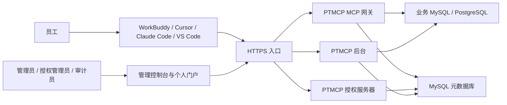
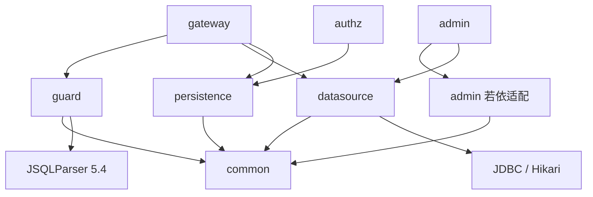
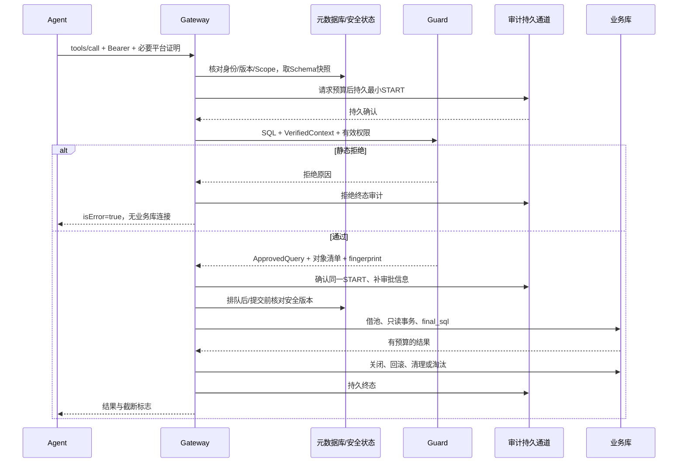
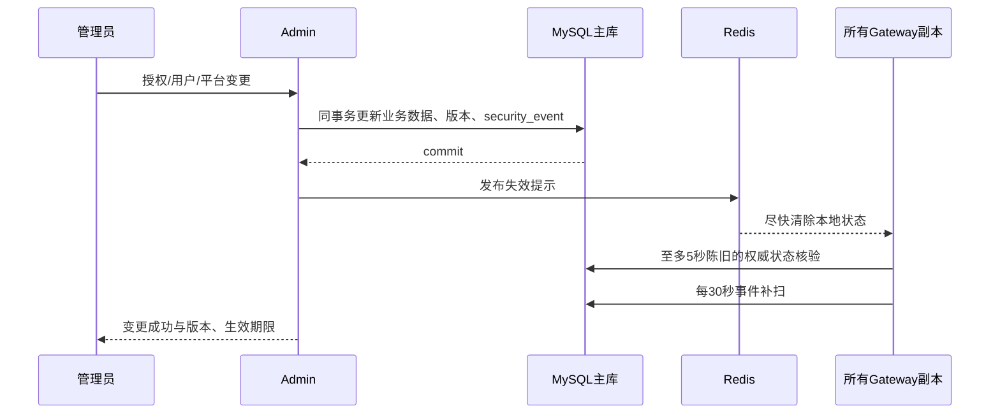

# PTMCP 整体架构与概要设计

版本：1.0-design · 日期：2026-10-23 · 状态：待实现。跨文档约束以[总体方案](../总体方案.md)为准。

## 1. 系统上下文



Agent 的自然语言推理、prompt、模型凭证和工具选择都在系统之外。业务库只对执行器、管理员批准的连通性检查和 Schema 同步开放；员工不获得数据库凭证。管理员后台也不能提供绕过 guard 的任意 SQL 编辑器。

## 2. 部署单元与职责

| 单元 | 责任 | 入站 | 出站 |
| --- | --- | --- | --- |
| ptmcp-ui | 双视角页面、配置复制、权限矩阵、审计展示 | 浏览器静态请求 | admin REST，浏览器 OAuth 跳转 |
| ptmcp-admin | 组织/账号、数据源、平台、授权、审计 API | 受控 Web 会话 | 元库、Redis、批准业务库、密钥服务 |
| ptmcp-authz | OAuth 发现、注册、登录、授权、签发、轮换与撤销 | 标准 OAuth HTTPS | 元库、Redis、受限 CIMD HTTPS |
| ptmcp-gateway | MCP 三工具、身份验证、权限、guard、只读执行、审计 | `/mcp` | 元库、Redis、批准业务库、审计 WAL |
| MySQL 8.4 | 权威元数据、安全版本、授权族、outbox、审计 | 仅服务网段 | 备份/受控复制 |
| Redis | 缓存、限流、失效通知；非权威授权源 | 仅服务网段 | 无任意外联 |

一期三个 Boot 进程独立发布。gateway 与 authz 可共同版本发布，但保持过滤链、资源与凭证配置独立；未经 ADR 不合并到若依进程。后台新能力通过应用服务调用，不直接依赖 gateway 的 REST 实现。

## 3. 代码模块与依赖方向

以下为完整计划目录；根目录目前已创建parent/common/guard/admin/authz/gateway和ptmcp-ui框架。后续已逐片增加common资源/错误合同、persistence安全基础三表迁移与真实数据库测试，应用仍仅有标准启动/健康检查和前端最小壳；datasource/内部评测及业务认证、查询/管理接口尚未实现。

```text
ptmcp-parent/
  ptmcp-common/              纯领域契约、ID、资源身份、错误码
  ptmcp-guard/               纯Java解析、绑定、校验、改写
  ptmcp-datasource/          JDBC池、元数据读取、安全执行
  ptmcp-persistence/         gateway/authz元库适配与事务
  ptmcp-gateway/             MCP应用与查询编排
  ptmcp-authz/               授权应用与refresh扩展
  ptmcp-admin/               若依独立工程适配、管理API
  ptmcp-regression-internal/ 内部测试，不参与开源分发
ptmcp-ui/                   plus-ui二开
```



禁止反向依赖和 gateway 引用 ruoyi-common-mybatis/satoken。admin 的 ORM 插件可保留其已验证的解析器版本；只要求单个运行进程依赖收敛，不能靠 Maven 最近依赖规则随机选择版本。guard API 不暴露可自由拼接的执行字符串入口；执行端只消费内部 ApprovedQuery。

## 4. 查询编排



“无业务连接”不代表不访问元库；权限/Schema 是服务端权威数据。入参通过静态守门前不借业务连接。审计不可持久确认、元库安全状态过期或版本已变都拒绝继续，不沿用旧 ApprovedQuery。

## 5. 管理变更与安全时效



事务提交才是变更成立的时间。只收到消息但数据未提交不视为授权事实。时间边界不等消息：每请求检查 now 与 nextBoundaryAt，未构建新版本权限则拒绝。重建采用版本标记和原子替换，禁止部分更新有效表集合。

## 6. 内部接口与一致性

| 接口/值对象 | 不变量 |
| --- | --- |
| VerifiedExecutionContext | 包含用户、平台、数据源、catalog/schema、安全epoch、auth_version、Schema版本、权威确认时间 |
| EffectivePermissions | 可追溯的meta/read集合、Deny原因、版本与nextBoundaryAt；不可由请求直接构造 |
| GuardPolicy | 方言、语法子集/函数类型版本、输入与结果预算 |
| ApprovedQuery | 仅guard创建；含final_sql、绑定对象/列、上下文版本、输出限幅计划与审计指纹 |
| ExecutionOutcome | 成功/拒绝/失败/未知、行数、字节、截断、阶段耗时；不含凭证 |
| SecurityEvent | 持久event_id、aggregate/version、变更类型、发生时间；消费者幂等 |

所有权威安全读取指向主库或提供等价强一致性的端点，不能使用未量化延迟的异步只读副本。Schema快照不能因缓存命中延长同步有效期。元数据同步由 job 状态机实现，只有完整快照核验成功才发布新版本。

## 7. 质量属性与演进触发

| 属性 | 一期设计目标 | 演进触发 |
| --- | --- | --- |
| 安全 | 默认拒绝、版本核验、静态拒绝0业务连接 | 新方言/节点必须新增回归与ADR |
| 时效 | 新查询撤销≤5秒、到期即时检查 | 主库状态读取成为瓶颈时研究版本服务，不能擅自延长陈旧期 |
| 性能 | 指定条件P95内部开销<50ms | 缓存/绑定/审计分段性能证据决定优化 |
| 可用性 | 依赖失效有明确错误和告警 | 审计/安全状态不能为可用性默默fail-open |
| 可维护 | 三应用隔离、纯guard可独立测试 | API或模型破坏性变化先补迁移与ADR |
| 数据保护 | 无结果持久化、原SQL加密、原文解密审计 | 二期脱敏/SSO不复用未审查的快捷通道 |

容量、部署和故障域见[基础设施](infra.md)；威胁与控制见[安全设计](security.md)；后端算法与数据库/API见[后端文档](../backend/api-spec.md)。
