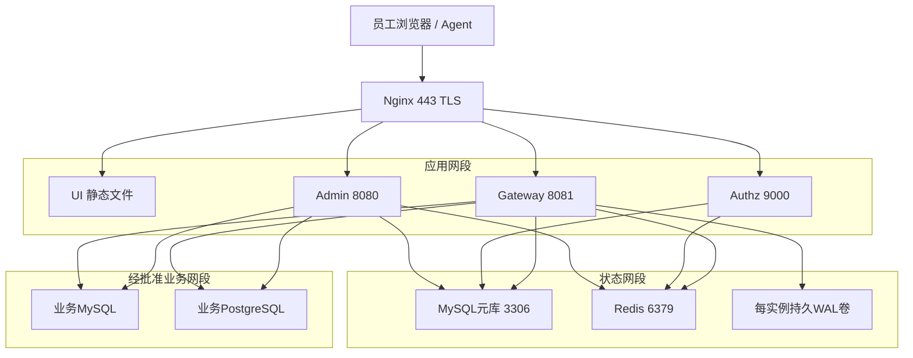

# 基础设施与部署拓扑设计

版本：1.0-design · 2026-10-23 · 状态：待部署验证。操作步骤见[部署手册](../ops/deploy.md)，此处定义拓扑、容量与故障边界。

## 1. 环境与部署方式

开发/集成采用独立测试 MySQL 8.4、Redis、MySQL/PG业务测试库。试点采用 VM 或 Docker Compose 管理三个独立 Boot 进程与 Nginx；生产如已有 K8s 运维能力可使用现有集群。K8s、CDN、Kafka、ELK 不是一期运行前提，不为文档完整而额外引入。

所有镜像、Compose/Helm 清单、证书和实际域名均为 M0～M4 待交付资产，本文描述配置契约而非现成部署包。CI 只推已测试、带digest的镜像；生产不使用浮动 latest。

## 2. 网络与服务发现

示例域名 `console.example.com`、`auth.example.com`、`mcp.example.com` 仅供设计；上线替换后固定 issuer 和 audience，不能让请求 Host 自动决定 token 签发对象。三个域名共享 TLS 入口但不共享应用会话 Cookie。内部服务名由环境配置提供，不能接受用户覆盖目标地址。

| 入口 | 内部目标 | 安全要求 |
| --- | --- | --- |
| console域根路径 | UI静态资源 | CSP；敏感页面不经公共CDN缓存 |
| console域 `/api/v1/` | admin:8080 | 会话Cookie、CSRF、菜单/数据管理权限 |
| auth域标准OAuth路径 | authz:9000 | 公共发现，登录/注册限速，回调精确匹配 |
| mcp域 `/mcp` | gateway:8081 | 每请求Bearer和平台证明；不限于initialize时校验 |
| 内部health/metrics | 各服务管理端口 | 禁止外网直连，最小化响应信息 |

业务库允许名单由管理员维护并经网络策略落实，可显式包含公司内网地址；CIMD 出站请求则禁止私有/链路本地/metadata地址。两种不同信任边界不能共用一条“所有内网都允许”的URL校验器。

## 3. Nginx 与 HTTP 配置契约

- `/mcp` 使用支持长响应的 HTTP/1.1 反向代理，禁用响应缓冲、代理缓存与压缩聚合对流式结果的干扰；不把 tool 响应写入代理缓存。
- 转发原始 Authorization、MCP 协议协商字段和经过验证的来源信息。由入口清除客户端伪造的 Forwarded/X-Forwarded-* 后再写入；服务只信任已配置代理网段。
- `/mcp` HTTP body 上限候选 256 KiB；控制台管理REST为1 MiB。guard 对 sql_query 另限 UTF-8 64 KiB。JSON转义或其他参数不改变SQL自身预算。超限返回413并留最小安全日志。
- ingress读取超时60秒；应用绝对请求期限30秒，阶段预算不能突破剩余总期限。超时清理可继续短暂持有连接，不能因HTTP请求结束就归还未终止连接。
- 登录、DCR、PAT管理、MCP分别限流；正常的业务拒绝不触发无上限自动重试。CORS 限定控制台所需来源，不用 `*` 搭配凭证。
- 无状态HTTP候选配置为 Spring AI `protocol=STATELESS`，传输仍是 Streamable HTTP。不要配置 `STREAMABLE` 后假定不存在SDK会话；四客户端兼容性属于 M0 闸门。

## 4. 资源与容量预算

单 gateway 的性能验证环境为2vCPU/4GiB，候选 JVM 堆512MiB～2GiB；实际堆/直接内存/线程/驱动峰值由压测锁定，不视为已验证生产容量。每副本最多16执行、每源8执行、用户跨副本最多3执行（共享配额），每副本队列32、排队最多3秒。

网关数据源池按元数据中的唯一数据源/受控物理目标建立；每个PG连接池固定catalog，变更catalog意味着不同物理连接目标而不是任意setCatalog切库。Schema使用已验证上下文与限定SQL，不生成任意数量schema池。数据源配置更新产生新池generation，老池drain，禁止就地混用新旧凭证。

数据库总预算：`各副本网关池上限之和 + admin测试/同步池 + 取消专用连接 + 迁移/运维预留` 不超过该业务库批准连接数。自动扩容前先检查这个总预算，不能只乘gateway副本后遗漏后台同步和驱动取消连接。单纯提高Hikari最大池不能解除数据库过载。

用户并发配额使用有租约的共享计数，进程退出可回收；配额服务不可确认时拒绝新查询。全局和数据源并发同时受控，取消/清理中的连接仍占额度，不能以响应已经返回为由提前释放。

## 5. 状态组件与存储

| 组件 | 持久性/可用性策略 | 故障行为 |
| --- | --- | --- |
| MySQL | InnoDB主库，binlog与事务持久设置、加密备份 | 权威快照超过5秒无法确认就拒绝新查询/签发 |
| Redis | 缓存可重建；业务配额、锁和速率限制单独命名空间 | 安全状态回主库；无法可靠限流/配额时拒绝受影响入口 |
| WAL | 每gateway独立持久卷、配额、加密、fsync、序号校验 | 不能与临时容器层共存亡；DB/WAL都不可写则阻断 |
| 密钥服务 | 独立密钥版本、最小权限访问、轮换 | 不在数据库同卷存明文主密钥 |
| 监控 | 指标聚合、脱敏日志、trace采样 | 不采集SQL原文、令牌或结果 |

START准入直接获得MySQL outbox持久确认；本地WAL主要承担执行后terminal落库故障。不要把 `append` 到内存缓冲或异步AOF误称为持久确认。DB不可用时不靠本地WAL继续准入新SQL。

## 6. K8s 可选落地约束

若使用K8s，三个应用分别Deployment/Service，网关按单副本资源预算设置requests/limits；WAL使用可恢复、明确归属的PVC，Pod消失不能删除未消费日志。不能让多个Pod无协调同时写同一WAL文件。配置PDB、就绪/存活探针及优雅停机；停机先停新请求，再等待/取消/清理在途查询，最后处理审计并退出。

TLS终止与来源证书传递要保留可信链；mTLS原始证书信息不能由公网Header伪造。NetworkPolicy仅开放必要方向；Pod不能任意访问云metadata、其他租户数据库或互联网。数据库可使用现有受管实例，不必部署到同一集群。

## 7. 数据保护、备份与恢复设计

元库包含账号、授权、客户端映射与令牌状态，审计WAL包含敏感SQL密文，因此备份必须加密且保留密钥恢复路径。设计目标：配置/授权与审计RPO≤5分钟，RTO≤60分钟；不等于已完成演练。禁止恢复旧授权后静默接受旧JWT：恢复后提升部署/安全epoch、撤销现有授权族与会话，重建缓存后开放流量。

原SQL在线保留180天，到期分批清理；备份生命周期和到期密钥处理须与运维手册一致。恢复、密钥轮换、证书到期、数据库主切换、WAL积压与回滚均需要演练记录。见[运维手册](../ops/operation-manual.md)。
