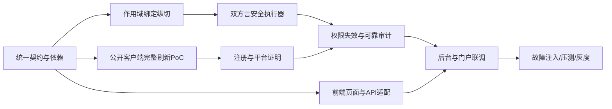

# 实施路线与验收门禁

版本：1.0-design · 2026-10-23。计划目标为M0～M4约9～10周，M0完成前不作为交付日期承诺。

## 1. 顺序与可并行部分

UI可用静态契约先写页面，但不能把mock通过视为后端功能完成。数据库/认证/guard的核心假设应前置验证，不能等最后联调才发现选型组合不成立。

## 2. 阶段交付与退出条件

| 阶段 | 目标 | 必须提交的证据 | 退出条件 |
| --- | --- | --- | --- |
| M0 第1～2周目标 | 工程/依赖、MySQL+PAT+ACL+审计纵切、公开OAuth链、宽行路径 | dependency tree、六例绑定回归、SQL等价、真实客户端流程、内存与取消初测 | R1～R6路径明确；未通过项阻断对应能力开放 |
| M1 第3～5周目标 | PG+MySQL、组织授权、版本/时间失效、动态池/Schema | 双方言集成、失效≤5s、丢事件/缓存故障、≥300内部回归 | 拒绝0业务连接、预算/隔离/审计故障路径符合设计 |
| M2 第6～7周目标 | 四客户端矩阵、后台完整API | API契约、公开刷新/重放/撤销、审计解密权限 | 每类客户端有版本化结果；不兼容明确降级 |
| M3 第6～8周目标 | 双视角UI和业务闭环 | 页面E2E、委派越级测试、配置/凭证/历史 | 新部门授权操作≤10分钟；身份/字段不泄露 |
| M4 第9～10周目标 | Fuzz、压测、恢复、灰度 | 环境/样本、故障演练、备份恢复、回滚记录 | 指定威胁模型未发现高危绕过，SLO实测满足 |
| 二期 | 行列权限、ERP/SSO等 | 新PRD/ADR/迁移与回归 | 一期不展示为已支持 |

## 3. 完成状态与风险

截至2026-10-26，已具备设计文档、历史解析器反例证据、本机环境、后端候选纵切（含 MySQL MCP 问数闭环、OAuth 授权码流程、管理/个人只读接口）和 18 组前端页面/开发预览。仍未交付：PG 执行接线、Tier1 平台证明、并发预算与排队、公开客户端 refresh/revoke、四客户端矩阵、私有29VQ、独立安全评审、生产域名、正式人工视觉/功能接受及生产部署产物。候选纵切和工程绿灯不等于 M0/M4 通过；排期需要实际投入校准，不把参考源码代码量作为可复用交付量。

M0若出现公开客户端刷新不兼容，先明确支持矩阵/重新授权路径，不降低重放检测；宽行内存不能证明则关闭该输出子集；Schema绑定不能证明等价则收窄语法。任何范围调整更新PRD、ADR和用户手册，而不是只在实现中加隐式例外。

任务清单见[研发任务计划](../../tasks/plan.md)与[待办](../../tasks/todo.md)，测试门禁见[测试计划](../test/test-plan.md)，实际状态见[测试报告](../test/test-report.md)。
