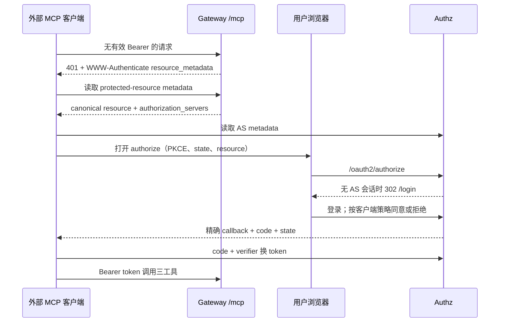

# 企业 MCP 问数网关能力核查（2026-10-29）

## 结论与证据范围

**核心后端、OAuth 服务端页面和多数 Vue 业务接口已有真实实现；完整接入、运维恢复与产品验收尚未完成。**
不能再把当前仓库称为只有启动骨架，也不能据历史构建通过宣称可以直接上线。

核查基准：`dev` / `6ea9a66ac24d4440dbc83b5362256121685ea154`。本轮做源码调查、隔离验证和文档校准，
未修改业务代码、迁移数据或部署。只做文档自审，未做独立安全评审。
续接 [网关收尾工作项](../../tasks/work-items/DEV-20261028-gateway-completion.md) 与
[既有提案](../../.agents/notes/proposed/architecture/2026-10-28-gateway-capability-hardening.md)，不另建产品基线。
后者的 G1 发现端点已实现，本轮发现的是后续资源标识与真实客户端组合问题。

这里的“已有”表示源码和接线存在，不表示本轮运行、人工接受或发布通过。
项目声明的 MCP 协议是 `2025-06-18`；规范核对按该版本进行。

## 1. 后端实现矩阵

| 能力 | 当前事实与入口 | 尚缺的闭环或证据 |
| --- | --- | --- |
| MCP HTTP 与工具 | [McpToolController](../../ptmcp-parent/ptmcp-gateway/src/main/java/local/ptmcp/gateway/mcp/McpToolController.java)、[McpToolService](../../ptmcp-parent/ptmcp-gateway/src/main/java/local/ptmcp/gateway/mcp/McpToolService.java) 实现 initialize、ping、tools/list、tools/call，三工具为 list_databases_and_tables、get_table_schema、execute_readonly_sql | 不是服务端自然语言转 SQL：外部 Agent 负责生成 SQL，网关负责鉴权和执行。取消通知未接通；工具 description 为空、缺少 annotations |
| 身份与平台 | [McpAuthenticationFilter](../../ptmcp-parent/ptmcp-gateway/src/main/java/local/ptmcp/gateway/mcp/McpAuthenticationFilter.java)、[PatJwtAuthentication](../../ptmcp-parent/ptmcp-gateway/src/main/java/local/ptmcp/gateway/mcp/PatJwtAuthentication.java) 接入 PAT/JWT、平台绑定和权威状态复核，Tier1 有请求 proof | 真实客户端、mTLS/代理部署和撤销时效仍待组合验收；不是仅验证 JWT 签名 |
| 对象权限与 SQL | 三工具已串联平台 scope ∩ 用户权限、Deny 优先、AST guard、执行前版本复核；MySQL/PG 只读执行、超时/输出限幅已接 | 需补撤权、排队配置变化、双方言及故障组合证据。annotations 和隐藏工具不能替代执行鉴权 |
| 生产装配 | [McpGatewayConfiguration](../../ptmcp-parent/ptmcp-gateway/src/main/java/local/ptmcp/gateway/mcp/McpGatewayConfiguration.java) 已接真实元库、权限、快照、连接策略、审计与执行器 | 默认 gateway.enabled=false；需要部署配置、可信 TLS/密钥和可用元库，单纯启动 health 不代表 MCP 可用 |
| 数据源管理 | [DatasourceAdminService](../../ptmcp-parent/ptmcp-admin/src/main/java/local/ptmcp/admin/datasource/DatasourceAdminService.java)、[DatasourceJobService](../../ptmcp-parent/ptmcp-admin/src/main/java/local/ptmcp/admin/datasource/DatasourceJobService.java) 有 CRUD、test/sync/job；业务连接有 TLS、目标隔离、精确池代和排空 | update 仍直接修改当前配置，未形成候选→探测→CAS 发布；列表 health 固定 UNKNOWN，test job 不等于版本化健康投影 |
| 元数据与字典 | 已有元数据同步、快照、管理与个人字典接口，模型 schema 主要返回物理注释 | 业务词义、单位和授权关系尚未完整进入 MCP 上下文；需响应预算、来源及不可信注释处理 |
| 审计与恢复 | START 主库准入；terminal 主库失败可写加密、fsync WAL；[WalReplayer](../../ptmcp-parent/ptmcp-persistence/src/main/java/local/ptmcp/persistence/audit/wal/WalReplayer.java) 有恢复原语与测试 | gateway 未见生产回放 owner/启动调度与过期 START 收敛接线，不能将写 WAL 等同于恢复完成 |
| 容量与取消 | 有用户/源/网关/队列限额和执行器取消原语 | 当前装配 InMemoryQuotaLimiter，用户/源额度未跨副本共享；无 id 的 notifications/cancelled 被直接 202，未关联请求主体和执行句柄 |
| 密钥轮换 | 凭据 AES-GCM 加密；WAL 加密写入 | [CredentialCipher](../../ptmcp-parent/ptmcp-datasource/src/main/java/local/ptmcp/datasource/connection/CredentialCipher.java) 为单钥、无对象 AAD；WAL 生产 key provider 也仅当前钥，旧钥读取/迁移需补 |
| 组织、ACL 与委派 | 组织/角色/ACL、[DelegationAdminController](../../ptmcp-parent/ptmcp-admin/src/main/java/local/ptmcp/admin/api/DelegationAdminController.java) 与范围解析已存在；[AclScopeGate](../../ptmcp-parent/ptmcp-admin/src/main/java/local/ptmcp/admin/api/AclScopeGate.java) 对授权写入检查部门、资源、动作和时间 | 不能称“委派全未实现”；也不能称所有管理端点支持委派。部分读取/effective/preview 仍限平台管理员，ROLE 范围 fail-closed；列表与写入的范围一致性待专项验证 |
| 管理与个人门户 | 平台/client/scope、审计查询/解密/操作日志、密码重置、PAT、授权族撤销、查询历史、MCP 配置均有实际服务端入口 | 用户 DELETE 未实现；账号供应与档案维护尚未闭环；18 组页面及四客户端验收不能由接口存在替代 |

## 2. OAuth 如何工作，首次连接是否跳转

[OAuthSecurityConfiguration](../../ptmcp-parent/ptmcp-authz/src/main/java/local/ptmcp/authz/oauth/OAuthSecurityConfiguration.java)
真实装配 Spring Security Authorization Server，支持授权码 + PKCE、refresh、revoke、AS metadata 和 JWKS。
[PtmcpOAuth2AuthorizationService](../../ptmcp-parent/ptmcp-authz/src/main/java/local/ptmcp/authz/oauth/PtmcpOAuth2AuthorizationService.java)
持久化 code/refresh 摘要、一次消费、原子轮换和重放撤族。
OAuth 默认关闭，启用需要签名私钥等配置。

预期首次接入流程如下；**浏览器由支持 OAuth 的 MCP 客户端打开，服务端不会把 /mcp 的 RPC 请求直接 302 到登录页。**

已有有效 PAT/access token 时不需要登录；已有 AS 会话时可能不再输入密码。
是否显示同意页取决于客户端 requireConsent 和既有同意记录，目前该字段默认 false。
DCR/CIMD 的 HTTP 接入保持关闭，因此需要预先注册 client_id 和精确 redirect URI，
不能承诺所有外部 Agent 仅填写 MCP URL 即可接通。客户端不支持该 OAuth 流程时，也不会自动开浏览器。
这些客户端职责依据 [MCP 授权规范](https://modelcontextprotocol.io/specification/2025-06-18/basic/authorization)。

### 页面已做，但真实页与预览页不同

[OAuthPageController](../../ptmcp-parent/ptmcp-authz/src/main/java/local/ptmcp/authz/oauth/OAuthPageController.java)
提供真实服务端 HTML `/login` 与 `/oauth2/consent`，包含 CSRF、HTML 转义、CSP、no-store、客户端名、scope、允许/拒绝。
会话为独立 `PTMCP_AS_SESSION`，配置 8h、HttpOnly、SameSite=Lax，与控制台 ADMIN 会话隔离。
Vue `/as/...` 是开发预览，不签授权码或 token。React 迁移仍应保留 AS 独立安全边界。
真实同意页尚缺页面规格要求的平台、精确回调与有效期/授权族说明；不能把 Vue 预览中的字段算作 AS 已完成。

### 已确认的阻断和契约差距

1. **资源标识不一致。** [McpResourceMetadata](../../ptmcp-parent/ptmcp-gateway/src/main/java/local/ptmcp/gateway/mcp/McpResourceMetadata.java)
   已提供 `/.well-known/oauth-protected-resource`；其 resource 是 canonical MCP URL。
   但 [AuthorizationRequestPolicy](../../ptmcp-parent/ptmcp-authz/src/main/java/local/ptmcp/authz/oauth/AuthorizationRequestPolicy.java)
   要求 authorize 的 resource 等于 OAuth audience；[开发配置](../../scripts/Dev-Linux.sh)
   同时使用 URL `http://127.0.0.1:8082/mcp` 与 audience/resource `ptmcp-mcp`。
   按发现 URL 请求授权会被拒绝。应统一 canonical resource、token aud 与 gateway 校验，拒绝错资源；
   补 token/refresh 请求的 resource 约束和组合测试。现有 code exchange 测试没有传 resource，未证明该契约。
   [MCP 规范](https://modelcontextprotocol.io/specification/2025-06-18/basic/authorization)
   要求 authorize 与 token 请求携带目标资源；资源元数据要求见 [RFC 9728](https://www.rfc-editor.org/rfc/rfc9728.html)。
2. **创建用户不是开通登录账号。** [UserAdminController](../../ptmcp-parent/ptmcp-admin/src/main/java/local/ptmcp/admin/api/UserAdminController.java)
   通过 [OrgStore](../../ptmcp-parent/ptmcp-persistence/src/main/java/local/ptmcp/persistence/org/OrgStore.java)
   创建登录名映射、PTMCP 档案和角色，不创建宿主 sys_user。
   [JdbcAccountAuthenticator](../../ptmcp-parent/ptmcp-authz/src/main/java/local/ptmcp/authz/oauth/JdbcAccountAuthenticator.java)
   登录却读取宿主 sys_user JOIN sys_user_login_name。
   [IdentityPasswordWriter](../../ptmcp-parent/ptmcp-admin/src/main/java/local/ptmcp/admin/identity/IdentityPasswordWriter.java)
   仅更新已有启用账号。需明确企业身份同步/开通、ID 对齐及跨库失败补偿；不能让前端收集一个不会生效的初始密码。
3. **access JWT revoke 未闭环。** findByToken 只识别 code/state/refresh；
   [撤销 provider](../../ptmcp-parent/ptmcp-authz/src/main/java/local/ptmcp/authz/oauth/PtmcpTokenRevocationAuthenticationProvider.java)
   对未知 token 按标准返回成功，所以 access JWT revoke 的 200 不表示 sid 已撤销。
   应验证签名/issuer/audience、归属客户端后按 sid 撤族，保持未知或他人 token 的不可枚举响应。
   refresh revoke 与个人门户的整族撤销已有实现，不应一起报缺失。
4. **AS 登录保护和全会话撤销仍需补齐。** 未找到 OAuth 账号/IP 失败限流、锁定以及 AS 会话主库撤销索引接线。
   [IdentityPasswordService](../../ptmcp-parent/ptmcp-admin/src/main/java/local/ptmcp/admin/identity/IdentityPasswordService.java)
   会撤 refresh family、PAT、authorization 和 ADMIN 会话，但没有撤 AS 浏览器会话。
   应以权威用户安全版本贯通登录、签发、刷新和 AS/ADMIN 会话；测试重置密码/停用后，旧 AS 会话不能重新签发可用授权。
   目前 auth_version 的读写来源也不统一；不能仅凭 INITIAL_AUTH_VERSION=1 就推断新登录必然失败，需专项反例验证。
5. **MCP HTTP 边界待补。** 仓库入口未见 Origin 白名单和 MCP-Protocol-Version 校验。
   应在网关接线并覆盖恶意 Origin/错误版本；若由代理承担，必须提供对应配置与直连隔离证据。
   要求依据 [Streamable HTTP 规范](https://modelcontextprotocol.io/specification/2025-06-18/basic/transports)。

## 3. 前端究竟接没接接口

**现有 Vue 多数页面已接真实接口，文档中“全部禁用/仅预览”已过时。**
[http.ts](../../ptmcp-ui/src/services/http.ts) 统一 `/backend/admin` 同源代理、Cookie、CSRF、错误和长整数。
[frontendMode.ts](../../ptmcp-ui/src/services/frontendMode.ts) 的 delegation/effective/platform/scope/client/audit/password
均已开启真实模式；userDelete 仍只允许预览。业务调用位于
[controlPlane.ts](../../ptmcp-ui/src/services/controlPlane.ts)、
[orgPortalApi.ts](../../ptmcp-ui/src/services/orgPortalApi.ts)、
[mePortalApi.ts](../../ptmcp-ui/src/services/mePortalApi.ts)、
[data.ts](../../ptmcp-ui/src/services/data.ts) 与 [access.ts](../../ptmcp-ui/src/services/access.ts)。

| 页面域 | 接线事实 | 仍需前端/后端协作 |
| --- | --- | --- |
| 数据源、job、元数据/字典 | CRUD、test/sync、job 查询、字典维护已有真实调用 | 双引擎实测、健康与候选配置行为；不能用 UNKNOWN 或合成成功证明连接可用 |
| 组织、角色、用户、ACL/委派 | 档案 CRUD、角色/部门/状态、ACL 写入/预览/effective、委派创建/撤销和密码重置已有调用 | 用户 DELETE 与新增账号供应未完成；email/phone/remark/initialPassword 非正常写 DTO；namespace 权威 generation 和部分目录选择受限 |
| 平台/client/Scope | CRUD、客户端精确 callback/secret 一次展示、Scope 查询/替换已有调用 | 真实回调兼容、Tier/proof 配置和 generation 选择需要验收，不应重新实现一套 API |
| 审计与个人门户 | 审计查询/解密、操作日志、PAT、授权族撤销、历史、MCP 模板已有调用 | 明文离页/到期清除、他人 ID 拒绝、撤销时效和真实客户端闭环待验证 |

预览仅 `DEV && MODE=frontend-preview` 启用；正常模式不会因后端失败自动降级为演示成功。
详细页面矩阵见 [business-coverage](../frontend/business-coverage.md)。源码接线不等于浏览器 Network 已逐页核验。

### React 窗口的交接边界

共享工作区已出现 `ptmcp-ui-react/`；另一窗口的
[React 建立记录](../../.agents/notes/implemented/architecture/2026-10-29-react-app-bootstrap.md)
记录了迁移决定。本轮保留其文件，不修改 UI 源码，也不替另一窗口选择组件库。
当前可用的线程列表没有定位到该 React 活动窗口，故本轮以此共享报告交接，没有声称已直接沟通。

本轮读取时 React 有接入配置、数据源、权限三页，已有部分读取 API；
[PermissionsPage](../../ptmcp-ui-react/src/views/admin/PermissionsPage.tsx) 的资源树已接
`/api/v1/admin/metadata/objects`，”计算有效权限”已接 `POST /api/v1/admin/acl/preview`；
「新增规则 / 编辑」按钮仍是 UI 占位。
[IntegrationsPage](../../ptmcp-ui-react/src/views/me/IntegrationsPage.tsx) 的”测试连接”按钮
直接 setTimeout 900ms 后置 success，没有发出 MCP 探测，且按钮回调未按预览模式隔离。
因此页面显示”连接验证通过”不能作为真实成功证据；接管前应将此交互限定为明确的演示，
真实模式须基于有身份的实际握手结果，尚无接口时禁用并说明。

- 复用上述 API/DTO/权限码和页面验收契约，迁移以真实网络行为对齐；不要把 Vue 的已接接口又当成缺失后端。
- 保留 Cookie + CSRF、内存凭据、长整数 string、写请求不自动重放、409 草稿恢复与无权限拒绝；前端可见性不替代服务端鉴权。
- 按页区分真实 API、只在预览可用与待后端实现；React 新应用的存在不自动继承 Vue 的接口接线或 109 项测试结果。
- AS 页仍由 authz 服务承载；设计可以统一，密码和授权码不能通过控制台代理流转。
- 首先迁一个真实登录→列表→写入/409→退出的可验证切片，再迁其余页面。React 不改变上述 OAuth、身份和恢复缺口。

## 4. 如何补齐：承接现有工作项

| 顺序 | 最小切片 | 验收反例与完成证据 |
| --- | --- | --- |
| 先修接入：G1 后续、T13/T14/T19-e | 统一 canonical resource/aud；确定预注册 client 与 callback；补 authorize/token/refresh 资源绑定、AS 页必要说明和 Origin/版本处理 | 隔离真实 HTTP 从 401→发现→登录→PKCE→token→MCP；错资源/回调/verifier/state、过期与拒绝均失败；目标客户端版本单列 |
| 同步补身份：T13/T17 | 明确宿主身份开通/同步；access revoke 按 sid；AS 会话撤销、统一安全版本与登录保护 | 新建档案不会伪装成账号开通；跨库失败可恢复；重置/停用后旧会话、JWT、refresh、PAT 均拒绝；他人 token 撤销不泄露归属 |
| G2、G5：T09/T20、T15-c S6 | WAL 独占 owner/关闭段回放/START 收敛；凭据和 WAL keyring、版本化 AAD/迁移 | 主库故障→terminal WAL→kill/restart→幂等入库；损坏段隔离告警；轮换后旧密文仍可读，不扫描正在写入的段 |
| G3：T15-c S4 | candidate→probe→CAS publish，健康绑定 configVersion、目标和时间 | 错候选不破坏 active；旧健康不覆盖新配置；并发发布冲突；切换目标不恢复旧授权 |
| G4：T15-c S5/T19-d | 主体/平台/请求 owner 绑定取消，明确单副本边界或共享用户/源预算 | 同 RPC id 跨用户不能互取消；排队/执行/迟到/断连覆盖；确认执行结束或连接淘汰后归还 DB 额度 |
| G6：T15-c S7 | 三工具 description/annotations；授权后字典、外键、来源和预算 | 撤权后不可见；关系两端都授权；超长/恶意注释按数据返回且受预算约束；调用仍鉴权 |
| G7 与前端迁移 | 双引擎、真实 MCP 客户端、浏览器 Network、409/离页/明文清理与恢复演练 | Maven/pnpm 适用门禁、边界测试、独立评审、人工接受与部署分别记录；无证据保持未验证 |

以上是补齐方案，未在本轮实施。无需先扩驱动、开放 DCR/CIMD 或增加写 SQL/事务/插件。
需要产品决定的是企业账号由谁供应；其余已确认接线缺口可沿既有合同实施，不能用前端假数据弥补。

## 5. DBX 可以参考什么

本轮只读本地 `Reference/dbx-main/`，没有执行参考代码。本地目录未附可验证 Git 元数据，
不把它冒称为昨天固定的外部 commit。下列定位以实际本地文件为准：

- `crates/dbx-mcp/src/http_auth.rs`：Origin/Host/Bearer 防护，作为入口检查参考。
- `crates/dbx-mcp/src/server.rs`：工具 description/annotations、按策略过滤 tools/list、调用时仍鉴权、
  cancellation token 到实际调用、schema 注释预算和不可信上下文包装。
- `crates/dbx-core/src/ai/mcp_policy.rs`：可借鉴策略组织方式，但其分层覆盖不等于企业平台∩用户权限。

吸收上述机制即可；不搬共享 token 主体、写 SQL、事务/插件或覆盖式授权。
不把物理注释和模型输出视为命令，也不把工具 annotations 当作安全边界。

## 6. 本轮实际验证

所有 Maven/pnpm 命令先进入 `scripts/Enter-Dev.ps1` 项目环境；测试不连接企业业务库。

| 命令/检查 | 实际结果 | 能证明什么 |
| --- | --- | --- |
| Vue `pnpm.cmd test:contracts` | exit 0：109 tests，109 pass，0 fail，0 skipped | 本轮 Node/SFC 契约通过；不覆盖 React、真实浏览器或 OAuth 客户端 |
| Vue `pnpm.cmd check` | exit 1：lint 有 1 error、5 warnings | GlobalSearch.vue 的 isEditableTarget 未使用；其余为属性顺序。后续 format/typecheck/build 未执行，不能报构建通过 |
| parent `mvnw.cmd -B -ntp verify`，启动专属开发服务后重跑 | 两次均 exit 1，persistence 10 errors / 0 failures / 0 skipped，无法找到 Docker 环境 | common 已执行；后续 guard/datasource/admin/authz/gateway 未运行。属于环境错误，不是业务断言通过或失败 |
| `Dev-Services.ps1 start` / 环境检查 | MySQL/PG/Redis Healthy，Windows 服务端口可达；Windows Docker mTLS _ping 握手重置 | Linux 内用同一客户端证书访问 loopback Docker 返回 OK；Windows 端存在到 WSL 地址的 portproxy，故障在跨系统访问链，未关闭 TLS 或重配共享网络 |
| `python scripts/check.py` | exit 1：文档142份/本地链接635项通过；流程检查发现另一窗口React建立笔记缺 Verification 节 | 全仓门禁未通过；保留该窗口文件，由其补实际验证记录，不修改/放宽检查器 |
| 单独运行 verify_quality_config.py、verify_commits.py、scripts/tests | 均exit 0；检查器回归62/62通过 | 为被提前中止的其余检查补充实际结果，不把它们等同全仓check通过 |
| 文档定稿后 `python docs/evidence/validate_docs.py` | exit 0：142份Markdown、637项本地链接 | Mermaid仅计数，未渲染；外部URL未由该检查器验证 |
| `git diff --check` | exit 0 | 仅受跟踪文档差异的空白检查；新增报告的本地链接已由文档检查覆盖 |

临时日志位于本机 TEMP，文件名前缀 `ptmcp-capability-audit-20261029-`，
后缀为 `contracts.log`、`frontend.log`、`maven.log`、`maven-rerun.log`。
Vue lint 其余位置为 EffectiveAccessPane、PermissionsView 两处、OperationsView、MetadataView；
本轮未抢改另一窗口占用的前端源码。

历史 [T15-c](../../tasks/work-items/T15-c.md) 的 746 项通过属于此前执行，不能替代本轮结果。
本轮未完成双引擎/MCP/OAuth 运行验收、真实外部客户端、浏览器 E2E、多副本、故障恢复、独立安全评审、人工接受或发布。
