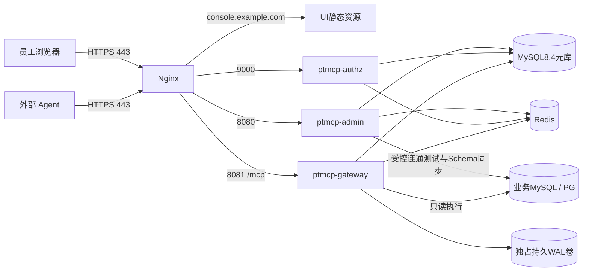

# PTMCP 部署手册

版本：1.0-design · 日期：2026-10-23 · 状态：部署设计，尚无PTMCP生产部署记录。

依据：[总体方案](../总体方案.md)、[基础设施设计](../architecture/infra.md)与 [运维手册](operation-manual.md)。本文是生产部署目标与退出条件，不是已验证的一键部署指南。仓库已有开发环境与元库迁移源码，但不等于已交付生产镜像、生产 Compose/Helm 清单或经过演练的发布迁移包；Reference 启动脚本不能作为 PTMCP 部署产物。下方端口为早期部署设计值，与本机工程默认端口不同，实施时须由实际配置和发布清单核定。

## 1. 一期部署拓扑

一期采用Linux VM或Docker Compose管理的固定实例。Kubernetes为后续容量/高可用选项，不能把尚未编写的Chart列为现成能力。三Boot进程独立运行、独立安全链、独立服务账号；不将admin与gateway合并为一个JVM。

`console.example.com`、`auth.example.com`、`mcp.example.com`均是保留示例域名，必须替换为组织实际管理的域名。本文没有提供生产地址、账号密码或已可访问的Swagger链接。

| 服务 | 进程内端口建议 | 对外暴露 | 起始资源设计值 |
| --- | --- | --- | --- |
| Nginx + UI静态资源 | 443；80仅做HTTPS跳转或证书验证 | 443 | 1vCPU/1GiB起，按连接数验证 |
| ptmcp-admin | 8080 | 仅Nginx/运维网 | 1vCPU/2GiB起，待测 |
| ptmcp-authz | 9000 | 仅Nginx/运维网 | 1vCPU/2GiB起，待测 |
| ptmcp-gateway | 8081 | 仅Nginx/运维网 | 每实例2vCPU/4GiB性能基线 |
| MySQL8.4元库 | 3306 | 服务网；不暴露公网 | 根据审计写入量与恢复目标单独估算 |
| Redis | 6379 | 服务网；不暴露公网 | 启用认证/网络隔离，容量按缓存与会话估算 |
| 业务MySQL / PostgreSQL | 3306 / 5432（以实际为准） | 只允指定服务身份与网段 | 由业务库负责人核准连接/查询预算 |

上述不是容量承诺。单VM、单元库或单Nginx会形成单点，一期小规模试点可接受与否由上线评审明确；需要高可用时先补主库故障切换、Redis会话策略、共享签名钥与WAL归属设计，不用“多开gateway”替代全链路高可用。

## 2. 环境与访问清单

开发、集成、预发、生产使用不同数据库、域名、OAuth注册、签名钥、加密主钥、平台凭证和PAT。预发只能使用合成/批准脱敏数据。生产凭证不得进入仓库、镜像层、CI日志或Compose文件明文。

开通前登记环境负责人、域名/DNS、证书、内外网路由、元库主节点地址、Redis拓扑、业务源白名单、磁盘/日志/备份路径、告警接收方式、时间同步、镜像仓库与密钥管理系统。所有持久时间使用UTC；系统UI/值班记录展示Asia/Taipei并保留原始UTC时间。

网络最小开放：Nginx到三应用；应用到元库/Redis；gateway到被批准业务源；admin仅到连通/同步所需源；监控采集到内部管理端点。authz不需要业务库读取权限。元库用户按进程授予必要表/操作，业务账号仅授批准对象的只读权限；禁止使用root、超级用户、带FILE或服务端文件/程序执行权限的账号。

## 3. 发布包交付契约

实施阶段必须先提交并验证以下产物，再执行部署：

| 预期产物 | 必含内容 | 当前状态 |
| --- | --- | --- |
| 三应用OCI镜像或JAR | Java21、非root、构建SHA、依赖清单、唯一版本/digest、健康检查 | 尚未交付 |
| UI静态资源 | 与REST契约匹配的版本、缓存策略、无内置凭证 | 尚未交付 |
| `deploy/compose.yaml`与环境样例 | 引用镜像digest、网络、只读根文件系统、持久卷/secret挂载、资源限制 | 预期路径，当前不保证存在 |
| 元库迁移包 | Flyway或等价版本迁移、checksum、前置/后置核验、N-1兼容说明 | 尚未交付，不能直接执行Reference初始化SQL替代 |
| 发布manifest | 应用/配置/schema版本、BOM、许可证、测试报告与回滚目标 | 尚未交付 |
| 环境配置模板 | 不含真实secret的键名/默认值/校验规则与示例域名 | 尚未交付 |
| 运维脚本 | 预检、只读健康检查、备份/恢复、WAL对账与发布排空 | 尚未交付 |

预期工程命令如 `./mvnw -pl ptmcp-admin,ptmcp-authz,ptmcp-gateway -am verify`、`docker compose -f deploy/compose.yaml config`、`docker compose -f deploy/compose.yaml up -d` 仅表达后续交付接口；**在对应工程/包装器/清单入库并通过CI前不可照抄运行，也没有在本次文档工作中执行过。** 实际构建模块和命令由发布manifest固定。

## 4. 配置基线

以下为配置语义，键名尚需实现模块最终绑定，不假称现有Spring属性已生效。

| 配置项 | 一期基线 |
| --- | --- |
| 控制台站点与REST | `https://console.example.com`；`/api/v1/admin`、`/api/v1/me`、`/api/v1/session` |
| OAuth issuer | `https://auth.example.com`，必须与发现、签名iss完全一致 |
| MCP资源与audience | `ptmcp.gateway.resource-uri`填对外MCP URL（如`https://mcp.example.com/mcp`），`ptmcp.gateway.resource-metadata-uri`填发现URL，`ptmcp.gateway.resource`为JWT audience；三者均来自部署配置，不从Host/Forwarded推导 |
| 传输 | HTTPS Streamable HTTP `/mcp`；一期无跨请求会话 |
| Spring AI候选协议 | `STATELESS`模式需在M0验证；配置STREAMABLE后仍产生会话不能称为无状态 |
| 超时 | ingress读取60秒；应用总请求deadline30秒；排队最长3秒、借池3秒、SQL15秒、取消3秒、清理2秒，均受剩余deadline约束 |
| 输入 | `/mcp` HTTP body256KiB、普通管理API body1MiB；SQL64KiB UTF-8；AST深度64、关系引用64 |
| 输出 | 行500、单格4KiB、完整JSON响应1MiB；只能收紧 |
| 并发 | 用户3、数据源/副本8、gateway/副本16；每副本队列32 |
| 安全状态 | 本地缓存≤1秒、主库确认最大陈旧5秒、事件补扫30秒、权限集合缓存≤300秒且受时间边界限制 |
| 令牌 | JWT10分钟；RT family绝对30天/空闲7天；PAT默认30天最大90天；Web会话最长8小时 |
| 时区 | 数据库/JVM/事件UTC；产品展示Asia/Taipei |
| 管理端点 | 独立内网或管理端口，鉴权；禁止公开暴露env、heapdump、配置详情 |

应用30秒deadline到达后可停止HTTP响应；取消/清理任务仍须持有原连接直到完成或淘汰，不能为了响应截止把在途连接归还。短暂后台清理必须有硬时限和可观测状态，不成为无界后台查询。

客户端兼容性未完成真实联调：若WorkBuddy/Cursor/Claude Code/VS Code与该无会话模式不兼容，记录结果并修订ADR/产品支持矩阵，不暗中开启旧SSE或跨请求会话。

## 5. Nginx与HTTPS要求

分别路由UI/admin、AS和MCP域名。对`/mcp`保留`Authorization`、必要MCP协议头、原HTTP状态和`WWW-Authenticate`；支持协议所需请求方法，返回正确Content-Type。Streamable HTTP可能产生流式响应，设置与实际协议匹配的代理缓冲/读取策略；不要把“禁用旧SSE端点”误解为拦截该协议的合法事件流响应。

网关只信任Nginx/负载均衡器的转发头；在入口清除外部伪造的`X-Forwarded-*`及内部平台证明头，再由受控代理重建。不要清除用户必要的OAuth协议参数，也不要让任意公网请求以Header声明Tier1。mTLS若在代理终止，客户端证书身份传递头必须由该代理覆盖并仅经受信网络到gateway，配置与验收成套交付。Tier1 proof Header为`X-PTMCP-Client-Cert-Fingerprint`（SHA-256 hex）与`X-PTMCP-Proxy-Secret`（base64）；gateway只从平台proof配置的`proxyCidrs`接受，入口必须无条件剥离外部同名值。

TLS采用组织核准的协议/证书配置，证书链覆盖客户端要求。Cookie均限定各自host，不设置覆盖全部子域的宽Domain：`PTMCP_ADMIN_SESSION`与`PTMCP_AS_SESSION`为HttpOnly/Secure/SameSite=Lax。写操作保留CSRF；CORS按实际批准origin精确配置，不用`*`配凭证。首次生产启用HSTS前核验所有子域HTTPS状态。

Nginx访问日志默认不记录Authorization、Cookie、请求body、query中的凭证或完整SQL。requestId由服务器为每次实际调用生成，贯穿应用响应和内部日志，不接受外部X-Request-Id覆盖；traceparent另按可信代理规则处理。`/mcp` HTTP body上限256KiB，普通管理API为1MiB；超限入口413，应用仍独立执行SQL长度限制。

## 6. 凭证与持久卷

签名私钥、信封加密KEK、平台secret、数据库密码与TLS私钥从组织密钥管理服务或权限收口的secret文件加载。不要为演示写入假“生产密码”。AS私钥不与gateway分享，gateway仅取公共JWKS并验证issuer/audience；admin仅按职责获得解密能力，审计列表角色不自动获得KEK解包权限。

网关业务数据源的TLS信任材料必须由部署显式提供：MySQL使用`ptmcp.gateway.truststore-path`（PKCS12及密码）；PostgreSQL使用`ptmcp.gateway.pg-ssl-root-cert`（PEM根证书）。缺失时对应引擎的首次业务连接失败关闭，不回退到JDK公共信任库。

admin 的 TEST/SYNC 与 gateway 共用物理连接策略。admin MySQL 信任材料使用
`ptmcp.admin.datasource.truststore-path` / `truststore-password` / `truststore-type`；
PG 使用独立 `ptmcp.admin.datasource.pg-ssl-root-cert`（PEM），旧通用 truststore-path
不能再充作 PG root。两服务的 allowed-cidrs / allowed-ports 必须表达等价批准范围；
端口默认 3306,5432，自定义端口必须显式添加，空值拒绝全部。详见
[数据源连接策略](../backend/datasource.md#共用物理连接策略)。

V8 快照隔离迁移前停止所有访问者和 metadata worker，备份后执行受控升级，禁止旧
worker 在 V8 上重启。存在历史 STAGING/FAILED 采集的源会保守清空 active 指针、
退役资源并撤销对象/命名空间 grant；重新同步和确认授权后再开放问数。保留历史快照
供核验；不可直接回退旧应用混跑，DDL 恢复需按备份方案执行。此处是部署约束，
当前实施没有执行生产迁移或发布。

gateway每个实例使用独占持久WAL卷与稳定instanceId；只读根文件系统不替代可写WAL目录。WAL必须加密、fsync、限额、记录key_id，并有唯一消费归属；同一卷不能被两个活动实例并发恢复。卷重建、节点迁移或实例缩容前必须确认积压已入库或已以受控方式转移，不能直接删除卷。

MySQL数据/binlog、Redis持久数据（如果启用）、WAL、备份和密钥备份位于独立受控存储；容器日志轮换防止挤占WAL。WAL留量按“峰值结局事件字节/秒×允许中断时长×安全系数”计算，不按业务结果集容量估算。磁盘达到阈值时停止新SQL，详见运维手册。

## 7. 从空环境部署的顺序

1. 确认测试报告、发布manifest、支持矩阵、数据责任人及回滚目标齐备；未通过M0或关键用例BLOCKED不进入生产发布。
2. 建立网络/DNS/TLS与时间同步，创建元库、Redis、秘密和持久卷；检查UTC、字符集、权限及存储告警。
3. 在新环境执行经审批的版本迁移和初始化；若依参考DDL必须由PTMCP迁移包吸收、裁剪并测试，禁止直接覆盖已有元库。初始化管理员凭证由受控通道生成，首次登录改密，不提供固定通用密码。
4. 启动authz与admin，核验健康、issuer/JWKS、会话/CSRF与账号规则；启动gateway并核验依赖隔离、状态快照、WAL可写与审计持久准入。
5. 发布匹配版本UI与Nginx路由。登记客户端精确回调URI；公开刷新扩展保持关闭，直到该构件/客户端矩阵测试通过后再启用。
6. 以管理员配置一个合成业务源、同步Schema、设置最小平台Scope与一项员工Allow；用专用只读账号做源连通/执行测试。
7. 冒烟覆盖：允许查询、salary拒绝0业务连接、错误issuer/aud、主库状态失联、授权到期、PAT撤销、审计START/结局、一个取消与连接再用场景。
8. 用量化报告确认内存、连接、时延与恢复能力，先开放测试部门/单平台，再扩大流量。正式业务源只在其数据库方言/驱动组合通过后启用。

每一步保留UTC时间、操作者、版本和结果。本文未执行任何上述生产动作。

## 8. 连接、容量与扩容

每源查询池`pool_max`必须与数据源并发信号量相容；预留元数据同步、驱动取消、健康检查及其他业务连接。MySQL驱动取消可能临时再开连接，这些不一定计入Hikari池，容量估算不能漏掉。

计算口径：`所需连接预算 = Σ(每副本每数据源查询pool_max × 副本数) + 同步/测试连接 + 取消连接最坏并发 + 管理和其他应用预留`。同一数据库被多个datasource配置指向时合并计数。增加gateway副本或数据源前重新验算，不把单副本8连接误当全局8连接。平台/用户限流在多副本部署时须验证其全局语义；不能靠扩容绕过个人3并发限制。

先增加已核准副本并做灰度，观察元库安全状态读、审计写、Redis与业务库负载。K8s HPA不得只按CPU无界扩容；最大副本数必须受总连接预算约束，WAL卷恢复要满足单活动拥有者，滚动更新设置合适排空时间。

## 9. 灰度与回滚

发布N前完成expand migration，使N与N-1都能读写；代码上线后先小流量/测试组织观察30分钟以上，时间可按风险加长。灰度必须测试允许、拒绝、撤销、审计、取消，不只看HTTP200。上线指标超过 [运维阈值](operation-manual.md#2-监控指标与告警)即停止放量。

下线实例先摘除准入，再排空活动请求、取消/清理未完成连接并持久化结局；建议预留至少45秒优雅终止窗口，最终按30秒请求deadline及清理实测调整。状态不确定的连接淘汰。不能在排空过程中删WAL卷。

回滚先停放量→摘除N→确认N-1兼容当前schema/配置与安全规则→切回已验证digest→运行安全冒烟并核对审计。禁止自动运行破坏性down migration；新字段/表保留到回滚窗口结束后再做contract。若N修复了安全绕过，回滚到N-1前应关闭受影响功能/平台，不能为恢复可用性重新放开漏洞。密钥回滚不等于删除新key_id；确保历史密文仍可解。

数据库恢复不是普通应用回滚，按运维手册独立执行并防止旧快照复活撤销记录。

## 10. 部署验收记录

正式环境交付时补：环境/版本清单、替换后的真实域名与回调、证书到期时间、镜像digest、迁移checksum、数据源/全局连接核算、WAL路径与归属、监控仪表盘、告警通道、最近恢复演练、客户端矩阵、值班责任和回滚演练结果。尚未建立的项标NOT_READY，不填写虚构地址或“已通过”。
