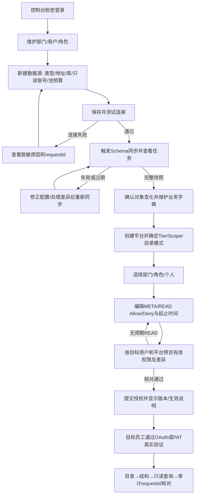
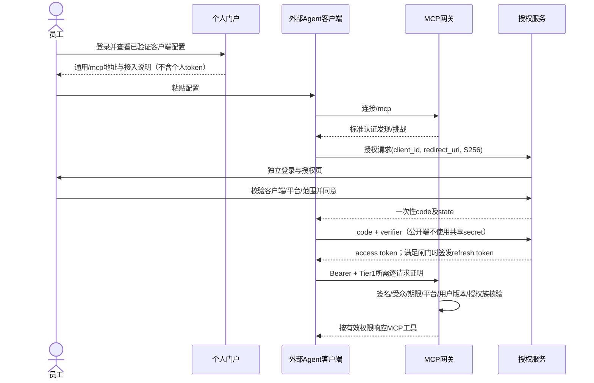
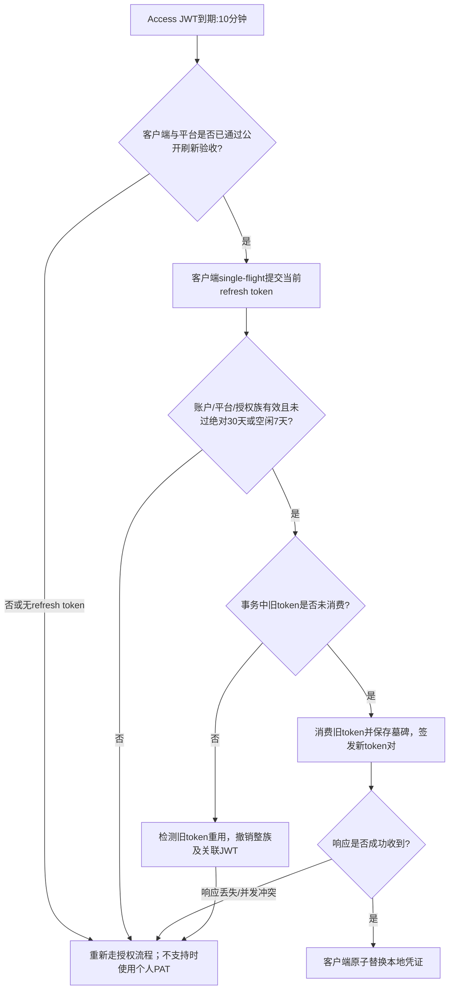
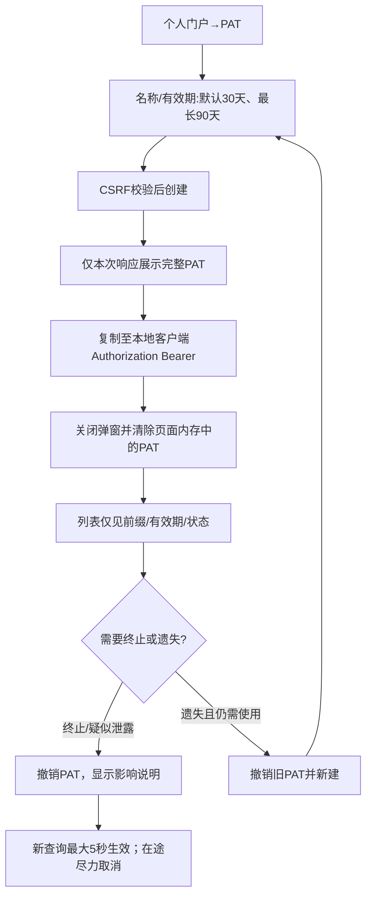
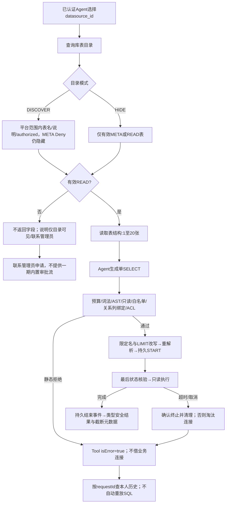
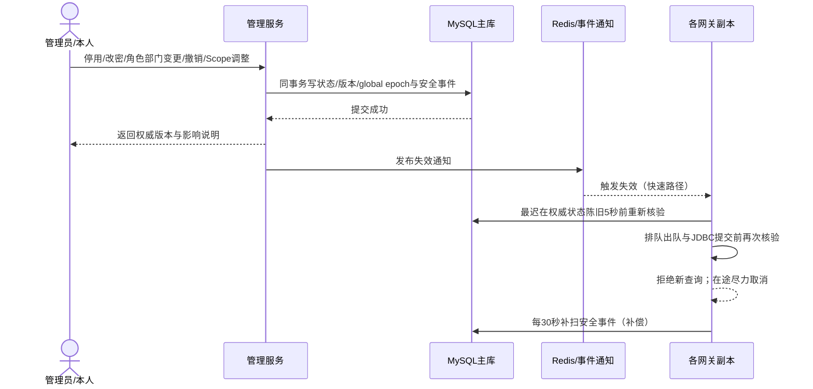

# PTMCP 用户业务流程

版本：1.0-design · 日期：2026-10-23 · 状态：待实现、待走查。

流程关联[PRD](PRD.md)中的 FR 编号。[总体方案](../总体方案.md)规定安全边界；[页面规格](../frontend/page-spec.md)、[仓库内低保真](../frontend/wireframes.md)和[API 契约](../backend/api-spec.md)承接实现。暂无外部原型或已部署地址。

## 1. 管理员完成首次开通（FR-02～08）

前置条件：部署已完成，管理员有管理权限，网络策略允许访问测试源，已准备只读数据库账号与平台接入类别。操作不需要管理员先获得业务表 READ。

测试连接只证明网络与认证，不代表 Schema 完整、SQL 方言已兼容或用户有查询权。同步失败保留任务错误，不发布部分成功快照。平台 Scope 与个人权限各自检查，缺一不可。管理员查看“有效权限预览”不等于代替员工执行查询；最终验证必须使用目标员工自己的凭证。

页面保存包含资源版本；409 时重新读取服务端变更并人工合并，不静默覆盖。删除/重建对象需重新确认授权；不能以同名显示名恢复旧授权。正常任务目标 10 分钟，网络/证书/数据库账号准备时间不计入。

## 2. 员工 OAuth 首次接入（FR-09、18）

授权页拒绝、账号锁定、回调不匹配、PKCE 不合法或平台停用时不创建可用授权。回调 scheme 和客户端版本以 M0 实测清单为准。控制台的 `PTMCP_ADMIN_SESSION` 不直接当作 `PTMCP_AS_SESSION`；一期可能再次登录，页面需明确原因。

## 3. 到期、刷新与竞争（FR-10）

不存在“几秒内旧 token 重试无条件放行”的产品保证。网关不自动刷新用户凭证，也不重放 SQL；客户端串行刷新、限次重试和重新授权能力属于兼容性验证项。公开刷新默认关闭到 M0 验收通过；只修改 token generator 不满足验收。

## 4. PAT 创建、使用和撤销（FR-11）

完整值不进入 URL、localStorage、sessionStorage、分析事件、错误上报或页面快照。用户没有复制成功时不自动重新创建；应检查列表并撤销不再使用的凭证。PAT 固定为个人终端平台，添加 Header 不能提升信任等级。

## 5. 目录、结构与拒绝处理（FR-12～15、17）

HTTP 401/403 表示认证或平台过滤链拒绝；进入 Tool 后的 SQL/权限/超时错误统一 `isError=true`。拒绝不是空结果。不能通过反复试错获取被隐藏对象名；提示仅包含调用者可见的信息。截断成功也不是完整结果，客户端应收窄查询或使用聚合。

## 6. 撤销与组织变更（FR-01、02、06～08、10、11）

权限自然到期/未来 DENY 生效无需新事件：有效权限缓存同时保存最近未来时间边界并在每次命中检查。主库不可确认、版本已变但权限重建未完成时拒绝新 SQL。消息丢失、Redis 命中和前端“保存成功”均不能绕过此规则。

## 7. 审计排障与解密（FR-16、17、19）

普通用户从个人历史选择 requestId，查看本人脱敏调用摘要和下一步动作。安全审计员使用审计列表按 verdict/error 分类，进入详情核对守门规则、对象、耗时与持久化状态。无解密权时不渲染解密按钮，服务端仍独立校验。

解密要求独立 `ptmcp:audit:decrypt`、受控审计范围与理由，任何角色默认无权。满足条件的人员填写理由，确认将显示敏感内容后请求解密；服务端先审计该访问，再返回短期展示内容。解密失败不回退显示密文或明文日志。关闭详情/会话失效后立即清空内存，禁止缓存和常规导出。

参考[用户手册](../ops/user-manual.md)、[FAQ](faq.md)。当前这些流程均为设计目标；必须由测试证据将状态推进至已验收。
