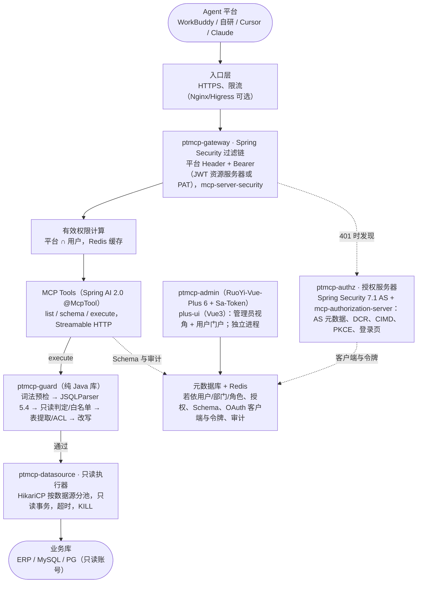

# PTMCP 开源选型与二开方案

> 结论（10-23 下午按 YC 决定修订）：后端只用 Java，前端 Vue，网关侧不再有 Python。主线是 Spring Boot 4.1 + Spring AI 2.0 MCP Server + Spring Security 7.1 自带的授权服务器 + JSQLParser 5.4（前置从 dbx 移植来的词法和只读规则）+ HikariCP + RuoYi-Vue-Plus。Python + Rust 路线降为备选。mes-data-qa skill 仍是 Agent 侧的 Python，它的 golden SQL 和评测集转成 Java 回归测试数据。

**资料来源**

- Maven Central 元数据核对版本（2026-10-23）：Spring Boot 4.1.2 / 3.5.16、Spring AI 2.0.2、Spring Security（含授权服务器）7.1.2、MCP java-sdk 2.1.0、mcp-security 0.1.14、JSQLParser 5.4、Druid 1.2.28、HikariCP 7.1.0；endoflife.date 核对 Boot 支持期
- JSQLParser 5.4 / Druid 1.2.28 本机 PoC（JDK 21.0.12、Maven 3.9.9）：/workspace/ptmcp/java-poc（result*.txt 为原始输出）
- RuoYi-Vue-Plus v6.0.0 release notes 与 6.X 分支 pom（GitHub API）；mcp-security README；Spring AI MCP Server Boot Starter 文档；Spring Security 授权服务器文档与 API
- GitHub REST API 实测 stars/license/语言/最近推送（2026-10-23 北京时间）
- sqlglot 30.24.0 本机 PoC：/workspace/ptmcp/poc_guard.py
- skills 包解压与阅读：/workspace/ptmcp/skills/mes-data-qa
- dbx 源码 commit 504e309（2026-10-23 13:21 北京时间）：/workspace/ptmcp/dbx
- sqlparser-rs 0.62 + dbx-sql-core 本机 PoC：/workspace/ptmcp/poc_rs；PyO3 封装 PoC：/workspace/ptmcp/ptmcp_guard

## 目录

- [结论先行](#tldr)
- [你的问数 skills 是什么](#skills)
- [数据库 MCP 服务 / 网关 / 问数平台](#dbmcp)
- [dbx 怎么用（修订）](#dbx)
- [dbx 代码复用清单](#reuse)
- [dbx 规则与测试移植清单（Rust→Java）](#port)
- [SQL 解析与 AST 安全](#ast)
  - [JSQLParser / Druid 实测（Java 主线）](#jpoc)
  - [sqlparser-rs / dbx 守门实测](#rspoc)
- [MCP 鉴权：规范、SDK、授权服务器、客户端](#auth)
- [RBAC / 后台脚手架](#rbac)
- [技术栈选型决策](#stack)
- [推荐路线组件清单](#route)
- [模块 → 组件映射](#mapping)
- [总体架构](#arch)
  - [Java 工程与模块结构](#modules)
- [关键设计](#design)
  - [权限交集模型](#perm)
  - [数据模型草图](#model)
  - [沙箱流水线](#pipeline)
  - [审计日志](#audit)
- [MVP 分阶段计划](#plan)
- [风险清单](#risk)
- [参考链接](#links)

<a id="tldr"></a>

## 结论先行

> [!NOTE]
> **主推路线（10-23 二次修订，YC 定）：Java 后端 + Vue 前端**
>
> JDK 21 + Spring Boot 4.1.x（当前 4.1.2）+ Spring AI 2.0.x MCP Server（WebMVC，Streamable HTTP，MCP java-sdk 2.1.0）+ spring-ai-community/mcp-security 0.1.14（资源服务器 + MCP 授权服务器）+ Spring Security 7.1 内置的 Authorization Server（OAuth 2.1、PKCE、DCR、CIMD）+ `ptmcp-guard`（JSQLParser 5.4，前面加一层从 dbx 移植的词法预检和可配函数白名单）+ HikariCP 7.1 按数据源动态建池 + RuoYi-Vue-Plus 6.0（后台脱手架）+ plus-ui（Vue3 + TS + Element Plus）。网关和后台分两个进程部署，共用元数据库和 Redis。

| 项目 | 内容 |
| --- | --- |
| 这次改了什么 | 按 YC 的决定：网关侧全 Java、前端 Vue、不再有 Python。原主推的「Python 外壳 + Rust 守门内核」降为备选 A′，其余对比保留。dbx 的 Rust 代码不再 vendor，改为把规则和测试用例移植到 Java（见「dbx 规则与测试移植清单」）。mes-data-qa skill 仍在 Agent 侧用 Python，它的 golden SQL 和评测集转成 JUnit 参数化回归数据。 |
| 为什么是 Boot 4.1 而不是 3.x | Spring Boot 3.x 最新是 3.5.16（2026-06-25），但 3.5 的开源支持已在 2026-06-30 结束（endoflife.date）。Spring AI 2.0.2 依赖 Boot 4.1.2；mcp-security 0.1.x 只支持 Spring AI 2.0.x；DCR 端点配置类在 Spring Security 7.0 才引入；RuoYi-Vue-Plus 6.0 也已升到 Boot 4.1。Boot 4.1 开源支持到 2027-07-31。如果必须用 3.x，对应组合是 Boot 3.5.16 + Spring AI 1.1.8 + mcp-security 0.0.6 + RuoYi-Vue-Plus 5.6.2，但已无开源补丁，且旧版授权服务器的 DCR 支持未核实。 |
| JSQLParser 实测结论 | 能正确提取 CTE 和子查询里的真实表（自动剔除 CTE 名，同名遮蔽也对）；LIMIT 收敛和行级条件注入都跑通；skills 的 29 条标准 SQL 全部能解析。但有两个坑：① MySQL 可执行注释 `/*!50000 …*/` 被当作普通注释丢掉，AST 里看不到 sleep，必须靠词法预检拦；② 普通的 Function 访问器看不到 `ROW_NUMBER() OVER`（甚至 `sleep(1) OVER ()`）和 `CAST`，白名单访问器必须覆盖这些节点类型。 |
| Druid WallFilter 只能做辅助 | 实测默认配置只拦下了多语句；危险函数只在 WHERE 里检查，`SELECT LOAD_FILE(...)` 会放行；系统库不拦；反而会把 LLM 常写的 `WHERE 1=1` 当永真条件拦掉。它是防 SQL 注入的防火墙，不是只读沙箱。可以不用；要用就加严配置后只当旁路复核。 |
| RuoYi-Vue-Plus 6.0 的变化 | v6.0.0（2026-07-30）基于 Boot 4.1 + JDK 21，内置 Spring AI 2.0 和 MCP 模块；完全移除了多租户（PTMCP 用不到）；数据权限改为「角色→菜单→数据权限」。它的认证用 Sa-Token，和 MCP OAuth 需要的 Spring Security 只能分开跑，所以网关和后台拆成两个进程。 |
| 备选 | A′：Python 外壳 + Rust 守门内核（上一版主推，dbx 复用率最高）。A：纯 Python + sqlglot。全 Rust 仍不推荐。详见「技术栈选型决策」。 |

<a id="tldr-old"></a>

## 上一版结论（已降为备选 A′，保留供对比）

> [!NOTE]
> **备选 A′（10-23 上午版主推）：Python 外壳 + Rust 守门内核**
>
> Python 3.12 + FastMCP（Streamable HTTP，兼容旧 SSE）+ 内置 OAuth 2.1 授权服务器（FastMCP OAuthProvider 或 Authlib，DCR + CIMD）+ SQLAlchemy 异步连接池（asyncmy / asyncpg）+ PostgreSQL 元数据库 + Redis + fastapi-best-architecture + vue-vben-admin。SQL 沙箱从 sqlglot 换成 `ptmcp-guard`：把 dbx 的 dbx-sql-core（sqlparser-rs 0.62）原样 vendor 进来，用 PyO3/maturin 打成 Python wheel，解析、只读判定、表提取、LIMIT 和行级改写都在这一个解析器里完成。

| 项目 | 内容 |
| --- | --- |
| 这次改了什么 | 只换了 SQL 沙箱内核。原方案的守门用 sqlglot；读完 dbx 源码并实测后，它的风险引擎在本页 10 个绕过用例上全部拦住，包括 sqlglot 漏掉的 MySQL 可执行注释。它还带 600 个单元测试，能单独编译，已用 PyO3 封装并在 Python 里跑通。MCP、OAuth、后台、连接池的选型不变。 |
| 为什么不全换 Rust | rmcp 3.7 的 `auth` feature 只管客户端 OAuth（已读源码），服务端的 PRM、授权服务器、DCR/CIMD 都要自己写或外接 IdP；Rust 也没有若依或 fastapi-best-architecture 那样的 RBAC 后台脚手架。dbx-mcp 的工具层（server.rs 9,796 行）依赖 28 万行的 dbx-core，抽不出来。 |
| 为什么不全用 Python | sqlglot 会丢掉 `/*!50000 …*/` 里的代码，也看不到 PG 数据修改 CTE（已实测），这些都要自己补规则并长期维护。dbx 已有现成、带测试的实现，直接抄比移植更稳。 |
| 备选 A：纯 Python | 团队完全不接受 Rust 时选。用 sqlglot，把 dbx 的判定逻辑和测试用例改写成 Python，工期约多 1 周。 |
| 备选 B：Java 若依系 | 以 Java 团队为主、要复用若依生态时选。dbx 代码基本用不上，只借鉴规则。（10-23 下午已升为主推，见上节。） |
| dbx 的定位 | 不 fork 整仓，按模块抽取：dbx-sql-core 直接抄，HTTP 鉴权、连接池和元数据 SQL 迁移后改造，其余只借鉴思路（见「dbx 代码复用清单」）。桌面端 dbx 继续给开发者和 DBA 用；PTMCP 上线后，skills 的执行器切到 PTMCP。 |
| 实测发现的坑 | dbx 的严格只读证明（ReadProof）里，MySQL 函数白名单没有 `sum`，窗口函数也不放行，skills 的 29 条标准 SQL 只过了 11 条；补上 sum、row_number、date_add、substring_index、cast 后过了 26 条，剩下 3 条卡在 `OVER` 窗口。另外，dbx MCP 实际用的只读闸门会放行 `SLEEP`、`LOAD_FILE`、`pg_read_file`、`set_config`。所以白名单必须由 PTMCP 自己维护，并且两道闸门都要过。 |

<a id="skills"></a>

## 你的问数 skills 是什么

| 项目 | 内容 |
| --- | --- |
| 名称 | `mes-data-qa`：标准 Agent Skill（`SKILL.md` + scripts + catalog），面向国人通信制造的 `asd_cloud_base`（MES/WMS/ERP/IQC/薪资，MySQL 8） |
| 语言 | Python 3.10+，只用标准库，没有第三方依赖；scripts 约 40 个文件、12,167 行；tests 有 56 个文件，evals 含 golden/holdout/stress 集 |
| 怎么连库 | 不直连数据库，全部通过客户端里配好的 dbx MCP `execute_query`。`dbxrpc.py` 走 stdio JSON-RPC；`transport.py` 已抽象出 Streamable HTTP + `Authorization: Bearer ${ENV}`，并支持 `tool_map` 映射别家 MCP 的工具名 |
| 语义层 | catalog 里有 808 张 live 表、30 条 verified queries（标准 SQL）、8 个指标卡片，外加别名、枚举、字段语义、报表日历、巨表清单。由 `mesqa.py route` 把问题路由成模板 SQL |
| SQL 守门 | `sqlguard.py`（895 行）用正则加轻量 token/作用域分析：只放行单条 SELECT/WITH；拦写关键字和 INTO/OUTFILE；拦 `sleep`、`benchmark`、`load_file`、`get_lock` 等危险函数；禁 `information_schema` 和 `FROM DUAL`；巨表必须带索引或时间过滤；明细必须 LIMIT；做枚举值校验 |
| Prompt / 规则 | 硬规则（只读、预算、口径顺序、失败不报 0）、Red Flags、证据分级；`rules/core.md` 是唯一必读规则 |
| 许可 | Proprietary（爱世达咨询 / xquan，内部测试专用）。只在内部使用，PTMCP 开源化时不要带上 |

它和 PTMCP 的关系：skill 是装在 Agent 侧的语义层加客户端自律守门，PTMCP 是装在服务端的强制守门加权限。两者是上下游，不是替代。

- `sqlguard.py` 里的规则用 Java 重写进服务端 ptmcp-guard，作为策略配置：危险函数表、系统库拦截、巨表必须过滤（二期性能规则）。它的 56 个测试文件、golden/holdout/stress 集和 verified queries 导出成 JSON/CSV 夹具，由 JUnit 5 参数化测试读取。skill 本身留在 Agent 侧继续用 Python。因为 skills 是 Proprietary，这些夹具放在内部私有模块，不进开源仓。
- `catalog/aliases.json`、`field-semantics.md`、`live-tables.json` 可以一次性导入 PTMCP 的「业务别名 / 问数说明」，冷启动不用从零写。
- skill 侧要改的只有三处：transport 指向 PTMCP、`tool_map` 映射到 `execute_readonly_sql`、`list_connections` 换成 `list_databases_and_tables`。
- skill 里记的 dbx 坑（检索列起别名报伪 1054、30 秒超时）在 PTMCP 下要重新验证。

<a id="dbmcp"></a>

## 数据库 MCP 服务 / 网关 / 问数平台

*Stars、License、语言、最近推送均为 2026-10-23（北京时间）GitHub API 实测；License 为 NOASSERTION 的已读 LICENSE 原文核对。*

**视图：基本信息**

| 类别 | 项目 | Stars | License | 语言 | 最近推送 |
| --- | --- | --- | --- | --- | --- |
| 数据库 MCP | googleapis/mcp-toolbox（原 genai-toolbox） | 16,709 | Apache-2.0 | Go | 2026-10-23 |
| 数据库 MCP | bytebase/dbhub | 3,710 | MIT | TypeScript | 2026-10-21 |
| 数据库 MCP | t8y2/dbx（含 MCP Server） | 27,593 | Apache-2.0 | Rust | 2026-10-23 |
| 数据库 MCP | crystaldba/postgres-mcp | 3,419 | MIT | Python | 2026-08-17 |
| 数据库 MCP | benborla/mcp-server-mysql | 2,177 | MIT | JavaScript | 2026-07-27 |
| 数据库 MCP | designcomputer/mysql_mcp_server | 1,402 | MIT | Python | 2026-08-02 |
| 数据库 MCP | runekaagaard/mcp-alchemy | 421 | MPL-2.0 | Python | 2026-10-15 |
| 数据库 MCP | FreePeak/db-mcp-server | 470 | MIT | Go | 2026-10-17 |
| 数据库 MCP | centralmind/gateway | 548 | Apache-2.0 | Go | 2025-07-18 |
| 数据库 MCP | supabase/mcp | 2,971 | Apache-2.0 | TypeScript | 2026-10-22 |
| 数据库 MCP | neondatabase/mcp-server-neon | 656 | MIT | TypeScript | 2026-10-21 |
| 数据库 MCP | modelcontextprotocol/servers-archived（官方 PostgreSQL/SQLite 参考实现） | 305 | MIT | JavaScript | 2025-05-28（已归档） |
| 治理 / 网关 | bytebase/bytebase | 14,620 | MIT 主体 + enterprise 部分商业许可 | Go | 2026-10-23 |
| 治理 / 网关 | IBM/mcp-context-forge | 4,681 | Apache-2.0 | Python | 2026-10-22 |
| 治理 / 网关 | higress-group/higress（阿里系 AI/MCP 网关） | 9,625 | Apache-2.0 | Go | 2026-10-22 |
| 治理 / 网关 | microsoft/mcp-gateway | 893 | MIT | C# | 2026-10-21 |
| 治理 / 网关 | aliyun/alibabacloud-dms-mcp-server | 54 | Apache-2.0 | Python | 2026-07-29 |
| 问数平台 | dataease/SQLBot | 6,949 | GPLv3 修改版（禁改 LOGO） | JavaScript/Python | 2026-10-22 |
| 问数平台 | Canner/WrenAI | 17,953 | Apache-2.0（按目录，预留 AGPL 模块） | Python | 2026-10-23 |
| 问数平台 | eosphoros-ai/DB-GPT | 20,183 | MIT | Python | 2026-10-23 |
| 问数平台 | vanna-ai/vanna | 23,812 | MIT | Python | 2026-02-02（已归档） |
| 问数平台 | OtterMind/Chat2DB | 28,330 | 自定义许可 | Java | 2026-10-20 |

**视图：覆盖与缺口**

| 类别 | 项目 | 覆盖 PTMCP 的部分 | 缺口 | 怎么用 | 风险 |
| --- | --- | --- | --- | --- | --- |
| 数据库 MCP | mcp-toolbox | 多源连接池、MySQL/PG 预置工具（含 `execute_sql`）、MCP Authorization（generic OIDC，自动发布 PRM）、Authenticated Parameters（JWT claim 自动填 SQL 参数） | 没有用户/角色/表级授权模型，没有后台；`execute_sql` 不做 AST 表级拦截；没有平台交集 | 参考设计：「claim→参数」思路用于二期 RLS；不作为基座 | Go 栈，和 skills 的 Python 不一致 |
| 数据库 MCP | dbhub | 多源 TOML、`execute_sql`/`search_objects`、只读分类、只读事务兜底、行数上限、超时、静态 Bearer、HTTP 传输 | 只读判定是关键字/正则分类，不是完整 AST；没有用户身份、OAuth、表级 ACL、审计后台 | 借鉴 `sql-access-policy.ts`、`readonly-transaction.ts`、`sql-row-limiter.ts` 里的逃逸函数清单和兜底分层 | 低（只借鉴代码思路） |
| 数据库 MCP | dbx | 18 个工具；Streamable HTTP + 单个 Bearer；中心策略分只读、读写、完全三档；连接白名单；基于 sqlparser-rs 的 AST | 定位是单人桌面/Web 客户端：没有多用户身份、OAuth、表级权限，也没有平台概念 | 不 fork 整仓；抽 dbx-sql-core 当守门内核，其余按模块迁移或借鉴（见复用清单） | Rust monorepo 27 个 crate，约 63 万行 Rust；整仓二开门槛高 |
| 数据库 MCP | postgres-mcp | restricted 模式：只读事务 + 执行时长限制 + 安全 SQL 解析 | 只支持 PG，无身份 | 借鉴 PG 侧的只读事务和超时做法 | 低 |
| 数据库 MCP | mcp-server-mysql 两个实现 / mcp-alchemy / db-mcp-server | 单库或多库直连、默认只读、部分支持 HTTP + Bearer | 都没有多租户身份、表级授权或审计 | 不选；只当行为参考 | 安全能力薄 |
| 数据库 MCP | centralmind/gateway | API key/OAuth 插件、PII 脱敏、Lua RLS、审计 | 2025-07 后基本停更；主要是生成 REST/MCP API，不是自由 SQL 网关 | RLS/脱敏插件思路可参考 | 维护停滞 |
| 数据库 MCP | supabase/mcp、mcp-server-neon | 云厂商托管库的 MCP | 绑定自家管理 API | 不适用 | - |
| 治理 / 网关 | bytebase | SQL Editor 访问控制、JIT 临时授权、动态脱敏、列级权限、审计、自带 MCP Server | 平台很重；权限、角色、套餐控制代码不在 MIT 范围（见 LICENSE 自述） | 有预算可直接买，当重方案对照；不建议 fork | 许可证限制 |
| 治理 / 网关 | mcp-context-forge | 通用 MCP 网关/注册中心：鉴权、RBAC、OAuth、限流、插件、联邦 | 不理解 SQL，做不到表级拦截 | 以后要统一管多个 MCP 时放在 PTMCP 前面；MVP 不引入 | 多一层运维 |
| 治理 / 网关 | higress / microsoft mcp-gateway | 外层 HTTPS、限流、路由、会话亲和 | 不理解 SQL | 可选，做外层入口 | 低 |
| 治理 / 网关 | alibabacloud-dms-mcp-server | 依托阿里云 DMS 的权限体系 | 依赖阿里云 DMS | 只在数据库托管在阿里云时考虑 | 厂商锁定 |
| 问数平台 | SQLBot | 问数平台：工作空间隔离、细粒度数据权限、MCP 调用 | 内置 LLM 推理，和「薄网关」定位相反 | 参考它的行列权限配置 UI | GPLv3 修改版有传染性，并要求保留 LOGO |
| 问数平台 | WrenAI / DB-GPT / Vanna | 语义层（WrenAI MDL）、Text-to-SQL 框架 | 自带 LLM 推理；Vanna 已归档 | 可参考 WrenAI 语义层；推理留在 Agent 侧 | 偏离定位 |
| 问数平台 | Chat2DB | AI 数据库客户端 | 客户端，不是网关 | 不选 | 许可证为自定义条款 |

共同缺口：没有一个项目同时具备「平台凭证 + 用户 OAuth + 表级 AST 拦截 + 审计后台」。这正是 PTMCP 自建的部分，执行器本身反而是最简单的一层。

<a id="dbx"></a>

## dbx 怎么用（修订）

*基于 commit 504e309（2026-10-23 13:21 北京时间）的源码阅读；行数为 wc -l，含测试和注释。*

**优点**

- Apache-2.0，27.6k stars，当天仍有提交，活跃度高
- 分层清楚：`crates/ARCHITECTURE.md` 明确规定下层 crate 不得反向依赖 dbx-core，所以 dbx-sql-core、dbx-types 能单独拿出来编译（已实测）
- SQL 风险引擎成熟：基于 sqlparser-rs 0.62 的 AST，加上词法养护（可执行注释、INTO OUTFILE/DUMPFILE、PG SELECT INTO、锁子句、数据修改 CTE、副作用函数），dbx-sql-core 里有 600 个 `#[test]`
- HTTP 侧做了 Host/Origin 白名单、远程绑定开关、token 热轮换（`http_auth.rs`），用 rmcp 的 Streamable HTTP 服务端

**缺点**

- 只有一个全局 token，没有多用户身份，更没有 OAuth 授权服务器；dbx-web 也只是单密码登录（argon2 + Cookie）
- 权限只到连接和库；跨库引用用正则检测（`production_safety.rs`），没有表、列、行级，也没有平台维度
- 工具层 `dbx-mcp/src/server.rs`（9,796 行）和 `backend.rs`（4,970 行）深度依赖 dbx-core（282,206 行），另有 18 个工具和 Redis/Mongo/Kafka 分支，整体搬不动
- 代码注释自己写明：严格只读证明是「UI-only…a heuristic, never a security boundary」。实测 MySQL 白名单缺 `sum`，直接用会误拦大量正常查询

修订结论：不 fork 整仓，按模块抽取。dbx-sql-core 连同 dbx-types 一起 vendor，作为 PTMCP 的守门内核；HTTP 鉴权、连接池参数、元数据 SQL 迁移后改造；工具层、策略层、前端只借鉴思路。dbx 桌面端继续给开发者用。

> [!WARNING]
> **Java 主线下的变化（10-23 下午）**
>
> 后端定为 Java 后，dbx 的 Rust 代码不再 vendor，代码复用率接近 0。能带走的是规则和测试：词法预检、只读结构判定、函数白名单和副作用函数表、USE/事务闸门，以及对应的测试用例，用 Java 重写进 ptmcp-guard。下面「代码复用清单」里的「直接抄」是按备选 A′（Python + Rust）写的；Java 主线按「dbx 规则与测试移植清单」执行。

<a id="reuse"></a>

## dbx 代码复用清单

*结论分四档：直接抄 = 原文件 vendor，只改配置或小补丁；迁移改造 = 拷出后大改；只借鉴思路 = 不拷代码；不适用。*

| 模块 | 文件与行数 | 做什么 | 结论 | PTMCP 要改什么 |
| --- | --- | --- | --- | --- |
| SQL 风险分类 + 严格只读证明 | `crates/dbx-sql-core/src/sql_risk.rs`（2,337），`query_execution_sql.rs`（3,316） | `classify_sql_risk_for_database` 分 ReadOnly/Write/Ddl/Transaction；`prove_read_only_for_database` 是 fail-closed 证明：必须是单条语句，函数白名单（MySQL 103 个），并拒绝可执行注释、INTO、`:=`、锁子句和可写 CTE | 🟢 直接抄 | 把函数白名单改成可配置；补上 `sum` 和窗口函数（已实测缺失）；两道闸门都要过：风险分类为 ReadOnly，且证明结果为 ProvenReadOnly |
| 方言感知的语句切分 / 注释剥离 | `dbx-sql-core/src/sql.rs`（7,346） | 按方言切分多语句，处理字符串、`#` 注释和存储过程；剥离注释和字面量 | 🟢 直接抄 | 无需改，随 dbx-sql-core 一起 vendor |
| 类型与连接模型 | `crates/dbx-types`（8,465） | DatabaseType、ConnectionConfig、查询与元数据 DTO | 🟢 直接抄 | dbx-sql-core 依赖它，一起 vendor；可以裁掉用不到的数据库类型 |
| 跨库引用检测 | `dbx-core/src/safety/production_safety.rs`（1,246） | 用正则提取 SQL 里的库名，判断是否越出允许的库；不确定时按越权处理 | 🟡 只借鉴思路 | PTMCP 要到表级，Java 主线改用 JSQLParser `TablesNamesFinder`（已实测能正确剔除 CTE 名）做提取器；继承「不确定就拒绝」原则 |
| MCP SQL 策略闸门 | `dbx-mcp/src/server.rs` 的 `validate_sql_policy`（约 50 行） | 禁 USE、禁事务语句；在 read_only 下拦写入和 DDL；拦高危语句和生产写入 | 迁移改造 | 迁到 ptmcp-guard，并加上严格证明和表级 ACL。实测 dbx 的闸门会放行 SLEEP、LOAD_FILE、pg_read_file、set_config |
| HTTP 鉴权中间件 | `dbx-mcp/src/http_auth.rs`（341），`http.rs`（713） | 常量时间比较 Bearer；Host/Origin 白名单；热轮换；`/healthz` `/readyz`；会话关闭 | 迁移改造 | Java 主线：按它的逻辑写成 Spring Security 过滤器（Host/Origin 规则、loopback 处理），再叠加 JWT 资源服务器、PAT 和平台 Header；备选 A′ 则写成 Starlette 中间件 |
| MySQL 驱动与连接池 | `crates/dbx-driver-mysql/src/mysql.rs`（11,043） | mysql_async 连接池（PoolConstraints、checkout 超时、keepalive 重试）；从 information_schema 取表和列；TLS | 迁移改造 | Java 主线只搬元数据 SQL 和池参数的经验值到 HikariCP（备选 A′ 是 SQLAlchemy）；全 Rust 路线则拷出并裁掉 StarRocks/OceanBase 等分支 |
| PG 驱动与连接池 | `crates/dbx-driver-postgres/src/postgres.rs`（17,339） | deadpool-postgres + tokio-postgres；取列信息时分级回退到 information_schema；`BEGIN READ ONLY`；文本编码处理 | 迁移改造 | 同上；分级回退的元数据查询值得照搬 |
| 查询超时与取消 | `dbx-driver-support/src/execution.rs`（默认 `QUERY_TIMEOUT` 30 秒），`dbx-core/src/query/query_cancel.rs` | 用 tokio 超时加 CancellationToken；超时后丢弃连接池 | 🟡 只借鉴思路 | PTMCP 改为由数据库侧超时兜底（`statement_timeout` / `max_execution_time`），再加 KILL QUERY。skills 里记录的「30 秒超时」就来自这个默认值 |
| 行数上限 | `server.rs` 的 `MAX_EXECUTE_QUERY_ROWS`（默认 100，最大 1000） | 驱动层只取前 N 行，并对单元格做字符窗口截断 | 🟡 只借鉴思路 | PTMCP 改写 SQL 本身（外层 LIMIT），驱动层再截断行数和字节数；字符窗口可以借鉴 |
| 中心策略 | `dbx-core/src/ai/mcp_policy.rs`（360） | 全局、连接、库三级执行模式（read_only / allow_dangerous），每次请求重新加载 | 🟡 只借鉴思路 | PTMCP 的权限模型是「用户 × 平台 × 资源树」，只借鉴「每次请求重算、库级覆盖连接级」的层级思路 |
| MCP 工具层 | `dbx-mcp/src/server.rs`（9,796），`backend.rs`（4,970），`session.rs`，`transaction.rs` | 18 个工具，包括会话、事务、批量、Redis/Mongo/Kafka 和插件 | 🟡 只借鉴思路 | PTMCP 只要 3 个只读工具；借鉴错误码风格（`SQL_BLOCKED`、`DATABASE_OUT_OF_SCOPE`）和工具注解（`read_only_hint`） |
| 密钥存储 | `dbx-core/src/persistence/secret_codec.rs` | AES-256-GCM 加密连接密码，密钥放系统 keyring 或 `.dbx/secret.key` | 🟡 只借鉴思路 | 服务端用 KMS 或主密钥加密 datasource.pwd_enc；算法一致 |
| Web 登录 | `dbx-web/src/auth.rs` | 单密码 argon2 + HttpOnly Cookie | 不适用 | PTMCP 需要多用户和 OAuth |
| 配置持久化 | `dbx-core/src/persistence/`（SQLite） | 桌面端本地存储、历史记录、云同步 | 不适用 | PTMCP 用 PG 元数据库 |
| 前端 | `apps/desktop`：Vue 3.5 + shadcn-vue + reka-ui + Tailwind 4 + Pinia + Tauri 2，535 个 .vue 文件 | 数据库客户端 UI：连接树、数据网格、SQL 编辑器（CodeMirror）、MCP 设置页 | 🟡 只借鉴思路 | Java 主线后台用 RuoYi-Vue-Plus 配套的 plus-ui（Vue3 + TS + Element Plus），备选 A′ 用 vue-vben-admin；「数据字典」页的表和列浏览可以参考 dbx 侧栏组件，两者都是 Vue 3 |
| npm 包 `packages/mcp-server` | `bin/dbx-mcp-server.js` | 只是按平台启动 Rust 二进制的壳 | 不适用 | - |

> [!NOTE]
> **Apache-2.0 义务（已核对 LICENSE 原文）**
>
> dbx 根目录和各 crate 的 Cargo.toml 都声明 Apache-2.0。仓库没有顶层 NOTICE 文件，唯一的 NOTICE 在第三方 Go 客户端 `agents/go-common/iotdb-client-go/` 里，和我们要抽的代码无关。抽取时要做到：① 在分发物（源码包、jar、镜像）里附上 Apache-2.0 全文，可以放成 `third_party/dbx/LICENSE`；② 保留原有的版权和归属声明（抽查的 crate 里没有文件头版权行，建议在 `third_party/dbx/README` 里注明来源仓库和 commit 504e309）；③ 改过的文件要在显眼处注明已修改，例如文件头写「Modified by PTMCP, 2026」；④ 不得用 dbx 的名称或商标替 PTMCP 背书。做到这些，PTMCP 自身可以采用任何许可，包括闭源。

<a id="port"></a>

## dbx 规则与测试移植清单（Rust→Java）

*源码基于 dbx commit 504e309；测试数是各文件里 #[test] 的数量。P0 放在 M0～M1，P1 放在 M1～M4，P2 放在二期。*

| 优先级 | dbx 规则（源文件） | 做什么 | Java 实现（ptmcp-guard） | 要移植的测试 |
| --- | --- | --- | --- | --- |
| 🔴 P0 | `has_dialect_specific_write`、注释和字面量剥离（`query_execution_sql.rs`，引用 `sql.rs` 的切分） | MySQL：发现可执行注释，或在注释和字面量之外出现 INTO OUTFILE / INTO DUMPFILE，就判为写。PG：引号外出现 INTO 就判为写。严格证明里另外拒绝 MySQL 的 `:=` 和任意 INTO（包括 `INTO @var`）。 | `LexicalPrecheck`：手写状态机扫描器，识别单/双引号、反引号、`--` 和 `#` 注释、块注释、PG 的 `$$` 引用，不依赖 JSQLParser。必须有这一层：实测 JSQLParser 会丢掉 `/*!…*/`。 | `query_execution_sql.rs` 87 个测试里涉及可执行注释、INTO 和剥离的部分；本页的绕过用例 |
| 🔴 P0 | `split_sql_statements_for_database`（`sql.rs`，7,346 行），以及严格证明里「恰好 1 条语句」的要求 | 按方言切分语句，字符串和注释里的分号不算 | 要求 `CCJSqlParserUtil.parseStatements` 的结果恰好 1 条，并且词法扫描在字符串和注释之外没有多余的 `;`，两个条件都要成立 | `sql.rs` 204 个测试里与切分、引号、`#` 注释相关的部分 |
| 🔴 P0 | `query_is_write_capable` / `set_expr_is_write_capable`（`sql_risk.rs`） | 递归检查：可写 CTE、集合运算的每个分支、锁子句、SELECT INTO、副作用函数 | `ReadOnlyVerifier`：顶层必须是 `Select`；递归遍历 WithItem，遇到 ParenthesedInsert/Update/Delete 就拒绝；遍历 SetOperationList 的每个分支和 ParenthesedSelect；`getForMode()` 非空、`getIntoTables()` 非空、`getMySqlSelectIntoClause()` 非空都拒绝（这些字段已实测可用） | `sql_risk.rs` 的 34 个测试 |
| 🔴 P0 | `prove_read_only_statement` + `ProofFunctionVisitor`；`MYSQL_PROOF_SAFE_FUNCTIONS`（103 个）、`POSTGRES_PROOF_SAFE_FUNCTIONS`、`SIDE_EFFECT_SELECT_FUNCTIONS`（15 个，包括 nextval、setval、pg_advisory_*、lo_*、pg_terminate_backend） | 函数白名单证明：白名单外的函数一律视为无法证明只读 | `FunctionAllowlist`：按方言从配置或元数据库加载，初始值是 dbx 的列表加上 skills 实际用到的 sum、row_number、date_add、cast、substring_index 等。访问器要覆盖 Function、AnalyticExpression、CastExpression、ExtractExpression 等节点，遇到不认识的表达式节点一律拒绝（实测普通 Function 访问器看不到窗口函数和 CAST）。 | 与证明相关的测试；危险函数全部拒绝；29 条 VQ 全部放行 |
| 🔴 P0 | `mcp_sql_has_forbidden_database_switch`（`sql_risk.rs`）、`validate_sql_policy`（`dbx-mcp/src/server.rs`） | 禁止 USE、事务语句和写入 | 顶层不是 `Select` 就拒绝，已经覆盖这些情况；另在词法层快速拒绝 USE、SET、CALL、DO、HANDLER、LOAD DATA（fail-fast） | USE 和事务相关的测试 |
| 🟡 P1 | `production_safety.rs`（dbx-core）的跨库检测 | 用正则提取库名，不确定就按越权处理 | 不照抄正则，只保留「不确定就拒绝」的原则。用 JSQLParser 的 TablesNamesFinder（实测会剔除 CTE 名并保留库名），缺库名的按 default_db 补全，系统库一律拒绝，再做 ACL 比对 | 跨库相关用例；本页的 CTE 同名遮蔽和嵌套子查询用例 |
| 🟡 P1 | 错误码风格（`SQL_BLOCKED`、`DATABASE_OUT_OF_SCOPE`） | 结构化的拦截原因 | 映射到 `GuardResult.reasonCode` 和审计表的 verdict 枚举 | - |
| 🟢 P2 | `is_safe_explain_sql_for_database`（`query_execution_sql.rs`） | 判断 EXPLAIN 是否安全（排除 EXPLAIN ANALYZE 等） | 二期做「EXPLAIN 预估行数」时再移植 | 对应测试 |
| 🟢 P2 | `analyze_sql_references`（`sql_analysis.rs`） | 表和列的引用分析 | 二期做列级规则时参考它的作用域处理 | 15 个测试 |
| 不移植 | `sql_editability`、`dml_preview_sql`、`object_source_sql`、`oracle_view_rename`、`mysql_ddl_normalize`、`mysql_event_sql` 等 | 桌面客户端的编辑、DML 预览和 DDL 功能 | 与只读网关无关 | - |

### JSQLParser 之前的预检层

1. **长度与编码**：限制字符数和字节数；拒绝 NUL 和非法 UTF-8；拒绝 `\G` 等客户端指令。
2. **词法扫描（移植 dbx）**：按方言识别字符串、引号标识符和注释。遇到 `/*!` 就拒绝；优化器 hint `/*+` 也拒绝，只允许网关自己加。
3. **关键字序列（只看注释和字面量之外）**：INTO OUTFILE/DUMPFILE、任意 INTO（MySQL 的 `@var`、PG 的 SELECT INTO）、`:=`、字符串外多余的 `;`，以及 USE/SET/CALL/DO/HANDLER/LOAD DATA 开头的语句，出现任一就拒绝。
4. **交给 JSQLParser**：解析失败就拒绝（fail-closed）；之后依次做结构只读判定、函数白名单、表提取和 ACL、改写。
5. **只执行重新生成的 SQL**：由 AST 重新生成 final_sql（deparse），执行器只接受它，不执行原文。实测 JSQLParser deparse 会去掉可执行注释，这是第二道保险；但仍在词法层直接拒绝，避免「用户以为执行的」和「实际执行的」不一致。

测试移植方式：把 Rust `#[test]` 里的（sql、方言、期望结果）抽成 `src/test/resources/dbx-ported/*.yaml` 夹具，用 JUnit 5 的 `@ParameterizedTest` 读取；只测 Rust 内部 API 的用例不搬。skills 的 golden SQL、评测集和 29 条 VQ 放在内部私有模块 `ptmcp-regression-internal`，不进开源仓。

> [!NOTE]
> **Apache-2.0 归属（Rust→Java 移植同样要做）**
>
> 逐函数翻译的逻辑、照搬的函数列表和测试向量，稳妥起见按衍生作品处理：① 在源码包和发布的 jar/镜像里附 `third_party/dbx/LICENSE`（Apache-2.0 全文）；② 在 NOTICE 或 `third_party/dbx/README` 里写明来源仓库 t8y2/dbx、commit 504e309，并列出移植了哪些文件；③ 移植文件和夹具的文件头写「Portions ported from t8y2/dbx (Apache-2.0) @504e309, translated to Java and modified by PTMCP, 2026」；④ 不得用 dbx 的名称或商标替 PTMCP 背书。做到这些，PTMCP 自身的许可不受限制。

<a id="ast"></a>

## SQL 解析与 AST 安全

| 库 | Stars / License | 语言 | MySQL+PG | 表提取（CTE/子查询） | LIMIT 改写 | 行级注入 | 结论 |
| --- | --- | --- | --- | --- | --- | --- | --- |
| JSQLParser 5.4（2026-09-13） | 5,966 / LGPL-2.1 与 Apache-2.0 双许可 | Java | 都支持（PG 的 `::`、INTERVAL、FETCH FIRST、LATERAL 已实测可解析） | `TablesNamesFinder` 自动剔除 CTE 名，同名遮蔽、嵌套子查询、EXISTS 都正确，保留库名（已实测） | 支持（已实测，含 UNION、OFFSET） | 支持（替换为派生表，已实测） | 🟢 Java 主选（10-23 下午）；需前置词法预检 |
| Druid 1.2.28 SQL Parser + WallFilter | 28,163 / Apache-2.0 | Java | 都支持 | `SchemaStatVisitor` 同样剔除 CTE 名、保留库名（已实测） | 支持 | 支持 | 🟡 可选旁路复核：WallFilter 是防注入防火墙，不是只读沙箱（已实测） |
| sqlparser-rs 0.62 + dbx-sql-core | 3,468 / Apache-2.0 | Rust（PyO3 封装给 Python） | 都支持 | `visit_relations` 会把 CTE 名也列出来，需要自己按作用域剔除（已实测） | 支持（已实测，含 UNION） | 支持（VisitorMut 替换为派生表，已实测） | 备选 A′ 的内核 |
| sqlglot 30.24 | 9,710 / MIT | Python | 都支持（30+ 方言） | 用 `traverse_scope` 准确提取并排除 CTE 名（已实测） | 支持 | 支持（`exp` 节点替换，已实测） | 纯 Python 备选；要自己补可执行注释和可写 CTE 规则 |
| Apache Calcite | 5,197 / Apache-2.0 | Java | 部分（方言靠 Babel 解析器） | 最严格（带校验器） | 支持 | 支持 | 太重，MySQL 方言兼容性一般，不选 |
| node-sql-parser | 1,043 / Apache-2.0 | PEG.js | 都支持 | 有 `tableList`（含操作类型） | 支持 | 需要手写 | 只在 TS 路线考虑 |
| libpg_query / pglast | 1,489 / BSD-3 | C（多语言绑定） | 只支持 PG | 用 PG 真实语法，最准 | 支持 | 支持 | PG 专项可做二次校验 |

<a id="jpoc"></a>

### JSQLParser 5.4 / Druid 1.2.28 实测（本机 JDK 21，10-23）

方法：在 /workspace/ptmcp/java-poc 建 Maven 工程，对同一批用例分别跑 JSQLParser 5.4（`parseStatements` + `TablesNamesFinder` + Function 访问器 + 自写改写）和 Druid 1.2.28（`MySqlWallProvider` / `PGWallProvider`，分默认配置和加严配置；加严即关闭 delete/insert/update/drop/selectInto 等并设 `commentAllow=false`）。原始输出在 result*.txt。

| 用例 | JSQLParser 5.4 | Druid WallFilter 默认 | Druid 加严 | PTMCP 处置 |
| --- | --- | --- | --- | --- |
| MySQL `SELECT 1 /*!50000 , sleep(10) */ FROM t`，以及 `SELECT /*!50000 sleep(10)*/ 1 FROM t` | 🔴 当普通注释丢弃：deparse 为 `SELECT 1 FROM t`，AST 里没有 sleep | 🔴 放行，deparse 原样保留这段注释 | 🔴 放行 | 词法预检遇到 `/*!` 直接拒绝（移植 dbx） |
| PG `WITH d AS (DELETE FROM t RETURNING *) SELECT * FROM d` | 🟡 顶层是 PlainSelect，但 WithItem 的类型是 ParenthesedDelete，可以识别；表提取为 t | 🔴 放行 | 🟢 拦截（1004/1005 delete not allow） | 递归检查 WithItem 类型（移植 dbx 的可写 CTE 规则） |
| `SELECT LOAD_FILE(...)` / `pg_read_file()` / `SLEEP(10)` / `set_config(...)` | 🟡 正常解析，Function 访问器能拿到函数名 | 🔴 放行 | 🔴 放行：Druid 只在 WHERE 里查黑名单函数，`WHERE sleep(10)=0` 才报 2001 | 函数白名单（不是黑名单） |
| `SELECT * FROM t INTO OUTFILE '/tmp/x'` | 🟡 能解析；`getIntoTables()` 为空，但 `getMySqlSelectIntoClause()` 有值，可以识别 | 🔴 放行 | 🟢 拦截（1003 select into not allow） | 词法和 AST 两处都拦 |
| `SELECT 1; DROP TABLE t` | 🟢 `parseStatements` 得到 2 条（PlainSelect、Drop） | 🟢 拦截（2201 multi-statement） | 🟢 拦截（2201、1103） | 语句数必须等于 1 |
| `SELECT * FROM t FOR UPDATE` | 🟢 `forMode=UPDATE`，可以识别 | 🔴 放行 | 🔴 放行 | AST 检查锁子句 |
| PG `SELECT * INTO newt FROM t` | 🟢 `intoTables=[newt]`；表提取为 t、newt | 🔴 放行 | 🟢 拦截（1003） | 词法（PG 引号外 INTO）和 AST 两处都拦 |
| `WITH x AS (SELECT * FROM orders) SELECT * FROM x JOIN users u …` | 🟢 表为 orders、users，正确剔除了 CTE 名 x | - | - | Druid SchemaStatVisitor 结果相同 |
| CTE 同名遮蔽 `WITH users AS (SELECT * FROM salary) SELECT * FROM users` | 🟢 表为 salary，正确 | - | - | 按 salary 做 ACL |
| 派生表 + IN 子查询 + EXISTS | 🟢 表为 a、b、c | - | - | - |
| `erp.t_salary` / `information_schema.tables` | 🟢 带库名原样提取 | 🔴 放行（`mysql.user`、`pg_catalog.pg_authid` 也放行） | 🔴 放行 | 系统库黑名单 + ACL 自写 |
| `WHERE 1=1` / `OR 1=1` | - | 🟡 拦截（2100 always true） | 🟡 拦截 | LLM 常写 `WHERE 1=1`，用 Druid 会误拦，需要关掉这个开关 |

| 能力 | JSQLParser 5.4 实测结果 |
| --- | --- |
| LIMIT 收敛（上限 500） | `LIMIT 100000` 改为 `LIMIT 500`；没有 LIMIT 的加上 `LIMIT 500`；UNION 的 LIMIT 加在整个集合运算之后；`LIMIT 10` 不动；`LIMIT 100000 OFFSET 5` 改为 `LIMIT 500 OFFSET 5`。PG 的 `FETCH FIRST n ROWS` 是单独的节点，本次改写未处理，要补 |
| 行级条件注入 | 自写递归把真实表替换为派生表：`orders o` 变成 `(SELECT * FROM orders WHERE factory_id IN (3, 5)) o`。在 CTE 体、IN 子查询、UNION ALL 的一个分支、派生表里都生效；名叫 orders 的 CTE 正确地没有被替换 |
| PG 语法 | `a::int`、`DATE_TRUNC` + `LIMIT/OFFSET`、`INTERVAL '1 day'`、`FETCH FIRST`、`LEFT JOIN LATERAL` 均能解析 |
| skills 29 条标准 SQL（用 example 参数渲染） | JSQLParser 全部能解析（29/29）；Druid 默认 WallFilter 全部放行（29/29）。Function 访问器看到的函数是 concat、count、date_add、date_format、datediff、ifnull、max、min、round、substring_index、sum，看不到 cast 和 row_number |
| 🔴 函数访问器的盲区 | `ROW_NUMBER() OVER` 是 AnalyticExpression，`CAST` 是 CastExpression，都不会进 Function 访问器；连 `sleep(1) OVER ()` 也看不到。白名单必须同时检查 AnalyticExpression、CastExpression、ExtractExpression 等节点的名字，遇到不认识的节点就拒绝 |
| 安全重生成 | JSQLParser deparse 会去掉可执行注释，按重新生成的 SQL 执行就不会触发它；Druid deparse 会把它原样保留。执行器只跑 final_sql，而且词法层仍然直接拒绝 `/*!` |

结论：JSQLParser 的表提取和改写能力够用，而且比 sqlparser-rs 省事（不用自己剔除 CTE 名）；只读判定所需的信息（WithItem 类型、into、forMode、语句数）都拿得到，但要自己写判定。唯一拿不到的是可执行注释，必须靠词法预检。Druid WallFilter 在默认配置下对只读沙箱几乎没用，加严后能补拦 DML CTE 和 SELECT INTO，但仍拦不住 SELECT 列表里的危险函数、系统库和 FOR UPDATE。建议不把它放进主链路；如果要用，就加严配置、关掉 always-true 检查，只作旁路复核和告警。

### sqlglot PoC 实测（本机 30.24.0）

| 用例 | 结果 | 处置 |
| --- | --- | --- |
| CTE + JOIN + IN 子查询 | 提取出 t_order、t_user、t_salary，排除 CTE 名 a | 🟢 通过 |
| 跨库 `erp.t_sal_order` + 派生表 `hr.emp` | 带库名提取 erp.t_sal_order、hr.emp | 🟢 通过 |
| `SELECT 1; DROP TABLE t` | 解析出 2 条语句 | 🟢 按语句数 ≠ 1 拦截 |
| `SELECT … INTO OUTFILE` | ParseError | 🟢 fail-closed 拦截 |
| `LOAD_FILE()` / `pg_read_file()` | 按普通函数通过 | 🟡 必须加函数白名单 |
| `SELECT … FOR UPDATE` | 顶层类型是 Select | 🟡 需额外拦截锁子句 |
| MySQL `/*!50000 sleep(10) */ 1` | 当注释丢弃，AST 里看不到 sleep，但 MySQL 会执行 | 🔴 高危：原文预检拒绝 `/*!` |
| PG `WITH d AS (DELETE FROM t RETURNING *) SELECT` | 顶层类型是 Select，scope 里也没有被删的表 t | 🔴 高危：全树搜索 DML 节点 |
| `information_schema.tables` | 能正确提取 | 🟢 按系统库黑名单拦截 |
| 无 LIMIT、LIMIT 100000、UNION | 统一改写为外层 `LIMIT 500` | 🟢 通过 |
| RLS 注入 `dept_id='D01'` | `FROM (SELECT * FROM t_order WHERE dept_id='D01') AS a` | 🟢 通过 |

经验：表提取不能直接用 `find_all(exp.Table)`，那样会把 CTE 名当成真实表；必须走 scope 遍历，同时再全树扫一遍 DML/DDL 节点和函数。

<a id="rspoc"></a>

### sqlparser-rs / dbx 守门实测（本机，rustc 1.99.1）

方法：新建一个 crate，用 path 依赖引入 dbx 的 `crates/dbx-sql-core`（只有它和 dbx-types，没有带上 dbx-core），直接调用 dbx 的公开函数。「dbx MCP 闸门」复刻 `validate_sql_policy` 的判断：风险不是 ReadOnly，或者 `is_write_sql_for_database` 为真，就拦截。「严格证明」就是 `prove_read_only_for_database`。

| 用例 | dbx 风险分类 | dbx MCP 闸门 | 严格证明 | 对比 sqlglot |
| --- | --- | --- | --- | --- |
| MySQL `SELECT 1 /*!50000 , sleep(10) */ FROM t` | Write（词法层识别为可执行注释） | 🟢 拦截 | 🟢 拒绝 | 🔴 sqlglot 会丢掉这段代码 |
| PG `WITH d AS (DELETE FROM t RETURNING *) SELECT * FROM d` | Write | 🟢 拦截 | 🟢 拒绝 | 🔴 sqlglot 看到的顶层是 Select |
| `SELECT … INTO OUTFILE` | Write | 🟢 拦截 | 🟢 拒绝 | sqlglot ParseError，也能拦 |
| `SELECT … FOR UPDATE` | Write | 🟢 拦截 | 🟢 拒绝 | sqlglot 需要额外规则 |
| `SELECT 1; DROP TABLE t` | Ddl | 🟢 拦截 | 🟢 拒绝 | 按语句数拦 |
| PG `SELECT * INTO newt FROM t` | Write | 🟢 拦截 | 🟢 拒绝 | - |
| `SELECT SLEEP(10)` / `LOAD_FILE()` / `pg_read_file()` | ReadOnly | 🔴 放行 | 🟢 拒绝（白名单外） | 需要函数白名单 |
| PG `SELECT set_config('default_transaction_read_only','off',false)` | ReadOnly | 🔴 放行 | 🟢 拒绝 | 需要函数白名单 |
| 正常查询（CTE + JOIN） | ReadOnly | 放行 | 通过 | 通过 |

| 能力 | 结果 |
| --- | --- |
| 表提取 | `visit_relations` 对 `WITH x AS (SELECT * FROM orders) SELECT * FROM x JOIN users` 返回 orders、x、users，把 CTE 名 x 也算进去了；可写 CTE 里的表 t 能取到。结论：要自己写按作用域剔除 CTE 名的提取器，约两三百行 |
| MySQL 可执行注释 | MySqlDialect 把 `/*!50000 , sleep(10) */` 里的代码解析进 AST，重新生成的 SQL 是 `SELECT 1, sleep(10) FROM t`。这和 MySQL 的执行语义一致，sqlglot 则会把它丢掉 |
| LIMIT 改写 | `LIMIT 100000` 收敛为 `LIMIT 500`；没有 LIMIT 的加上；UNION 的 LIMIT 加在整个集合运算之后 |
| 行级注入 | 用 VisitorMut 的 `post_visit_table_factor`，把 `orders o` 换成 `(SELECT * FROM orders WHERE factory_id IN (3, 5)) AS o`；对 CTE 和子查询内部也生效。注意：用 `pre_visit` 会递归到新生成的子查询里，导致栈溢出（已实测） |
| PyO3 封装 | maturin 打成 abi3 wheel（Python ≥ 3.10），编译约 40 秒；Python 里调用 `ptmcp_guard.is_proven_read_only(sql, 'mysql')`，结果与纯 Rust 一致 |
| skills 标准 SQL 误拦率 | 29 条 verified queries（用 example 参数渲染）：dbx MCP 闸门全部放行；严格证明只过 11 条。缺的函数按影响条数排：sum 17、row_number 3、date_add 2、cast 2、substring_index 1。补上这些后过 26 条，剩下 3 条都用了 `OVER` 窗口函数，还需放开 |

结论：dbx 的词法检查加 AST 判定，比 sqlglot 加自写规则更稳。但它的两道判断各有缺口：MCP 闸门会放行副作用函数，严格证明的白名单又太窄。PTMCP 要两道都过，白名单自己维护，并用 skills 的 golden 集做误拦回归。

<a id="auth"></a>

## MCP 鉴权：规范、SDK、授权服务器、客户端

| 项目 | 内容 |
| --- | --- |
| 当前规范（2026-07-28 版） | MCP Server 作为 OAuth 2.1 资源服务器，必须实现 RFC 9728 Protected Resource Metadata（401 时通过 `WWW-Authenticate` 的 `resource_metadata` 指向它，或放在 well-known 路径）。授权服务器必须提供 RFC 8414 或 OIDC Discovery。客户端注册优先级：预注册 > CIMD（Client ID Metadata Document）> DCR（RFC 7591，已标记 deprecated，保留作兼容）。PKCE S256 必须支持。 |
| 对 PTMCP 的含义 | 内置授权服务器要同时支持 CIMD 和 DCR：WorkBuddy 的文档明确要求 DCR，Claude Code 支持 CIMD 和 DCR。token 的 audience 绑定 PTMCP 的 MCP URL（Resource Indicator）。 |
| 传输 | 主推 Streamable HTTP（`/mcp`）；旧的 HTTP+SSE 从 2025-03-26 版起已废弃，但 WorkBuddy、Cursor 仍可配 `sse`，所以同时挂一个 `/sse` 兼容端点。Spring AI 里协议由 `spring.ai.mcp.server.protocol` 一个属性选定，SSE 自 2.0.0 起废弃；一个应用里同时提供 STREAMABLE 和 SSE 需要手工再注册一个 transport，或单独起一个 SSE 实例（未实测）。 |

### SDK 与授权服务器候选

| 组件 | Stars / License | MCP OAuth 能力 | 在 PTMCP 里的角色 |
| --- | --- | --- | --- |
| PrefectHQ/fastmcp 4.1.3 | 28,174 / Apache-2.0 | TokenVerifier、RemoteAuthProvider（对接带 DCR 的外部 IdP）、OAuthProxy（桥接不带 DCR 的 IdP，默认开启 CIMD）、OAuthProvider（完整自建授权服务器） | 备选 A / A′ 的 MCP 框架 |
| modelcontextprotocol/python-sdk 2.3.0 | 24,648 / MIT | 官方 SDK，内置 auth 模块（资源服务器 + 授权服务器 provider 接口） | 备选，或用作 FastMCP 底层 |
| authlib 1.9.1 | 5,443 / BSD-3 | 成熟的 OAuth2/OIDC 服务端库（授权码、PKCE、刷新令牌、DCR） | 自建授权服务器时的协议实现 |
| typescript-sdk | 13,640 / 混合许可（NOASSERTION） | 官方 TS SDK，带 auth 路由 | 只在 TS 路线考虑 |
| Spring AI 2.0.2（MCP Server Boot Starter）+ MCP java-sdk 2.1.0 | 9,569 Apache / 3,736 MIT | `spring-ai-starter-mcp-server-webmvc`，`spring.ai.mcp.server.protocol` 取 STREAMABLE / STATELESS / SSE（SSE 自 2.0.0 起标记废弃）。文档明确说 starter 本身不做任何鉴权，要靠 Spring Security 或 MCP Security | 🟢 Java 主线 MCP 框架 |
| spring-ai-community/mcp-security 0.1.14 | 120 / Apache-2.0（社区项目，非 Spring 官方） | `mcp-server-security`：OAuth2 资源服务器（`McpServerOAuth2Configurer`，Boot 模块只需配 issuer-uri）或 API Key，仅 WebMVC。`mcp-authorization-server`：基于 Spring Security 授权服务器，默认开 DCR，`cimd(true)` 开 CIMD，自带 localhost 任意端口回调校验、支持 Resource Indicator。README 自称 work in progress；0.1.x 只配 Spring AI 2.0.x，0.0.6 配 1.1.x | 🟡 Java 主线；社区 WIP，需锁版本 |
| Spring Security 7.1.2 内置 Authorization Server | Spring Security 主仓 / Apache-2.0（原 spring-authorization-server 仓已归档） | `spring-security-oauth2-authorization-server`：OAuth 2.1、PKCE、AS 元数据（RFC 8414）、DCR（RFC 7591，`OAuth2ClientRegistrationEndpointConfigurer` 自 7.0 起，默认 `/oauth2/register`）、Token Exchange、PAR、DPoP、设备码、introspection/revocation。开放注册默认关闭（需 initial access token），7.0.5 起对 redirect_uris 等做严格校验 | 🟢 Java 主线授权服务器 |
| keycloak 26.8 | 37,476 / Apache-2.0 | 官方 MCP 集成文档：支持 DCR，CIMD 和 Resource Indicators 为实验特性 | 二期对接公司 SSO 时用作外部授权服务器 |
| casdoor | 14,639 / Apache-2.0 | 仓库简介写着面向 Agent/MCP（MCP 细节未逐项核实） | 可选外部 IdP |
| logto | 14,757 / MPL-2.0 | 官方宣传支持 AI/MCP 场景（未逐项核实） | 可选外部 IdP |
| ory/hydra | 17,625 / Apache-2.0 | OpenID 认证的 OAuth 2.1 服务器 | 可选（重） |
| zitadel | 15,398 / AGPL-3.0 | IAM | 🟡 AGPL，不建议嵌入 |

一期建议内置授权服务器：账号本来就是内置账密。Java 主线用 Spring Security 7.1 授权服务器 + mcp-security 的 `mcp-authorization-server`（DCR、CIMD、PKCE、刷新令牌），客户端和授权记录用官方的 JDBC 存储落元数据库；登录页校验若依的 sys_user 账密。备选 A/A′ 则用 FastMCP OAuthProvider 或 Authlib。二期接 ERP 或企业 SSO 时，把登录页改成上游联邦（OIDC 到 Keycloak 或企业 IdP），PTMCP 签发的 token 格式不变。

### Agent 客户端支持情况

| 客户端 | MCP OAuth | 静态 Header | 注意 | 核实程度 |
| --- | --- | --- | --- | --- |
| WorkBuddy（腾讯） | 支持：OAuth 2.1 + PKCE + DCR（必需），自动刷新 | 支持 `headers`；≥5.0.0 支持 `staticHeaders`（对用户隐藏、不可编辑） | 回调优先私有协议 `workbuddy://…`，被拒时回退 `http://127.0.0.1:{port}`；DCR 响应必须回显 redirect_uris | 官方开发者文档（open.workbuddy.cn） |
| Cursor | 支持（SSE / Streamable HTTP），可用 DCR 或 `auth.CLIENT_ID` 静态客户端 | 支持 `headers`，变量用 `${env:X}` | 社区反馈：服务端发布 PRM 时，即使配了 header 也可能转走 OAuth，需实测 | 官方文档 + 社区 |
| Claude Code | 支持（DCR / CIMD），`/mcp` 登录 | 支持 `--header` | - | 第三方汇总，需实测 |
| claude.ai / Claude Desktop 自定义连接器 | 支持 | Web 端据称只支持 OAuth | 请求从 Anthropic 云端发出，PTMCP 必须公网可达 | 第三方指南，需实测 |
| VS Code、Codex、Gemini CLI、Zed、OpenCode | 支持 | 支持 | - | 第三方汇总（syllago），需实测 |
| Cline、Kiro、Copilot CLI、Roo Code | 未见文档 | 支持 | 走模式 B（个人 Token） | 第三方汇总 |
| 自研 Agent 平台 | 可自己实现 | 服务端注入平台 Header | 推荐由平台后端注入 X-Platform-Id/Secret，用户身份用 OAuth 或 PAT | - |

> [!WARNING]
> **平台凭证的现实问题**
>
> Cursor、Claude 这类 IDE 的配置文件在员工本机，X-Platform-Secret 写进去等于发给所有人，起不到平台鉴别作用。建议平台身份分三档：服务端注入 Header（WorkBuddy 的 staticHeaders、自研平台）可信度最高；按 OAuth client_id 映射平台（CIMD 域名可验证）次之；兜底归到「未知/IDE」平台，只开放最小数据源集合。平台 ID 在签发 token 时写死，防止换 Header 越权。

<a id="rbac"></a>

## RBAC / 后台脚手架

| 项目 | Stars / License | 语言 | 给 PTMCP 带来什么 | 建议 |
| --- | --- | --- | --- | --- |
| fastapi-practices/fastapi-best-architecture | 2,592 / MIT | Python | FastAPI + SQLAlchemy 企业架构：RBAC、部门、菜单、操作日志，配套 Vue 前端 | 备选 A/A′（Python）的后端骨架 |
| insistence/RuoYi-FastAPI | 1,568 / MIT | Python | 若依的 FastAPI 版：部门/角色/用户/数据权限，带代码生成 | 备选，熟悉若依的团队上手快 |
| vbenjs/vue-vben-admin | 33,656 / MIT | TypeScript | Vue3 后台前端：权限路由、表格、树形组件 | 备选路线的前端；Java 主线也可用社区的 ruoyi-plus-vben5 替代 plus-ui |
| fastapi/full-stack-fastapi-template | 46,052 / MIT | TS/Python | FastAPI + React + SQLModel + PG 全栈模板 | 想用 React 时选 |
| fastapi-amis-admin | 1,566 / Apache-2.0 | Python | 低代码 admin | 不选：定制权限树较难 |
| fastapi-admin | 3,831 / Apache-2.0 | Python | TortoiseORM admin | 🟡 2025-04 后停更，不选 |
| dromara/RuoYi-Vue-Plus 6.0.0（2026-07-30） | 2,808（GitHub 镜像）/ MIT | Java | Boot 4.1 + JDK 21 + Spring AI 2.0，新增 ruoyi-common-mcp 模块；Sa-Token 认证；数据权限细化为「角色→菜单→数据权限」；完全移除多租户；dynamic-datasource 4.5.0、MyBatis-Plus 3.5.17、操作日志、代码生成。如果要多租户或 Boot 3，用 5.6.2（2026-06-17，Boot 3.5.15，官方称最后一个 3.X） | 🟢 Java 主线后台脚手架 |
| plus-ui（RuoYi-Vue-Plus 前端） | 279（GitHub 镜像）/ 许可未核实 | TypeScript | Vue3 + TS + Element Plus；另有 React 版 plus-ui-react 和社区 vben5 版 ruoyi-plus-vben5 | 🟢 Java 主线前端 |
| pig-mesh/pig | 6,693 / Apache-2.0 | Java | Spring Cloud + Spring Authorization Server 的 RBAC | Java 路线，需要 OAuth 服务器时选 |
| jeecgboot/JeecgBoot | 48,265 / Apache-2.0 | Java | 低代码平台，功能很多 | 太重，不选 |
| yangzongzhuan/RuoYi-Vue | 3,264 / MIT | Java | 经典若依 | 被 Plus 版覆盖 |
| apache/casbin-pycasbin / casbin-jcasbin | 1,776 / 2,649，Apache-2.0 | Python / Java | RBAC with domains、ABAC 策略引擎 | 可选：用作平台 × 角色 × 资源的判定引擎；资源树放自建表，Casbin 只负责判定 |

数据权限引擎方面，没有现成的「SQL AST 级」开源组件能直接用。若依系的 @DataPermission 是改写自家 ORM 的 SQL，不适用于 Agent 传进来的任意 SQL，所以行列权限要在 ptmcp-guard 里自己实现（行级注入已分别用 JSQLParser 和 sqlparser VisitorMut 验证可行）。若依的部门、角色、用户表和菜单权限可以直接用于控制台本身的权限，也作为 PTMCP 授权主体（用户/角色/部门）的来源。

<a id="stack"></a>

## 技术栈选型决策

*标「已实测」的是本机跑过的；「已读源码」是看过代码；其余是文档或经验判断。工期按 2～3 人估，粗估。*

| 维度 | ① A′：Python 外壳 + Rust 守门内核（混合） | ② A：纯 Python（FastMCP + sqlglot） | ③ 全 Rust（抽 dbx crate） | ④ Java（Boot 4.1 + Spring AI 2.0 + JSQLParser 5.4 + RuoYi-Vue-Plus 6）——主推 | ⑤ TS / Go |
| --- | --- | --- | --- | --- | --- |
| dbx 代码复用 | 🟢 高（守门内核原样 vendor，约 3.4 万行含测试） | 低（只能把逻辑和用例改写成 Python） | 🟢 最高（再加上驱动、连接池、HTTP 中间件） | 代码几乎为 0；规则、白名单和测试用例可移植（见移植清单） | 几乎为 0 |
| SQL AST（MySQL + PG） | 🟢 强：10 个绕过用例两道闸门全拦（已实测） | 🟡 中：可执行注释、可写 CTE 要自己补（已实测） | 🟢 强（同 ①） | 🟢 强（加词法预检后）：JSQLParser 表提取、LIMIT、行级注入已实测，可执行注释靠词法层拦；Druid WallFilter 实测不适合做主闸门 | 中：node-sql-parser 需要手写大量规则（未实测） |
| MCP SDK + OAuth 2.1 | 🟢 强：FastMCP 自带 OAuthProvider、DCR、CIMD、PRM | 🟢 强（同 ①） | 🔴 弱：rmcp 3.7 的 auth 只有客户端（已读源码），授权服务器要自写或外接 Keycloak（它的 CIMD 仍是实验特性）；oxide-auth 最后发版是 2024-06 | 🟡 中强：Spring Security 7.1 授权服务器自带 DCR（自 7.0）、PKCE、Token Exchange；mcp-security 0.1.14 补 PRM、CIMD、localhost 动态端口，但它是社区 WIP（120 stars） | 中：TS SDK 带 auth 路由；Go 未评估 |
| 后台脚手架 | 🟢 有：fastapi-best-architecture + vue-vben-admin | 🟢 有（同 ①） | 🔴 没有：Rust 里没有成熟的 RBAC 后台脚手架；dbx-web 只有单密码登录 | 🟢 最强：RuoYi-Vue-Plus 6.0 + plus-ui（Vue3），带部门/角色/菜单/数据权限（6.0 已移除多租户） | 中 |
| 连接池 / 性能 | 够用：网关是 I/O 密集型，耗时主要在数据库；守门走 Rust，解析开销低 | 够用；sqlglot 是纯 Python（可选 C 扩展），大 SQL 解析慢一些（未压测） | 🟢 最好 | 好（HikariCP） | 好 |
| 与 skills（Python）协同 | 🟢 高：同语言，sqlguard 规则和测试直接搬；golden 集做回归 | 🟢 高 | 中：只能通过 HTTP 接口对接，规则要用 Rust 重写 | 中：skill 留在 Agent 侧 Python，sqlguard 规则用 Java 重写；golden/评测集直接做 JUnit 回归数据 | 中 |
| 团队技能 / 招聘 | 主体 Python；只需 1 人能读懂 Rust 来维护 vendor 的 crate（改白名单、跟上游） | 最容易 | 🔴 最难：全栈 Rust 招聘成本高 | 容易（若依生态熟悉的人多） | 中 |
| 交付时间（MVP） | 🟢 约 8 周：守门省掉自写和大部分红队迭代，稍多一点 Rust 构建流水线工作 | 约 8～9 周：多出来的时间花在守门补规则和回归 | 🔴 约 12 周以上：授权服务器和后台都要自写 | 🟡 约 9～10 周（见「MVP 分阶段计划」）：多出的时间花在 dbx 规则移植和 Boot 4 / RuoYi 6 新版踩坑 | 约 9～10 周 |
| 主要风险 | 两种语言的构建和发版（maturin 出 wheel）；vendor 代码要定期对上游 diff | 解析器绕过要长期自己补 | 工期和招聘 | 守门规则要从 Rust/Python 重写成 Java；mcp-security 是社区 WIP；Sa-Token 与 Spring Security 需分进程 | 生态都不占优 |
| 结论 | 备选 A′：若日后允许网关侧用 Python | 备选 A：团队完全不碰 Rust 且允许 Python 时 | 不推荐（除非团队本身是 Rust 团队，且接受外接 Keycloak） | 🟢 主推（10-23 下午 YC 定：后端只用 Java，前端 Vue） | 不选 |

> [!TIP]
> **最终选型（10-23 下午，Java 主线）**
>
> JDK 21、Spring Boot 4.1.x、Spring AI 2.0.x MCP Server（WebMVC，STREAMABLE）、mcp-security 0.1.14、Spring Security 7.1 授权服务器、JSQLParser 5.4、HikariCP 7.1、RuoYi-Vue-Plus 6.0 + plus-ui。关键约束不变：只用一个解析器。解析、校验、改写、生成 final_sql 都由 JSQLParser 完成；Druid 如果上，只做旁路复核，它的结果不影响执行的 SQL。词法预检是硬性前置，因为 JSQLParser 看不到可执行注释。如果必须用 Boot 3.x，可退到 Boot 3.5.16 + Spring AI 1.1.8 + mcp-security 0.0.6 + RuoYi-Vue-Plus 5.6.2，但 3.5 已停止开源支持，旧版授权服务器的 DCR 也要另行验证。

> [!NOTE]
> **上一版（备选 A′）的选型理由，保留供对比**
>
> 改的只有 SQL 沙箱：由 sqlglot 改为 ptmcp-guard，即 vendor 的 dbx-sql-core 加 PTMCP 自己的表提取、ACL 和改写，用 PyO3 封装。MCP 框架、OAuth、后台、连接池、元数据库不变。原因有三点：① 实测里两个高危绕过 sqlglot 拦不住，dbx 现成的代码能拦；② dbx-sql-core 可以独立编译，带 600 个测试，抄过来就能用；③ 全 Rust 在 OAuth 和后台上没有现成轮子，工期会拉长一半以上。关键约束：只用一个解析器。解析、校验、改写、生成最终 SQL 都在 Rust 侧完成，Python 侧不再用 sqlglot 重新解析，避免两个解析器对同一条 SQL 理解不一致而被绕过。

### ptmcp-guard 接口草案（Java）

1. **输入**：`GuardResult SqlGuard.guard(String sql, Dialect dialect, String defaultDb, GuardPolicy policy)`。GuardPolicy 包含已授权表集合、按方言的函数白名单、系统库黑名单、行数上限，二期再加 rowPolicies 和列规则。纯 Java 库，不依赖 Spring。
2. **判定（移植 dbx）**：LexicalPrecheck → `parseStatements` 且恰好 1 条 → ReadOnlyVerifier（可写 CTE、INTO、锁子句、副作用函数）→ FunctionAllowlist（覆盖 Function、AnalyticExpression、CastExpression 等，未知节点拒绝）。
3. **表与 ACL（自研）**：TablesNamesFinder 提取真实表（已实测会剔除 CTE 名），缺库名的按 defaultDb 补全，系统库拒绝，再和已授权集合比对；提取不确定就拒绝。
4. **改写（自研）**：外层 LIMIT 收敛（含 OFFSET，要补 FETCH FIRST）；二期把真实表替换为带行级条件的派生表；从 AST deparse 出 finalSql。
5. **输出**：`record GuardResult(Verdict verdict, String reasonCode, List<String> objects, String finalSql, List<String> ruleHits)`，字段和审计表一一对应；执行器只执行 finalSql。

### 上一版 ptmcp-guard 接口草案（Rust + PyO3，备选 A′）

1. **输入**：`guard(sql, dialect, default_db, policy_json)`；policy 包含已授权表集合、函数白名单、系统库黑名单、行数上限，二期再加 row_policy 和列规则。
2. **判定（抄 dbx）**：先做 `has_dialect_specific_write` 词法检查，再跑 `classify_sql_risk_for_database`，最后是带 PTMCP 白名单的 `prove_read_only` 证明，三关都要过。
3. **表与 ACL（自研）**：按作用域提取真实表并剔除 CTE 名；缺库名的用 default_db 补全；系统库一律拒绝；再和已授权集合比对。提取不确定时按拒绝处理。
4. **改写（自研）**：外层 LIMIT 收敛；二期用 VisitorMut 注入行级条件；从 AST 生成 final_sql。
5. **输出**：`{verdict, reason_code, objects, final_sql, rule_hits}`，字段与审计表一一对应。Python 侧只执行 final_sql。

<a id="route"></a>

## 推荐路线组件清单

| 维度 | 主推：Java 后端 + Vue 前端（版本为 2026-10-23 Maven Central 核对） | 备选 A′：Python 外壳 + Rust 守门内核 |
| --- | --- | --- |
| 运行时 / 框架 | JDK 21 + Spring Boot 4.1.x（4.1.2，开源支持到 2027-07-31） | Python 3.12 |
| MCP 框架 | Spring AI 2.0.x（2.0.2）`spring-ai-starter-mcp-server-webmvc`，protocol=STREAMABLE；底层 MCP java-sdk 2.1.0；工具用 `@McpTool` | FastMCP 4.x（Streamable HTTP + SSE 兼容） |
| MCP 资源服务器 | mcp-security 0.1.14 `mcp-server-security`（JWT 校验 + 401 时给出 resource metadata），外加自研 PAT 和平台 Header 过滤器 | FastMCP TokenVerifier |
| OAuth 授权服务器 | Spring Security 7.1.2 内置 Authorization Server + mcp-security `mcp-authorization-server`（DCR 默认开、CIMD 可开、PKCE、刷新令牌、Resource Indicator）；二期可用自带的 Token Exchange | FastMCP OAuthProvider 或 Authlib |
| SQL AST | ptmcp-guard：词法预检（移植 dbx）+ JSQLParser 5.4 + 可配函数白名单 + TablesNamesFinder/ACL + LIMIT/行级改写；Druid 1.2.28 WallFilter 可选旁路复核 | vendor dbx-sql-core（sqlparser-rs 0.62）+ PyO3 wheel |
| 连接池 | HikariCP 7.1.0：按 datasource_id 动态建池、热启停（自写注册表；也可用若依自带的 dynamic-datasource 4.5.0） | SQLAlchemy 2 async（asyncmy / asyncpg） |
| 业务库驱动 | MySQL Connector/J、PostgreSQL JDBC（版本未单独核对） | asyncmy / asyncpg |
| 后台 | RuoYi-Vue-Plus 6.0（Sa-Token，部门/角色/菜单/数据权限，无多租户）二开为 ptmcp-admin | FastAPI + fastapi-best-architecture |
| 前端 | plus-ui（Vue3 + TS + Element Plus）；想要 vben 风格可换社区 ruoyi-plus-vben5 | vue-vben-admin |
| 元数据 / 缓存 | PostgreSQL 或 MySQL 8（按若依脚本支持情况定，未核对）+ Redis | PostgreSQL + Redis |
| 部署 | 三个 Boot 应用：ptmcp-gateway、ptmcp-authz（可与 gateway 合并）、ptmcp-admin；共用元数据库和 Redis；镜像用 JDK 21 | 一个 Python 服务 + 预编译 wheel |
| 和 skills 的契合 | 🟡 中：skill 留在 Agent 侧；golden/评测集做 JUnit 回归数据 | 🟢 高：同语言 |
| MCP OAuth 成熟度 | 🟡 中强：Spring Security 授权服务器成熟，MCP 适配层是社区 WIP | 🟢 高：DCR/CIMD/PRM 现成 |
| 适合团队 | Java 团队，熟悉若依（YC 已定） | Python 团队，接受 1 人维护 Rust |

<a id="mapping"></a>

## 模块 → 组件映射

| PTMCP 模块 | 组件（主推路线） | 自研量 | 借鉴来源 |
| --- | --- | --- | --- |
| 1 平台 Header 鉴权 | ptmcp-gateway 里的 Spring Security 过滤器 + platform_app 表（secret 用 argon2 哈希） | 小 | dbx 的 Host/Origin 白名单 |
| 1 用户 OAuth（模式 A） | ptmcp-authz：Spring Security 7.1 授权服务器 + mcp-authorization-server（DCR/CIMD/PKCE）+ 自研登录页（校验若依 sys_user）+ JDBC 存储；gateway 侧用 mcp-server-security 做资源服务器 | 中 | WorkBuddy OAuth 端点清单、MCP 规范、mcp-security 示例 |
| 1 个人 Token（模式 B） | `ptm_` 前缀随机 token，库里只存哈希，可吊销和设过期；自写 `AuthenticationProvider` 与 JWT 并列 | 小 | GitHub PAT 的做法 |
| 2 多数据源连接池 | ptmcp-datasource：HikariCP 7.1 池注册表，按 datasource_id 懒加载，支持热启停（后台改配置后经 Redis 通知重建） | 小 | DBHub 的多源 TOML；dbx 池参数经验值 |
| 2 Schema 同步与字典 | information_schema / pg_catalog 增量抓取 + 若依定时任务 + 业务别名 | 中 | skills catalog 一次性导入；dbx 的分级回退元数据 SQL |
| 3 RBAC 与授权 | 用户/角色/部门复用若依；自建资源树 + acl_grant 表 + 有效权限缓存（Redis）；jCasbin 可选 | 中 | RuoYi-Vue-Plus 的部门/角色 |
| 4 三个 MCP Tools | Spring AI `@McpTool`，按权限过滤输出 | 小 | DBHub search_objects 的渐进披露 |
| 4 安全沙箱 | ptmcp-guard（纯 Java：词法预检 + JSQLParser 5.4 + 白名单 + ACL + 改写）+ 只读事务 + 超时 + 行数和字节上限 | 中偏大（规则从 dbx 移植，表提取用现成 TablesNamesFinder，改写自研） | dbx-sql-core 规则与测试；skills sqlguard、DBHub sql-access-policy |
| 5 管理后台 | ptmcp-admin（RuoYi-Vue-Plus 6.0 二开）+ plus-ui | 中 | SQLBot 权限 UI |
| 5 用户门户 | 同一 plus-ui 按角色渲染菜单（若依菜单权限） | 小 | - |
| 审计 | 元数据库分区表（按月）+ 异步写入（队列或 Redis Stream） | 小 | 若依操作日志只管后台操作，查询审计单独建表 |

<a id="arch"></a>

## 总体架构



<a id="modules"></a>

### Java 工程与模块结构

*Maven 多模块，JDK 21，Spring Boot 4.1.x。ptmcp-admin 基于 RuoYi-Vue-Plus 6.0 的独立工程，引用公共模块。*

| 模块 | 类型 | 主要依赖 | 职责 |
| --- | --- | --- | --- |
| ptmcp-common | jar | Jackson、MyBatis-Plus 实体（与若依一致） | 元数据实体（datasource、meta_object、acl_grant、platform_app、personal_token、audit_log）、错误码、有效权限计算与缓存版本号 |
| ptmcp-guard | jar（不依赖 Spring） | JSQLParser 5.4；可选 Druid 1.2.28（旁路） | `LexicalPrecheck`、`ReadOnlyVerifier`、`FunctionAllowlist`、`TableExtractor` + `AclChecker`、`LimitRewriter`、`RowPolicyRewriter`、`SqlGuard.guard(...)`；内含 dbx 移植测试与绕过集 |
| ptmcp-regression-internal | 仅测试（内部私有） | JUnit 5、ptmcp-guard | skills 的 golden/holdout/stress 集和 29 条 VQ 夹具；上线门槛。skills 是 Proprietary，不进开源仓 |
| ptmcp-datasource | jar | HikariCP 7.1、MySQL/PG JDBC 驱动 | 按 datasource_id 的池注册表；会话初始化（只读事务、语句超时）；取数截断；超时 KILL；Schema 抓取 |
| ptmcp-authz | Boot 应用（可并入 gateway） | spring-security-oauth2-authorization-server 7.1、mcp-authorization-server 0.1.14 | AS 元数据、DCR、CIMD、PKCE、刷新令牌、登录页（校验若依 sys_user）；token 里写入 platform_id 和 audience |
| ptmcp-gateway | Boot 应用 | spring-ai-starter-mcp-server-webmvc 2.0.x、mcp-server-security 0.1.14、ptmcp-guard、ptmcp-datasource | `/mcp` Streamable HTTP；平台 Header / PAT / JWT 过滤器；3 个 `@McpTool`；异步审计 |
| ptmcp-admin | Boot 应用（RuoYi-Vue-Plus 6.0 二开） | Sa-Token、MyBatis-Plus 3.5.17、ptmcp-common、ptmcp-datasource（连通测试和 Schema 同步） | 数据源、组织账号、平台、权限矩阵、审计、用户门户、PAT 管理的 API |
| ptmcp-ui | 前端（plus-ui 二开） | Vue3、TS、Element Plus | 管理员页面 + 用户门户（数据字典、MCP 配置复制、查询历史） |

- 为什么 gateway 和 admin 分进程：RuoYi-Vue-Plus 6 的认证是 Sa-Token，MCP OAuth 依赖 Spring Security 的资源服务器和授权服务器，两套安全框架放一个应用里容易互相干扰。分开后只共用数据库和 Redis，权限变更通过缓存版本号通知 gateway。
- 若依 6 自带的 ruoyi-common-mcp 不直接拿来当网关：它挂在 Sa-Token 的应用里，是否支持 MCP OAuth 未核实。可以参考它的 Spring AI 版本对齐方式。
- ptmcp-guard 不依赖 Spring，方便单独发版、做 fuzz，以后开源时也能单独拆出。
- 开源边界：ptmcp-guard 里的 dbx 移植代码附 Apache-2.0 归属；ptmcp-regression-internal 和 skills 相关导入脚本只留在内部仓。

<a id="design"></a>

## 关键设计

<a id="perm"></a>

### 权限交集模型

```text
Eff(u, p) = ( Allow(u) ∪ Allow(roles(u)) ∪ Allow(depts(u)) − Deny(…) ) ∩ Scope(p)
```

- 资源统一成一棵树：数据源 → 库/schema → 表/视图 → 列（二期）。授权挂在任意节点上并向下继承，Deny 优先于 Allow。
- 平台 Scope 是天花板（一期到数据源/库级，可选到表级）。用户侧把个人、角色、部门链（含上级部门，开关可配）取并集。
- 结果按 (user_id, platform_id) 物化为「已授权表集合」，存 Redis；授权变更时 bump 版本号让缓存失效。拦截判定是 O(1) 的集合查找。
- list 工具返回全表并标 authorized true/false，用户可配置「隐藏无权表」。在 get_table_schema 里对无权表只给表名和注释，不给列。
- 二期：列级规则在同一张 grant 表上加 resource_kind=column，行级规则放 row_policy 表，表达式模板如 `dept_id = :user.dept_code`，由 AST 注入。

<a id="model"></a>

### 数据模型草图

| 表 | 关键字段 | 说明 |
| --- | --- | --- |
| org_dept → 若依 sys_dept | id, parent_id, name, path, ext_source, ext_id | 部门树；Java 主线直接用若依的 sys_dept，另加 ext_* 字段预留 ERP 同步 |
| sys_user（若依） | id, username, pwd_hash, dept_id, status, ext_id, attrs_json | 用若依的 sys_user，扩展 ext_id 和 attrs_json（存 RLS 变量，如 dept_code、region） |
| sys_role / sys_user_role（若依） | role_id, code, name / user_id, role_id | 角色，直接用若依表 |
| platform_app | id, code, secret_hash, trust_level, status, oauth_client_ids | 平台注册；trust_level 区分服务端注入和 IDE |
| datasource | id, type, host, port, db_user, pwd_enc, pool_max, idle_timeout, stmt_timeout_ms, max_rows, status | 密码用 KMS 或主密钥加密 |
| meta_object | id, datasource_id, parent_id, kind, name, data_type, comment, biz_alias, biz_desc, sensitivity, view_def, synced_at | 统一资源树：db/schema/table/view/column |
| acl_grant | id, subject_type, subject_id, object_id, effect, action, inherit, valid_from, valid_to, created_by | subject_type 取 user/role/dept/platform；action 取 meta/read |
| row_policy（二期） | id, object_id, subject_scope, expr_template, enabled | AST 注入条件 |
| column_mask（二期） | id, object_id, mask_type, subject_scope | 列脱敏或拒绝 |
| oauth_client | client_id, kind, redirect_uris, platform_id, metadata_url | kind 取 dcr/cimd/pre。Java 主线改用 Spring Security 授权服务器的标准 JDBC 表 oauth2_registered_client，平台映射另建 client_platform 表 |
| oauth_token | id, access_hash, refresh_hash, user_id, client_id, platform_id, scope, resource, exp | token 绑定 platform 和 audience。Java 主线用标准表 oauth2_authorization / oauth2_authorization_consent，platform_id 写进 token claims |
| personal_token | id, user_id, prefix, token_hash, name, platform_id, expires_at, last_used_at, revoked_at | 模式 B |
| audit_log | 见下节 | 按月分区 |

<a id="pipeline"></a>

### 沙箱流水线

1. **原文预检（ptmcp-guard LexicalPrecheck，移植 dbx）**：必须在 JSQLParser 之前：实测 JSQLParser 会把 `/*!…*/` 当注释丢掉。限制长度和字节数；按 dbx `has_dialect_specific_write` 的词法检查 MySQL 可执行注释 `/*!`、INTO OUTFILE/DUMPFILE、PG SELECT INTO；拒绝 `\G` 等客户端指令。
2. **解析（ptmcp-guard · JSQLParser 5.4）**：`CCJSqlParserUtil.parseStatements`：解析失败即拒绝（fail-closed）；语句数必须为 1，且顶层必须是 `Select`。备选 A′ 用 sqlparser-rs，备选 A 用 `sqlglot.parse`。
3. **只读红线（移植 dbx 的结构判定）**：递归检查 WithItem（ParenthesedInsert/Update/Delete 即拒绝，PG 可写 CTE 已实测可识别）、SetOperationList 的每个分支、`getForMode()`、`getIntoTables()`、`getMySqlSelectIntoClause()`，以及 dbx 的 15 个副作用函数。EXPLAIN ANALYZE 禁止（它会真实执行）。命中即阻断并记高危告警。
4. **函数白名单（移植 dbx ReadProof + PTMCP 可配白名单）**：访问器必须覆盖 Function、AnalyticExpression、CastExpression、ExtractExpression 等节点（实测普通 Function 访问器看不到 `ROW_NUMBER() OVER` 和 CAST），未知节点一律拒绝。白名单做成可配置项。在 dbx 原有 103 个 MySQL 函数的基础上，补 sum、row_number、date_add、cast、substring_index 和 `OVER` 窗口。只放行聚合、字符串、日期、数学、条件类函数；`sleep`、`benchmark`、`load_file`、`get_lock`、`pg_read_file`、`pg_sleep`、`dblink`、`lo_*`、`set_config`、`current_setting` 以及用户自定义函数一律拒绝。
5. **表解析与越权判定（ptmcp-guard 自研）**：用 JSQLParser `TablesNamesFinder` 拿到真实表（已实测会剔除 CTE 名、处理同名遮蔽、保留库名；备选 A′ 的 sqlparser `visit_relations` 则要自己剔除）；注意 PG `SELECT INTO newt` 的目标表也会被列出，但这类语句已在前一步拒绝；未带库名的按 tool 入参 database_name 补全；系统库（information_schema、mysql、performance_schema、sys、pg_catalog）一律拒绝；视图要单独授权；和有效权限集合比对，越权就返回结构化拒绝，不连数据库。
6. **改写（ptmcp-guard，二期加列和行）**：外层 LIMIT 收敛到 ≤500（JSQLParser 已实测，含 UNION 和 OFFSET；PG `FETCH FIRST` 要补）；二期把真实表替换为带 row_policy 条件的派生表（已实测，CTE、子查询、UNION 分支都生效），结合 Schema 展开 `*` 并校验列；MySQL 加 `MAX_EXECUTION_TIME` hint。final_sql 由 AST deparse 生成，执行器只执行它。
7. **执行**：只读账号；会话级 `SET SESSION TRANSACTION READ ONLY` / `SET TRANSACTION READ ONLY`；`statement_timeout=15s`（PG）、`max_execution_time=15000`（MySQL）；JDBC 侧 `setMaxRows`/`setQueryTimeout` + 边读边计字节截断；Hikari 连接初始化时设只读；超时就 KILL QUERY 熔断。
8. **返回与审计**：返回列、行和 truncated 标记；原 SQL、改写后 SQL、判定、耗时、行数异步写审计。

越权拒止的结构化返回示例：`{"status":"denied","reason":"table_not_authorized","objects":["erp.t_salary"],"message":"权限不足：当前账号无权查询表 [erp.t_salary]，请联系管理员申请权限。","platform":"workbuddy"}`。返回用 isError=false 加结构化内容，让 Agent 能转述给用户，而不是当成工具故障重试。

<a id="audit"></a>

### 审计日志

| 项目 | 内容 |
| --- | --- |
| 字段 | ts、request_id、mcp_session_id、platform_id、user_id、client_id、auth_mode（oauth/pat）、tool、datasource_id、database、sql_raw、sql_final、sql_fingerprint、verdict、denied_objects、rule_hits、duration_ms、rows、bytes、truncated、error_code、ip、user_agent |
| verdict 枚举 | ok / denied_table / denied_column / denied_function / non_readonly / multi_statement / syntax_error / timeout / db_error / rate_limited |
| 存储 | PG 按月分区，写入走异步队列，不阻塞查询；保留 180 天以上（按公司合规要求调整）。可选同步一份到 ELK 或 Loki。 |
| 告警 | non_readonly、multi_statement、denied_function 记为高危，推送管理员；同一用户短时间内多次越权触发频控。 |
| 用户门户 | 「我的查询历史」直接查 audit_log WHERE user_id=当前用户，展示被拦截的原因和缺失的表。 |

<a id="plan"></a>

## MVP 分阶段计划

*按 Java 主线、约 2 名 Java 后端 + 1 名 Vue 前端估算，一期约 9～10 周，工期是粗估。*

| 阶段 | 周期 | 交付 | 验收 |
| --- | --- | --- | --- |
| M0 PoC | 第 1～2 周 | 建 Maven 多模块骨架（JDK 21、Boot 4.1.x）；ptmcp-gateway 用 Spring AI 2.0 在 `/mcp`（STREAMABLE）上跑通 3 个 `@McpTool`；ptmcp-guard 先做 P0：LexicalPrecheck、单语句、ReadOnlyVerifier、可配 FunctionAllowlist（含 AnalyticExpression/Cast）、LIMIT 改写；移植 dbx `sql_risk.rs` 的 34 个测试和本页绕过集，附 `third_party/dbx/LICENSE`；接 1 个 MySQL（HikariCP）；PAT 鉴权；skills 的 transport 切到 PTMCP | 29 条 VQ 全部放行；本页绕过用例（可执行注释、可写 CTE、LOAD_FILE、pg_read_file、INTO OUTFILE、多语句、FOR UPDATE、SELECT INTO、set_config）全拦 |
| M1 核心 | 第 3～5 周 | RuoYi-Vue-Plus 6.0 拉起 ptmcp-admin 并建 PTMCP 表；数据源管理与动态连接池、Schema 同步、表级 grant、平台 Header 与交集、审计；ptmcp-guard 做 TableExtractor + 系统库拒绝 + ACL、PG 方言与 FETCH FIRST；移植 `sql.rs` / `query_execution_sql.rs` 里相关测试；用 Java 重写 sqlguard 规则，建 ptmcp-regression-internal（≥300 条，含 skills golden/stress） | 越权、非只读、多语句全部拦截；PG 和 MySQL 双方言通过；回归集进 CI 门禁 |
| M2 OAuth | 第 5～7 周 | ptmcp-authz：Spring Security 7.1 授权服务器 + mcp-authorization-server（AS 元数据、DCR、CIMD、PKCE、刷新令牌、登录页）；gateway 接 mcp-server-security 资源服务器和 PRM；token 绑定 platform 和 audience；验证 WorkBuddy 的 `workbuddy://` 回调能否过严格 redirect 校验 | WorkBuddy、Cursor、Claude Code、VS Code 实测首登加自动续期 |
| M3 控制台 | 第 5～8 周（前端可与 M1/M2 并行） | plus-ui 二开：数据源、组织账号（复用若依）、平台、权限矩阵树、审计；用户门户：数据字典、MCP 配置复制、PAT 管理、查询历史 | 管理员 10 分钟内完成一个新部门的授权 |
| M4 加固 | 第 9～10 周 | 红队 fuzz（sqlmap 类 payload、方言怪招、JSQLParser 未知节点）、压测（并发、Hikari 池、虚拟线程可选）、灰度上线、运维手册；可选接入加严的 Druid WallFilter 旁路告警 | 无高危绕过；P95 网关额外开销小于 50ms（不含数据库时间） |
| 二期 | 第 11～16 周 | ERP 组织同步（定时或 Webhook）、列级拦截与脱敏、行级 AST 注入、对接企业 SSO（Keycloak 联邦）、自研平台代用户 token exchange（RFC 8693） | 行列规则回归集通过；ERP 变更 5 分钟内生效 |

<a id="risk"></a>

## 风险清单

| 风险 | 说明 | 对策 |
| --- | --- | --- |
| 🔴 MySQL 可执行注释 | `/*!…*/` 被 JSQLParser 当注释丢掉（sqlglot 同样），Druid deparse 会保留但不报警，MySQL 却会执行（均已实测） | JSQLParser 之前强制过 LexicalPrecheck（移植 dbx 词法检查）；优化器 hint `/*+` 只允许网关自己加 |
| 🔴 PG 数据修改 CTE | `WITH x AS (DELETE…) SELECT` 顶层是 Select，WithItem 里是 ParenthesedDelete；Druid 只有加严配置才拦（已实测） | ReadOnlyVerifier 逐个检查 WithItem 和所有子语句节点，非 Select 一律拒绝；只读事务、只读账号兜底 |
| 🔴 JSQLParser Function 访问器覆盖缺口 | VQ 实测里 `CAST` 和 `ROW_NUMBER() OVER` 不经过 Function 访问器（分别是 CastExpression、AnalyticExpression）；若只遍历 Function，同类节点里的危险调用可能漏检 | FunctionAllowlist 显式处理 AnalyticExpression、CastExpression 等所有含函数名的节点；遇到未知表达式节点 fail-closed；补专门回归用例 |
| 🟡 Druid WallFilter 局限 | 危险函数只在 WHERE 里检查（SELECT 列表里的 sleep 放行）；系统库、FOR UPDATE 放行；`WHERE 1=1` 被判 2100 拒绝（已实测） | 只做可选旁路复核或告警，不作为主判定；如启用需关闭永真条件检查并加严配置 |
| 白名单误拦 | dbx 原白名单下 skills 标准 SQL 只过 11/29；补 5 个函数后过 26/29，剩余 3 条是 `OVER` 窗口（已实测） | 白名单做成可配置项，不硬编码；上线前以 golden 集为门槛；误拦先进回归集再放开 |
| 🟡 mcp-security 是社区 WIP | 0.1.14，约 120 stars，只支持 WebMVC；API 可能变动 | 锁定版本；封装在 ptmcp-authz / gateway 的适配层里；必要时退回直接用 Spring Security 授权服务器 + 自写 PRM 端点 |
| 🟡 Boot 4 / RuoYi 6.0 较新 | Boot 4.1 与 RuoYi-Vue-Plus 6.0.0（2026-07-30）发布不久，周边插件兼容性可能有坑；Boot 3.5 开源支持已于 2026-06-30 结束 | 锁定 Boot 4.1.x 补丁线；M0 先验证全部依赖；回退组合 Boot 3.5.16 + Spring AI 1.1.8 + RuoYi 5.6.2（但需商业支持，且该线授权服务器 DCR 未核实） |
| Sa-Token 与 Spring Security 并存 | 若依后台用 Sa-Token，OAuth/MCP 用 Spring Security，同进程会有过滤器链冲突 | admin 与 gateway/authz 分进程部署，只共享元数据库和 Redis；authz 登录页直接校验 sys_user 账密 |
| 🟡 redirect_uri 严格校验 | Spring Security 7.0.5 起对 redirect_uri 严格校验；WorkBuddy 的 `workbuddy://` 自定义 scheme 能否通过未核实 | M2 首周用 WorkBuddy 实测；不通过则自定义 RegisteredClient 校验器，只放行白名单 scheme |
| SSE 兼容 | Spring AI 2.0 起 SSE 协议已标记弃用；个别旧客户端只支持 SSE | 默认 STREAMABLE；确需兼容时单独开 SSE 端点并标注过渡期 |
| 🔴 危险函数 | LOAD_FILE、pg_read_file、dblink、lo_import、SLEEP、BENCHMARK、pg_sleep 会读文件或造成 DoS | 函数白名单（不是黑名单）；PG 账号不授予 pg_read_server_files 和 pg_execute_server_program |
| INTO OUTFILE / DUMPFILE / @var | 导出文件或给会话变量赋值 | 解析失败即拒绝，Into 节点阻断；账号不给 FILE 权限，`secure_file_priv` 设为 NULL |
| USE 与跨库限定名 | `USE` 切库，或 `otherdb.t` 跨库访问 | 禁止 USE/SET；未带库名的表按入参补全；每条连接固定默认库；授权按全限定名判定 |
| 视图、函数绕过 | 视图或存储函数内部访问了未授权表 | 视图作为独立授权对象；同步 view_def 给管理员提示依赖；禁用用户自定义函数 |
| information_schema / pg_catalog 探测 | 绕过表级权限去枚举结构 | 执行时拒绝系统库；结构只能通过 list/schema 工具按权限给出 |
| JSQLParser 方言边界 | JSQLParser 是单一语法兼容多方言，冷门语法可能解析失败或解析得与数据库实际含义不同 | fail-closed；锁定 5.4，升级时跑 VQ 集、绕过集和移植测试全量回归；只用一个解析器做主判定，Druid 只旁路 |
| LIMIT 绕过与大结果 | 子查询里的 LIMIT、PG `FETCH FIRST`、大字段 | JDBC `setMaxRows` + 字节截断；外层统一收敛 LIMIT；FETCH FIRST 改写在 M1 补齐 |
| 慢查询拖库 | 笛卡尔积、全表扫描 | 15 秒语句超时 + KILL；每用户并发配额；可选 EXPLAIN 预估行数拦截；分池隔离 |
| 平台凭证泄漏 | IDE 配置里的 secret 对员工可见 | 平台信任分级；token 绑定平台；secret 可轮换 |
| token 被盗 | PAT 或 access token 外泄 | 存哈希；短 TTL 加刷新；PAT 设过期和 IP 备注；异常地点告警 |
| 返回内容做提示注入 | 数据库里的文本诱导 Agent 执行其他操作 | 结果打上「数据」标记；skill 侧已有规则（把结果当数据，不当指令） |
| 许可证 | SQLBot 是 GPLv3 修改版，Bytebase 部分代码是商业许可，zitadel 是 AGPL | 只借鉴思路，不复制代码 |

> [!NOTE]
> **纵深防御**
>
> AST 拦截只是第一道。必须同时做到：数据库只读账号（只 GRANT SELECT 到授权 schema）、会话只读事务、语句超时、网关行数和字节截断、审计告警。任何一层失效，其余几层仍能挡住。

<a id="links"></a>

## 参考链接

- [MCP 规范 2026-07-28：Authorization](https://modelcontextprotocol.io/specification/2026-07-28/basic/authorization/client-registration) — modelcontextprotocol.io
- [WorkBuddy 连接器开发文档（OAuth / DCR 要求）](https://open.workbuddy.cn/docs/connector) — open.workbuddy.cn
- [Cursor MCP 文档](https://cursor.com/docs/mcp) — cursor.com
- [FastMCP OAuth Proxy / CIMD](https://gofastmcp.com/servers/auth/oauth-proxy) — gofastmcp.com
- [FastMCP Full OAuth Server](https://gofastmcp.com/servers/auth/full-oauth-server) — gofastmcp.com
- [MCP Toolbox Generic OIDC / MCP Auth](https://mcp-toolbox.dev/documentation/configuration/authentication/generic/) — mcp-toolbox.dev
- [Keycloak MCP 授权服务器集成](https://www.keycloak.org/securing-apps/mcp-authz-server) — keycloak.org
- [Spring AI MCP Server Boot Starter（Java 主线）](https://docs.spring.io/spring-ai/reference/api/mcp/mcp-server-boot-starter-docs.html) — docs.spring.io
- [Spring Security Authorization Server](https://docs.spring.io/spring-security/reference/servlet/oauth2/authorization-server/index.html) — docs.spring.io
- [spring-ai-community/mcp-security](https://github.com/spring-ai-community/mcp-security) — github.com
- [JSQLParser](https://github.com/JSQLParser/JSqlParser) — github.com
- [HikariCP](https://github.com/brettwooldridge/HikariCP) — github.com
- [RuoYi-Vue-Plus](https://github.com/dromara/RuoYi-Vue-Plus) — github.com
- [plus-ui（RuoYi-Vue-Plus 前端）](https://github.com/JavaLionLi/plus-ui) — github.com
- [Spring Boot 生命周期](https://endoflife.date/spring-boot) — endoflife.date
- [Druid WallFilter 配置](https://github.com/alibaba/druid/wiki/%E9%85%8D%E7%BD%AE-wallfilter) — github.com
- [DBHub](https://github.com/bytebase/dbhub) — github.com
- [dbx MCP Server](https://github.com/t8y2/dbx/tree/main/packages/mcp-server) — github.com
- [sqlglot](https://github.com/tobymao/sqlglot) — github.com
- [dbx crates 架构说明（ARCHITECTURE.md）](https://github.com/t8y2/dbx/blob/main/crates/ARCHITECTURE.md) — github.com
- [dbx-sql-core](https://github.com/t8y2/dbx/tree/main/crates/dbx-sql-core) — github.com
- [sqlparser-rs](https://github.com/apache/datafusion-sqlparser-rs) — github.com
- [rmcp（Rust MCP SDK）](https://github.com/modelcontextprotocol/rust-sdk) — github.com
- [PyO3](https://pyo3.rs) — pyo3.rs
- [maturin](https://www.maturin.rs) — maturin.rs
