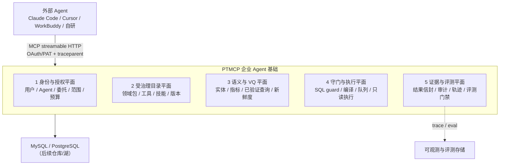

# 从问数网关到企业 Agent 基础：PTMCP 演进研究

研究日期：2026-11-04。状态：研究建议，尚未实施，不替代 [PRD](../product/PRD.md)、[架构](../architecture/architecture.md)、[路线图](../architecture/roadmap.md) 或既有 ADR。
工作记录：[DEV-20261104-enterprise-agent-foundation](../../tasks/work-items/DEV-20261104-enterprise-agent-foundation.md)。

**证据边界**：本报告区分四类证据——A 官方规范/厂商文档，B 厂商基准或案例（有方向性，不等于独立验证），C 预印本/单一实验（只作方向参考），D 本仓与 `data-qa` 技能的本地核查（只证明查阅时的快照）。引用数字均保留原始前提，不把厂商基准当成企业上线门槛。本轮未改业务实现，未连接业务库，未调用收费模型，未安装参考仓代码。

## 0. 结论

1. **PTMCP 不应变成 Agent 运行时，而应成为企业 Agent 的“受治理数据与工具基础”。** 企业不缺另一个会聊天的 Agent，缺的是让任何被授权的 Agent 都能安全、准确、可审计地使用企业数据的那一层。Agent 负责理解人，PTMCP 负责理解数据。
2. **准确性的最大杠杆不是更强的模型，而是语义层与已验证查询。** dbt 的对照实验显示，在语义层覆盖的问题上，Sonnet 4.6 从 90.0% 提升到 98.2%，GPT-5.3-Codex 从 84.1% 提升到 100.0%；更关键的是失败形态——text-to-SQL 失败是“看起来合理的错答案”，语义层失败是报错（B）。
3. **`data-qa` 技能已经是一套可工作的“客户端语义层 + 程序性知识 + 评测台”。** 808 张表、11,525 个字段、22 个实体、16 条关系、70 个指标、29 条已验证查询、8 个指标规格、85 条核心评测用例（另有 233 条压力集、156 条扰动集）、测试棘轮 ≥709（v2.5 实际 963）（D）。应当产品化，而不是重写。
4. **发布单元应从“数据源 + 工具”升级为“领域数据包（data pack）”。** 一个包 = 连接 + 可见对象 + 语义资产 + 技能包 + 评测集 + 策略 + 负责人 + 版本。发布、评测、版本、回滚、下线都以包为单位。管理与使用分离：语义资产、包发布、授权和升级只由管理员维护，普通用户只使用。
5. **分工要写死：外部 Agent 做理解、澄清、解释和下一步；PTMCP 做身份、上下文、编译、守门、执行、证据和审计。** 覆盖问题不让 Agent 直接写自由 SQL，而是让它选指标/已验证查询，由平台编译 SQL。自由 SQL 只作长尾兜底，一期默认关闭，仅管理员可按白名单开启，并明确标记“非官方口径”。
6. **三步走，且不推翻现有 M0–M4。** 第一步（4–6 周）语义上下文 + VQ + 评测门禁，以 MES 为试验田；第二步（6–10 周）技能注册 + Agent 身份/委托 + 轨迹审计 + 预算；第三步（8–12 周）多领域包 + 行动边界 + A2A。现有身份/HTTP 收尾、审计恢复、发布/健康、取消/容量仍是前置，不跳过。

一句话定位：

> **PTMCP 不替企业决定用哪个 Agent，而是让任何被授权的 Agent 都能安全、准确、可审计地问同一套企业数据。**

## 1. “企业 Agent 基础”到底指什么

### 1.1 四个问题，加一个第五问

阿里云 MCP 网关文章把企业接入 Agent 的问题收敛为四问：**谁在调用、以谁的身份、能做什么、做了什么**（A/B）。Snowflake 的 MCP 网关文章给出五个支柱：零密钥暴露与动态身份、受治理的工具目录、运行时安全与上下文收窄、遥测/审计/成本、与数据和工作流层集成（B）。

对企业数据 Agent，还要加第五问：**答得对不对，凭什么相信**。这五个问题对应五类能力：

| 问题 | 能力 | 失败后果 |
| --- | --- | --- |
| 谁在调用 | Agent 身份、注册、生命周期 | 影子 Agent、无主 Agent、无法撤销 |
| 以谁的身份 | 用户委托、范围交集、不透明令牌 | 越权、混淆代理、令牌透传 |
| 能做什么 | 受治理工具目录、语义上下文、策略 | 工具滥用、上下文泄漏、答非所问 |
| 做了什么 | 调用审计、轨迹、成本 | 无法追责、无法复现、无法计费 |
| 答得对不对 | 口径、证据分级、评测门禁 | 看起来合理的错答案 |

### 1.2 三种可能定位

| 定位 | 范围 | 优势 | 风险 | 判断 |
| --- | --- | --- | --- | --- |
| A. 问数网关（现状） | 身份 + 库表权限 + SQL guard + 只读执行 + 审计 | 边界清晰、安全内核已成形 | 价值止于“能查”，准确性仍靠外部 Agent | 保留为内核，不封顶 |
| B. 企业数据 Agent 基础（建议） | A + 语义层 + VQ + 技能分发 + Agent 身份 + 轨迹 + 评测 | 占据“可信上下文 + 受控执行 + 可核证据”的稀缺层；与现有不变量同源 | 需要语义资产治理和跨团队协作 | **建议** |
| C. 通用 Agent 控制平面 | Agent 注册、运行时、模型路由、工作流、市场 | 想象空间大 | 正面竞争 Microsoft/Amazon/阿里；偏离现有内核 | 不建议 |

选 B 的理由不是“赛道更大”，而是**现有资产正好落在稀缺层**：PTMCP 已经有只读 guard、权限交集、审计 WAL、OAuth 资源绑定和发布式数据源模型；这些是 Agent 最需要、也最难补的信任能力。往上加语义上下文是相邻扩展；跳到通用 Agent 平台则是换赛道。

市场侧也有一个明确空隙。Agami 对 Snowflake Cortex Analyst、Databricks Genie、BigQuery Gemini 的对比结论是：三者都强在各自仓库内，**没有一个住在助理侧、能跨多个仓库、带可移植语义模型**（B）。PTMCP 的“外部 Agent + 多数据源网关”形态正好对着这个空隙。这不是说 PTMCP 要取代仓库原生 Agent，而是说企业需要一个统一的、与 Agent 解耦的数据底座。

## 2. 证据

### 2.1 准确性：语义层是最大杠杆

**dbt 对照实验（B，厂商基准）**：同一批问题，在语义层覆盖范围内，Claude Sonnet 4.6 的 text-to-SQL 准确率 90.0%，语义层 98.2%；GPT-5.3-Codex 84.1% 对 100.0%。更值得抄的是失败形态的差异：

> With text-to-SQL, failure looks like a plausible but incorrect answer. With the Semantic Layer, failure looks like an error message.

对董事会材料、审计和 KPI 看板，这个差异比几个百分点的准确率更重要。语义层把“静默错误”变成“显式失败”，而显式失败可以被评测、被告警、被人工兜底。

**DataSpace 预印本（C，单一实验）**：410 个跨语言任务、7,439 份文件、约 15.01 GB，最好组合准确率 66.34%；同一模型换 Agent harness，成绩最多差 15.36 个百分点。作者明确说这不是企业上线门槛。它说明两件事：真实企业数据的异构性和跨源连接很难；**运行框架和上下文组织方式与模型同等重要**。

**Count.co（B，厂商观点）**：写 SQL 前有四个决策——选哪些表、怎么连接、字段是什么意思、时间范围怎么算；其中连接方式和口径/时间窗最容易“静默失败”——查询不报错，数字却是错的。这与 `data-qa` 的 route/guard 设计完全同构。

**Cube（B，厂商观点）**：SQL 对 Agent 是错误抽象——语义不在 schema 里、join graph 是雷区、SELECT 里没有访问控制。缺的是一层“访问 + 理解”。

**Atlan（B，厂商观点）**：语义层 grounding 是最大的准确性杠杆；指标漂移和治理上下文是关键。

**Agami（B，厂商对比）**：仓库原生 Agent 各自为战，缺一个助理侧、多仓库、可移植语义模型的统一面。

**推论**：不要把准确性押在“下一代模型”上。可复用的杠杆是：**受治理的语义资产 + 确定性编译 + 已验证查询 + 评测门禁**。这也解释了为什么 `data-qa` 的技能资产比它的提示词更值钱。

### 2.2 网关：从“转发”到“治理点”

**Snowflake（B）** 的五个支柱已在 1.1 引用。它还有一个关键判断：传统 API 网关不够，因为 Agent 会动态选工具、链式调用、异步行动，网关必须回答“**特定 Agent、特定工具调用、特定参数、代表特定用户、就在此刻**”这一组问题。

**阿里云（A/B）** 的四问之外，还给了协议安全基线：OAuth 2.1、RFC 9728 资源元数据、PKCE、RFC 8707 资源指示器、audience 校验、禁止令牌透传；工具级策略包括最小暴露、参数约束、调用者与主体区分、人工审批、限流和审计；内容风险包括间接提示注入、工具描述变更监控、服务端白名单。

**InfoQ（B）** 把 AI Gateway 归纳为六要素：受治理的模型推理、动态模型路由、MCP/工具治理、集中可观测、安全策略/护栏、成本治理。PTMCP 不需要做模型推理和路由，但后四要素与它直接相关。

**MCP 2026-07-28（规范为 A；本轮经厂商分析阅读，A/B）**：核心转为无状态，移除协议会话和 `Mcp-Session-Id`，去掉初始化握手，请求按 `Mcp-Method` 和 `Mcp-Name` 头路由；列表结果可缓存；Tasks/Apps 成为扩展；OAuth 加固；引入正式弃用生命周期。对网关的含义是：**网关从“可选的代理”变成“协议的一等公民”**，因为路由、缓存、审计、任务治理都需要一个稳定的中间层。

PTMCP 当前协议基线是 `2025-06-18`（`McpToolService.PROTOCOL_VERSION`），但传输层已经是 `STATELESS` 设计（`docs/backend/mcp-tools.json`）。这使升级到 2026-07-28 的成本相对低：不需要拆会话，只需补版本协商、头部路由、缓存语义和可选的 Tasks。**这是 P2，不是当前阻塞。**

### 2.3 Agent 身份与互操作：标准已经就位

**Microsoft Entra Agent ID / Agent365（A）**：把 Agent 作为目录中的一等身份，支持条件访问、RBAC/ABAC、访问审查、生命周期、审计；Agent 注册表解决影子 Agent、无主 Agent、过度授权、无生命周期、多 Agent 轨迹缺失等问题。核心思想是**用管人的方式管 Agent**，而不是另起一套治理孤岛。

**A2A 1.0（A）**：150+ 组织、生产使用、Linux Foundation；引入签名 Agent Card、多协议、企业多租户、迁移路径；与 MCP 互补——MCP 连工具和数据，A2A 连 Agent 与 Agent。对 PTMCP 的含义：**先把 MCP 侧做好，A2A 是后续的互操作出口，不是当前的重心。**

**Agent Skills（A）**：`SKILL.md` 文件夹 + 渐进披露，70+ 平台、100 万技能、2.8 亿安装，已捐给 Agentic AI Foundation（Linux Foundation）。Anthropic 的企业指南给出风险分级（代码执行、指令操纵、MCP 引用、网络访问、硬编码凭证、文件系统范围）、评测维度（触发准确性、隔离性、共存性、指令遵循、输出质量）、每个技能 3–5 条代表性问题、生命周期/版本/角色捆绑。

对 PTMCP 的含义：**技能不该是散落在各人电脑里的提示词，而应是可发布、可版本化、可评测、可下线的资产**。这正好接上 PTMCP 已有的“发布式数据源”模型。

### 2.4 方法论：简单、上下文、可观测、可评测

**Anthropic《Building effective agents》（A）**：先用最简单的方案，只有证明有效才加复杂度；workflow 是可预测的固定路径，agent 是模型自主决策；Agent 用延迟和成本换任务表现。对 PTMCP 的含义：**不要把“Agent 基础”做成一个复杂的自治系统；把确定性留给平台，把开放性留给外部 Agent。**

**Anthropic《Effective context engineering》（A）**：上下文是有限资源，存在 context rot；目标是“最小的高信号 token 集”；渐进披露和 just-in-time 检索优于一次性灌入。对 PTMCP 的含义：**工具返回要小、要准、要可继续检索；不要把 808 张表的 DDL 一次性塞给模型。**

**AWS Strands 三层确定性架构（B）**：VQR（已验证查询）→ 语义层 → Agent；口号是“能不用 LLM 就不用”；VQR 零 LLM 调用，语义层轻 LLM，Agent 全 LLM；语义层作为运行时 CRUD 数据；核心实体是指标、维度、同义词。这与 `data-qa` 的“标准 SQL → 指标编译 → 卡片最小补丁 → 自由 SQL”是同一套思想；`data-qa` 已经以真实 MES 目录为对象把这套阶梯实现出来，并配套了评测。

**Braintrust Agent 可观测性（B）**：四类 span——工具调用、推理、状态转移、记忆操作；trace schema 要能连到评测。PTMCP 看不到模型的推理，但能完整看到工具调用、编译/执行状态转移和结果，这已经足以构成“数据侧轨迹”。

**Anthropic Skills 企业指南（A）**：评测要覆盖触发、隔离、共存、指令遵循、输出质量；每个技能 3–5 条代表性问题；生命周期和版本化。对 PTMCP 的含义：**技能包和语义资产要有和代码同级的发布门禁。**

### 2.5 用户参考报告的三条结论，如何落到 PTMCP

用户提供的《数仓与企业 Agent 落地方案调研》给出三个案例和三条结论。逐条映射：

| 参考报告结论 | 对 PTMCP 的含义 | 本报告对应 |
| --- | --- | --- |
| 从“查询”走向“发现与行动” | 查询是基础，但企业要的是异常发现、归因、跟进；PTMCP 先做“发现”的数据与证据底座，行动交给外部 Agent/工作流 | §4.5、§8、§6 第三步 |
| 准确性取决于数据与业务定义，不只是模型 | 语义层、指标口径、枚举、同义词、 freshness 是核心资产 | 4.3、5 |
| 自动化与 AI 分工：固定规则用程序，AI 做理解与解释 | 平台做确定性路由/编译/守门，Agent 做澄清/解释/建议 | 4.4、4.6 |
| 案例 A：语义库 → 指标/维度/时间/过滤 → 参数化 SQL → 聚合 → AI 解释，刻意不做自由 SQL | 这正是 `data-qa` 的 route ladder；PTMCP 应把它变成平台能力 | §5 第 1–2 行 |
| 案例 B：15/10/5 天自动跟进、风险评估、供应商评分仍在测试 | 定时/阈值用确定性工作流；评分/归因标注证据等级，不把建议当事实 | §8、§9 |
| 案例 C：高频固定 SQL，长尾 text-to-SQL | 高频走 VQ/指标编译，长尾才自由 SQL，并标记非官方 | §4.4、§5 第 1 行 |

一个关键的产品叙事由此成立：**把“AI 直接写 SQL”改成“AI 选口径、平台编译 SQL”**。外部 Agent 仍然负责理解自然语言、澄清歧义、解释结果；但它不再需要猜表、猜 join、猜口径。对覆盖问题，平台返回的是可复现、可审计的编译结果；对长尾问题，才退回自由 SQL，并明确告知“非官方口径”。

### 2.6 `data-qa` 技能资产盘点（D）

以下数字来自本轮对 `Reference/skill/data-qa` 的实际清点：

| 资产 | 数量/内容 | 位置 | 对 PTMCP 的价值 |
| --- | --- | --- | --- |
| 表/字段目录 | 808 张表、11,525 个字段 | `catalog/index.json`、`live-tables.json`、`live-columns.json` | 证明“授权后上下文”可以做到多小、多准 |
| 语义层 | 22 个实体、16 条关系、70 个指标 | `catalog/semantic-layer.json`（schema v2） | 可直接作为领域包的第一批语义资产 |
| 指标规格 | 8 个 | `catalog/metric-specs/*.json` | 指标编译器的输入样例 |
| 已验证查询 | 29 条 | `catalog/verified-queries/VQ-*.json` | VQ 工具与评测的黄金集 |
| 同义词/枚举 | `aliases.json`、`enums.json`、`dim-cache.json` | `catalog/` | 术语解析与澄清选项 |
| 新鲜度 | 表级最大日期 + 探测时间 | `catalog/freshness.json` | 结果信封的 freshness 字段 |
| 评测 | 38 条 golden + 47 条 route holdout（15+20+12）；另有 233 条压力集、156 条扰动集 | `evals/*.jsonl`、`evals/stress/` | 领域包评测门的起点 |
| 规则 | 只读、时间窗、报表日历、大表、证据分级、失败语义、预算、澄清 | `rules/core.md` | 平台不变量的业务版 |
| 测试 | 棘轮 ≥709，v2.5 实际 963（`CONSTRAINTS.md`） | `tests/` | 资产质量的基线 |
| 路由/执行脚本 | `mesqa.py` 等 | `scripts/` | 可参考的确定性实现，不是产品代码 |

`data-qa` 的本质不是“一个提示词”，而是**一套可执行的业务语义 + 一套评测 + 一套失败处理纪律**。这三样恰好是 PTMCP 从“能查”走向“答得对”所缺的。

## 3. 现状与差距

### 3.1 已经具备的（不要重建）

- 身份与接入：OAuth 2.1 资源服务器、PAT、audience 绑定、预注册客户端、撤销与会话管理；canonical MCP URI。
- 工具面：4 个工具——`list_datasources`、`list_databases_and_tables`、`get_table_schema`、`execute_readonly_sql`；无状态 HTTP；分页。
- 安全内核：SQL 静态 guard、只读执行、平台 ∩ 用户权限、发布式数据源、审计 WAL、请求 ID。
- 管理面：数据源/授权/审计/发布的后台；React 双视图。
- 工程：Java/JDBC 内核、MySQL/PG、测试与检查脚本。

这些是“企业 Agent 基础”的信任底座，不能为了追新而替换。

### 3.2 差距矩阵

| 能力 | 现状 | 目标 | 差距 | 优先级 |
| --- | --- | --- | --- | --- |
| 用户身份 | OAuth/PAT、audience、撤销 | 保持 | 小 | — |
| Agent 身份 | 只有客户端注册 | Agent 注册、所有者、版本、环境、允许的包/工具 | 大 | P2 |
| 用户委托 | 用户令牌直接调用 | 明确 on-behalf-of、范围交集、禁止透传 | 中 | P2 |
| 工具目录 | 4 个数据工具，按数据源 | 按领域包暴露；语义工具；技能包 | 大 | P1 |
| 语义层 | 无（在 `data-qa` 客户端） | 平台侧版本化实体/指标/同义词/枚举 | 大 | P1 |
| 已验证查询 | 无（在 `data-qa` 客户端） | VQ 注册、参数化、评测、版本 | 大 | P1 |
| 指标编译 | 无 | 指标 + 参数 → SQL，走同一 guard | 大 | P1 |
| 结果契约 | 原始行 | 结果信封：route、sql_hash、time_window、freshness、warnings、evidence、audit | 中 | P1 |
| 失败语义 | 有超时/截断处理 | 明确区分失败/超时/截断/零行，禁止归零 | 小 | P1 |
| 评测 | 仓库测试 | 领域包 golden/holdout/trap + 发布门禁 | 大 | P1 |
| 技能分发 | 本地文件夹 | 签名、版本化、可下线的技能包 | 大 | P2 |
| 轨迹审计 | 单次调用 WAL | trace_id、工具 span、会话轨迹视图 | 中 | P2 |
| 预算 | InMemoryQuotaLimiter（生产装配） | 按调用/会话/Agent/用户/日 | 中 | P2 |
| 协议 | 2025-06-18 | 2026-07-28 协商 + 头部路由 + 可选 Tasks | 中 | P2 |
| 多领域 | 单部署、单数据源 | 领域包隔离、跨包不泄漏 | 大 | P3 |
| 行动 | 只读 | 独立的行动服务/审批边界 | 大 | P3/非目标 |

### 3.3 一个必须说清的关系

既有[优化报告](mcp-landscape-optimization-20261029.md)的 P1 是“授权后的问数上下文（小、准）”，并明确“不先扩一套语义平台”。本报告**不推翻**这个判断，而是把它推进一格：

- 仍然不做完整的 BI 语义平台，不做 NL2SQL 生成服务，不替代外部 Agent。
- 但把“上下文”从一次性字典升级为**可版本化、可评测、可发布的领域资产**，因为 `data-qa` 已经以真实 MES 目录为对象证明这套资产可构建、可评测。
- 起步只做 10–15 个高频指标和 10–15 条 VQ，不做 70 个指标的全量迁移。

换句话说：**不是“先建语义平台”，而是“先让一个领域包里的语义资产可发布、可评测、可回滚”**。这与既有路线是同一方向上的深化，不是分叉。

## 4. 目标架构

### 4.1 五个平面



五个平面不是五个新服务。一期可以仍在现有 `ptmcp-gateway`/`ptmcp-authz`/`ptmcp-admin` 内实现，按模块分层；只有评测和轨迹存储可能需要独立表或独立进程。

### 4.2 身份与授权平面

**保留**：用户 OAuth/PAT、audience 校验、平台 ∩ 用户权限、撤销 ≤5s、请求 ID。

**新增**：

- **Agent 注册**：`agent_id`、名称、所有者、版本、环境（dev/staging/prod）、允许的领域包/工具、预算、状态（active/disabled/revoked）。客户端注册是 OAuth 层的技术身份，Agent 注册是治理层的业务身份，两者用 `client_id` 关联，不混为一谈。
- **委托链**：请求同时携带“谁在调用 Agent”和“Agent 代表谁”。有效范围 = 用户权限 ∩ Agent 权限 ∩ 领域包可见范围。禁止令牌透传；如需跨服务，用 token exchange 或 audience-bound token。
- **审计字段**：`agent_id`、`on_behalf_of`、`pack_id`、`tool`、`params_hash`、`result_id`、`route`、`sql_hash`、`trace_id`。
- **撤销**：用户、Agent、领域包、版本四个维度；撤销后新请求立即拒绝，运行中的任务在下一个检查点终止。

一期不必上企业 IdP。先用“注册 + 委托声明 + 交集”把边界立住；企业 SSO/Token Exchange 仍按既有二期契约推进。

### 4.3 受治理目录平面：领域数据包

**发布单元**从“数据源”升级为“领域数据包”：

```text
data_pack
├── connection            数据源与只读账号
├── visible_objects       授权可见的库/表/字段
├── semantic_assets       实体、关系、指标、同义词、枚举、新鲜度
├── verified_queries      问题模板 + 参数 + SQL + 期望结果 + 容差
├── skill_bundle          SKILL.md + rules + references（签名、版本）
├── eval_suite            golden / holdout / trap
├── policy                工具白名单、预算、时间窗、脱敏
├── owner                 管理员账号（唯一维护者）
└── version               语义版本 + 变更说明 + 回滚点
```

生命周期：`draft → eval → published → deprecated → disabled`。发布前必须过评测门禁；回滚以包版本为单位；工具列表按调用者的包权限过滤，`tools/list` 不泄露未授权工具。

**为什么以包为单位**：

- 多领域扩展时，MES、WMS、ERP 各自有语义和评测，互不污染。
- 版本化让“口径变更”可审计、可回滚，而不是改一条提示词了事。
- 评测门禁有明确对象：包的新版本。
- 技能包和语义资产同版本发布，避免“技能说 A、平台算 B”。

### 4.4 语义与 VQ 平面

**规范模型**（版本化 JSON/表，建议 `schema_version` 与 `data-qa` 的 v2 对齐）：

- `entity`：业务实体、主键、粒度、所属域、同义词。
- `join`：实体间关系、连接键、基数、方向、适用场景。
- `metric`：名称、口径、公式、粒度、可用维度、默认时间字段、过滤器、负责人、证据等级、版本。
- `dimension`：维度、枚举、层级、别名。
- `verified_query`：问题模板、参数、SQL 模板、期望结果、容差、适用路由、证据。
- `freshness`：对象级最大日期、探测时间、更新频率、过期阈值。
- `glossary`：业务术语、缩写、歧义、待决项。

**工具面**（新增，全部只读，全部走现有身份/授权/guard/审计）：

| 工具 | 输入 | 输出 | 说明 |
| --- | --- | --- | --- |
| `search_context` | 问题/关键词、可选 `pack_id` | 紧凑候选：指标/实体/VQ，含匹配理由 | 不返回 DDL；分页；按权限过滤 |
| `get_metric` | `metric_id` | 口径、公式、维度、时间粒度、负责人、版本、新鲜度、注意事项 | 纯定义不执行 |
| `compile_query` | `metric_id` + 参数 | SQL、参数、警告、`official: true` | 只编译不执行；SQL 仍走 guard |
| `run_verified_query` | `vq_id` + 参数 | 结果信封 | VQ 参数化执行 |
| `get_freshness` | 对象 ID 列表 | 最大日期、探测时间、是否过期 | 防止“拿旧数据当新数据” |
| `explain_result` | `result_id` | 路由、口径、SQL hash、证据、警告 | 结果可解释，不返回原始 SQL 给无权限者 |

**路由阶梯**（平台给出 `route_hint`，Agent 可覆盖但需说明理由）：

1. **VQ**：命中已验证查询，零 LLM 生成，直接参数化执行。
2. **指标编译**：命中指标，按维度/时间/过滤编译 SQL。
3. **卡片最小补丁**：在已发布查询上做受限修改（如换时间窗、换组织），仍走 guard。
4. **自由 SQL**：一期默认关闭，普通用户不可用；仅管理员可按 Agent/用户白名单开启，作为长尾兜底，标记 `official: false`，结果信封明确“非官方口径”。

这套阶梯直接来自 `data-qa` 的 `SKILL.md`、`rules/core.md` 和 `mesqa.py`，但实现位置从客户端脚本移到平台。**外部 Agent 不再需要自己实现路由、join 和口径判断；它只需要选对工具、补全参数、解释结果。**

**起步范围**：从 `data-qa` 的 70 个指标中选 10–15 个高频指标（产量、良率、MO 投入/关闭、WIP、IQC 批次合格、计划达成等），从 29 条 VQ 中选 10–15 条。选择标准是“业务每天问、口径有争议、错了代价高”，不是“技术上好做”。

### 4.5 守门与执行平面

**保留现有 guard/executor**，新增两件事：

1. **编译结果必须走同一条 guard 路径**。`compile_query` 产出的 SQL 不能绕过 guard；VQ 模板也要在发布时和运行时各校验一次。
2. **结果信封**。原始行之外，返回可核验的元数据：

```json
{
  "result_id": "rr_...",
  "query": {
    "mode": "verified | metric | card_patch | free",
    "official": true,
    "sql_hash": "sha256:...",
    "params": {"org": "一部", "start": "2026-10-25", "end": "2026-11-01"}
  },
  "time_window": {"start": "2026-10-25T08:00:00+08:00", "end": "2026-11-01T08:00:00+08:00", "calendar": "report-v1"},
  "rows": [],
  "row_count": 0,
  "status": "ok | empty | truncated | timeout | error",
  "freshness": {"max_date": "2026-10-31", "probed_at": "2026-11-04T09:00:00+08:00", "stale": false},
  "warnings": ["PD-CANCEL: 已取消记录的处理口径待业务确认"],
  "evidence": {"level": "business_confirmed", "refs": ["metric:output@v3"]},
  "audit": {"request_id": "req_...", "trace_id": "..."},
  "budget": {"remaining_tool_calls": 6}
}
```

关键语义：

- `status=empty` 不等于 0；`timeout`、`truncated`、`error` 分别标记，禁止把失败归零。
- 仅管理员可按白名单开启自由 SQL；`official=false` 的结果必须带“非官方口径”警告，Agent 在回答首行声明。
- `freshness.stale=true` 时，Agent 必须先说明数据截止时间，再给结论。
- `warnings` 承载待决口径（如 `PD-CANCEL`），Agent 必须转述，不能静默忽略。
- `result_id` 让“解释结果”和“复核结果”成为独立工具调用，而不是让 Agent 复述 SQL。

**预算**：调用级（行数、字节、超时）、会话级（工具调用次数）、Agent/用户/日级（查询数、扫描量、成本）。预算余量放进信封，Agent 可以据此收敛。一期可先做调用级和会话级，二期再做 Agent/日级。

### 4.6 证据、可观测与评测平面

**轨迹审计**：

- 传播 W3C `traceparent`；PTMCP 发出 `mcp.tool.call` span，属性包括 `agent_id`、`on_behalf_of`、`pack_id`、`tool`、`route`、`sql_hash`、`row_count`、`latency_ms`、`guard_decision`、`result_id`。
- 管理台提供“会话 → 调用 → 路由 → SQL hash → 结果 → 证据”的轨迹视图。
- 默认只存 hash 和元数据，不存原始 SQL/结果；需要排障时按授权开启脱敏采样。这既满足审计，又避免把业务数据复制进日志。

**评测门禁**：

- 每个领域包自带评测集：golden（结果正确）、holdout（路由/泛化）、trap（越权、歧义、失败语义、注入）。
- 指标：结果正确率、口径正确率、路由正确率、澄清/拒答正确率、越权次数、修复次数、工具调用数、上下文字节数、P50/P95、成本。
- 发布门禁：golden 不回退、trap 全过、路由正确率达到阈值、语义 diff 经业务负责人确认（管理员提交）。
- 夜间漂移检查：语义资产对 live schema、VQ 对表结构、freshness 对阈值；发现漂移先告警，不自动改口径。

**评测是产品的一部分，不是研发内部脚本。** 这是 PTMCP 相对“裸 MCP 数据库服务器”的差异化：客户买的不是“能连库”，而是“口径有据、结果可核、变更可控”。

### 4.7 与外部 Agent 的分工

| 职责 | 外部 Agent | PTMCP |
| --- | --- | --- |
| 理解自然语言、澄清歧义 | ✅ | 提供候选与默认值 |
| 选择指标/VQ/自由 SQL | ✅（按 `route_hint`；自由 SQL 默认不可用，仅管理员开启时） | 提供路由建议与可用资产 |
| 生成 SQL | 仅长尾，且仅管理员开启时 | 覆盖问题由平台编译 |
| 权限判断 | ❌ | ✅ |
| SQL 守门、只读执行 | ❌ | ✅ |
| 结果解释、归因建议 | ✅ | 提供证据与警告 |
| 审计、轨迹、预算 | ❌ | ✅ |
| 行动（跟进、改单、通知） | ✅（外部工作流） | 一期不做；三期定义边界 |

**PTMCP 不做的**：聊天 UI、Agent 循环、模型调用/路由、工作流编排、BI 看板、写操作。这些不是“以后再说”，而是**边界**：一旦把 Agent 循环放进网关，网关就会同时承担模型成本、提示注入和行动风险，现有只读安全模型会被稀释。

## 5. 从 `data-qa` 可复用的模式

| # | `data-qa` 的做法 | PTMCP 产品化 | 阶段 |
| --- | --- | --- | --- |
| 1 | 路由阶梯：标准 SQL → 指标编译 → 卡片补丁 → 自由 SQL | `route_hint` + `compile_query` + `official` 标记 | P1 |
| 2 | 29 条已验证查询，零 LLM | `run_verified_query` + VQ 注册/版本/评测 | P1 |
| 3 | `semantic-layer.json`（实体/关系/指标） | 平台侧版本化语义资产表 + `get_metric`/`search_context` | P1 |
| 4 | 证据四级：业务确认 > 源文档 > 库观察 > 待定 | 结果信封 `evidence.level` + `refs` | P1 |
| 5 | 失败/超时/截断 ≠ 0 行 | `status` 枚举 + 禁止归零 + Agent 必述 | P1 |
| 6 | 预算：工具调用数、上下文、弱模型档 | 调用/会话/Agent 预算 + 信封余量 | P1/P2 |
| 7 | 澄清：2–4 个选项 + 默认值 | `clarify` 结构（选项、默认、理由） | P1 |
| 8 | 待决口径：临时默认 + `must_state` | `warnings` + `must_state` 字段 | P1 |
| 9 | 评测：38 golden + 47 route holdout；另有 233 条压力集、156 条扰动集 | 领域包评测门禁 + 夜间漂移 | P1 |
| 10 | 渐进披露：SKILL.md 只读核心规则 | 技能包 + `search_context` 按需取上下文 | P2 |
| 11 | 报表日历：日 20:30、周周日 08:00、月 24 日 20:30 | `time_window.calendar` + 默认时间窗 | P1 |
| 12 | 值锁定：组织/车间/产线/工位先解析再查询 | `search_context` 返回值 ID + `clarify` 候选 | P1 |
| 13 | 大表规则与扫描预算 | `get_table_schema` 返回大表标记 + 执行预算 | P2 |

几个最容易做错的点，`data-qa` 已经给出答案：

- **不要把语义层做成“大而全的文档”**。`data-qa` 的 SKILL.md 控制在 100 行以内，细节放在 `rules/` 和 `catalog/`，按需读取。平台侧同理：`search_context` 返回候选，不返回整本字典。
- **不要让自由 SQL 和官方口径混在一起**。`data-qa` 要求自由 SQL 首行标“非官方口径”；平台应把这个纪律变成 `official: false` 字段和强制警告，而不是靠提示词自觉。
- **不要把“零行”当成“没有异常”**。`data-qa` 明确失败/超时/截断不等于 0；平台的结果信封必须保留这个区分，否则 Agent 会把“查询失败”解释成“业务正常”。
- **不要让指标定义散落在提示词里**。`data-qa` 的指标有 JSON 规格、负责人和证据；平台应把指标当数据管理，而不是当文案管理。

## 6. 演进路线

路线与既有 [M0–M4](../architecture/roadmap.md) 并行，不替代。M0–M4 的身份/HTTP 收尾、审计恢复、发布/健康、取消/容量、四客户端矩阵仍是前置条件；下面是“企业 Agent 基础”增量的顺序。

周期按“单领域、复用现有内核、不新增数据库类型”估算。若与 M0–M4 抢同一批人力，以 M0–M4 前置为先，本路线顺延；不要为了赶阶段跳过评测门禁或身份收尾。对外交付且客户私有部署时，第一阶段还需计入实例与环境隔离、用量计量、离线安装/升级、运维硬化；工程按 6–8 周估算，客户环境的网络、镜像/离线依赖、安全评审和变更窗口另计，整体按 8–10 周排；阶段顺序和研究结论不变。

### 第一阶段（4–6 周）：语义上下文 + VQ + 评测门禁

**目标**：用一个 MES 领域包证明“平台编译比 Agent 自由写更准、更可核”。

**交付**：

1. `data_pack` 契约 v0：字段、生命周期、版本、负责人、评测集引用。
2. 10–15 个高频指标 + 10–15 条 VQ，从 `data-qa` 迁移；每条有维护责任（管理员）、证据等级、期望结果。
3. 3 个新工具：`search_context`、`get_metric`、`run_verified_query`；全部复用现有身份/授权/guard/审计。
4. 结果信封 v0：`result_id`、`mode`、`official`、`sql_hash`、`time_window`、`status`、`freshness`、`warnings`、`evidence`。
5. 30–50 条评测：golden + trap + 澄清/拒答；接入发布检查。
6. 管理台只读视图：包、指标、VQ、评测结果、最近调用。

**退出条件**：

- 外部 Agent 在 30 条 golden 上口径正确率 ≥90%，越权 0 次，失败/空结果不被解释为 0。
- 人为制造一次语义回退，评测门禁能阻断发布。
- 审计能还原一次完整调用：Agent、用户、包、路由、SQL hash、结果 ID。
- 不新增数据库类型，不改现有 guard 语义。

**非目标**：删除自由 SQL；全量迁移 70 个指标；多领域；Agent 身份。

### 第二阶段（6–10 周）：技能注册 + Agent 身份 + 轨迹 + 预算

**目标**：让“哪个 Agent、代表谁、能用哪个包、做了什么”可治理。

**交付**：

1. 技能包：`SKILL.md` + `rules/` + `references/` 的签名、版本、发布/下线；与领域包同版本。
2. Agent 注册：`agent_id`、所有者、版本、环境、允许的包/工具、状态；与 OAuth `client_id` 关联。
3. 委托：`on_behalf_of` 声明 + 范围交集；审计字段落地。
4. 轨迹：`traceparent` 传播、工具 span、管理台会话视图；默认只存元数据。
5. 预算：调用级 + 会话级 + Agent/日级；信封返回余量。
6. 长查询：评估 MCP Tasks 扩展；只有真实长查询需求才引入。

**退出条件**：

- 两个不同客户端（如 Claude Code + 另一个 MCP 客户端）用同一个包得到一致结果。
- 撤销一个 Agent 后 ≤5s 新请求被拒；运行中任务在检查点终止。
- 一条轨迹能还原“用户 → Agent → 包 → 工具 → 结果”的完整链路。
- 预算超限返回明确错误，不静默截断。

### 第三阶段（8–12 周）：多领域包 + 行动边界 + 互操作

**目标**：从单领域试点走向可复制的领域扩展。

**交付**：

1. 第二个领域包（WMS 或 ERP）按同一契约接入；领域接入清单 ≤2 周。
2. 包隔离测试：跨包不可见、不可查、不可引用语义资产。
3. 行动边界设计：写操作不进查询网关；定义独立行动服务的审批、审计、幂等、回滚契约（只设计，不一定实施）。
4. A2A：把 PTMCP 作为“数据 Agent”暴露签名 Agent Card 的可行性评估；不急于实施。
5. 协议升级：MCP 2026-07-28 版本协商、`Mcp-Method`/`Mcp-Name` 路由、列表缓存；Tasks 按需。

**退出条件**：

- 第二个领域包在 2 周内完成接入和评测，不复制 MES 的代码。
- 跨包越权测试 0 通过。
- 行动边界设计通过安全评审，明确“查询网关不写”的不变量。
- 协议升级不破坏现有四客户端矩阵。

### 与既有优先级的关系

| 既有项 | 本报告的处理 |
| --- | --- |
| G1–G7 网关收尾 | 仍是前置；本报告不插队 |
| P0 身份/HTTP 闭环 | 仍是前置；Agent 身份在其后 |
| P0 密钥兼容/审计恢复 | 仍是前置；轨迹审计依赖审计恢复 |
| P1 候选发布/健康 | 领域包复用其发布模型 |
| P1 取消/容量 | 结果信封的 `status` 依赖取消语义 |
| P1 授权后上下文（小、准） | 本报告把它深化为领域包语义资产 |
| P2 企业 IdP/Token Exchange | 仍是二期；本报告先做注册 + 委托声明 |
| P2 行列权限 | 仍按二期契约；领域包不替代行级权限 |

## 7. 关键设计决策

| 决策 | 选项 | 建议 | 理由 |
| --- | --- | --- | --- |
| D1 语义层放哪 | 平台侧 / 技能侧 / 混合 | **混合**：平台侧为权威，技能侧只做使用说明；离线场景可同步快照 | 平台侧才能做权限、版本、审计、评测；技能侧保留可移植性 |
| D2 MCP 暴露形态 | 工具 / 资源 / 提示 | **工具为主**，紧凑列表；资源只在客户端支持被验证后使用 | 工具调用可审计、可预算、可路由；资源支持度参差 |
| D3 Agent 身份 | 只用户 / 客户端注册 / 独立 Agent 身份 | **客户端注册 + 独立 Agent 注册**，逐步引入委托 | 不阻塞一期；避免把 OAuth client 当业务 Agent |
| D4 评测门禁 | 建议 / 阻断 | **发布阻断，草稿建议**；trap 全过 | 没有阻断就没有口径纪律 |
| D5 技能分发 | Git / 注册表 / 离线包 | **签名包 + 注册表/离线分发**；Git 仅开发态 | 私有部署需要可校验的离线包；仍需要版本、下线、权限、审计 |
| D6 行动 | 放进网关 / 独立服务 | **独立服务**；查询网关保持只读 | 写操作会破坏只读安全模型和审计边界 |
| D7 协议升级 | 立即 / 等客户端 / 渐进 | **渐进**：先版本协商 + 头部路由，保留 2025-06-18 兼容 | 成本低、收益明确；不赌客户端节奏 |
| D8 管理面 | 用户自助 / 管理员统一 | **管理员统一**：语义资产、包发布、授权、配额、升级只由管理员执行；普通用户只使用 | 私有部署客户没有专职平台团队；减少误配和越权面 |

## 8. 风险与非目标

### 8.1 风险

| 风险 | 表现 | 缓解 |
| --- | --- | --- |
| 语义资产腐化 | 指标口径与业务脱节、VQ 失效、freshness 过期 | 管理员维护 + 业务确认 + 夜间漂移 + 评测门禁 + 版本回滚 |
| 过度治理 | 发布流程太重，业务绕过平台 | 轻量包模板、默认包、只读自助、按风险分级审批 |
| 技能与平台重复 | 技能里写一套口径，平台里又一套 | 技能只引用 ID，不复制定义；同版本发布 |
| 提示注入 | 表名/注释/工具输出里藏指令 | 元数据视为不可信；工具描述不含指令；输出转义；行动需审批 |
| 评测过拟合 | 只对 golden 调参，holdout 不涨 | 固定 holdout + trap + 轮换题 + 真实会话抽样 |
| Agent 身份复杂 | 注册/委托流程拖慢接入 | 先注册后委托；用标准 OAuth 能力，不自造协议 |
| 上下文成本 | 语义工具返回过多，挤占模型注意力 | 紧凑候选、分页、按需展开；列表结果可缓存 |
| 多领域泄漏 | 包 A 的语义/数据被包 B 看到 | 包级查询过滤 + 跨包越权测试 + 审计告警 |
| 管理员单点 | 管理员离职、账号共用或交接缺失，审计无法归因、运维中断 | 管理员实名、一人一号；受控应急账号；交接清单与演练 |
| 私有部署环境不可控 | 客户网络、镜像/离线依赖、数据库版本、变更窗口导致延期或版本漂移 | 环境预检清单 + 离线包 + 版本矩阵 + 远程支持边界 |
| 只读被稀释 | 为了“行动”在网关加写工具 | 行动独立服务；查询网关只读不变量写入 ADR |

### 8.2 非目标

- 不做通用 Agent 运行时/编排器。
- 不做聊天 UI、BI 看板、报表设计器。
- 不做模型网关/推理路由/提示词管理。
- 不在查询网关内做写操作。
- 不在一期做完整行列权限（按既有二期契约）。
- 不替代外部 Agent，也不要求客户只用一种 Agent。
- 不把 `data-qa` 的 808 张表全量搬进平台；只迁被选中的领域包资产。

## 9. 立即行动（2 周内）

1. **写契约，不写代码**：产出 `data_pack` + 结果信封 + 路由阶梯的 v0 设计文档，明确字段、状态、错误语义、版本规则；与 PRD/架构对齐后再实施。
2. **选资产**：从 `data-qa` 选 10–15 个高频指标、10–15 条 VQ，逐条标注证据等级、期望结果、失败模式；维护责任归管理员，业务口径由客户业务负责人确认；形成第一版领域包清单。
3. **做最小工具面**：在分支上给现有网关加 `search_context`、`get_metric`、`run_verified_query` 三个只读工具，全部走现有身份/授权/guard/审计；不接生产库，先用隔离环境。
4. **先测基线**：用 30 条题（golden + trap + 澄清/拒答）测三个组合——裸 Agent、Agent + 技能、Agent + 技能 + 语义工具；记录真实数字，不预设结论。
5. **补轨迹字段**：把 `request_id`、`trace_id`、`agent_id`、`pack_id`、`route`、`sql_hash`、`result_id` 写进审计；做一个最小轨迹视图，先能还原一次调用。

这五件事的顺序不能反：先有契约和题集，再做工具；先有基线，再谈收益。否则很容易做成“又一个 MCP 服务器”，无法证明准确性改善。

客户私有部署的环境预检（网络、镜像仓库/离线介质、数据库版本、证书、变更窗口、管理员账号与交接人）与上述契约工作并行启动；管理面按“管理员统一维护、用户只使用”执行；环境不具备时，平台侧演示环境只用于功能验证，不替代客户环境验收。

## 10. 开放问题

1. **第一个产品领域（已定）**：MES 优先。WMS/ERP 是否在 6 个月内进入仍待定；领域包契约从第一天保留多域字段，但一期只交付 MES。
2. **买家与部署形态（已定）**：对外交付、客户私有部署。一期单客户单实例，数据留在客户环境；`tenant_id` 作为逻辑预留，不作为主要隔离边界；离线安装、升级回滚、客户运维和远程支持边界成为交付关键路径。完整 SaaS 计费后置。
3. **语义资产负责人（已定）**：语义资产由管理员账号统一维护，普通用户只使用；业务口径和验收题集由客户业务负责人在发布前确认，作为门禁证据，不参与日常维护。
4. **自由 SQL 的边界（已定）**：普通用户不提供自由 SQL；默认关闭，仅管理员可按 Agent/用户白名单开启；所有自由 SQL 走同一 guard、标 `official: false`、单独配额与审计。
5. **协议升级节奏（已定）**：由管理员统一执行，渐进升级；先版本协商 + 头部路由，保留 2025-06-18 兼容；Tasks/Apps 不进一期；四客户端支持矩阵由管理员/平台在升级前盘点。
6. **行动需求**：业务是否真的需要 PTMCP 触发跟进/通知，还是外部工作流足够？如果前者，行动服务要单独立项，不能塞进网关。
7. **管理员账号与交接**：客户侧指定谁持有管理员账号、离职/休假时如何交接、应急管理员如何保管；这是一期上线前必须落地的运营项。

## 附录 A：证据表

| 来源 | 类型 | 关键主张 | 用途 | 限制 |
| --- | --- | --- | --- | --- |
| [dbt: Semantic Layer vs text-to-SQL](https://docs.getdbt.com/blog/semantic-layer-vs-text-to-sql-2026) | B 厂商基准 | 覆盖问题上 90.0→98.2、84.1→100.0；失败形态不同 | 语义层价值 | 厂商自测，题目集未独立复现 |
| [DataSpace 论文解读](https://ss-data.cc/posts/ss-8e4de1)（本地 `ss-data-agent-66.md`） | C 预印本解读 | 410 任务、7,439 文件、15.01 GB、最好 66.34%；harness 差 15.36pp | 真实数据难度、harness 重要性 | v1 预印本，非企业门槛；本轮读的是解读文，未读论文原文 |
| [Snowflake MCP Gateway](https://www.snowflake.com/en/blog/engineering/enterprise-mcp-gateway-ai-agent-governance/) | B 厂商 | 五支柱；传统 API 网关不够 | 网关能力模型 | 厂商产品叙事 |
| [阿里云 MCP 网关](https://developer.aliyun.com/article/1771361) | A/B 厂商 | 四问；OAuth 2.1/RFC 9728/PKCE/RFC 8707；工具级策略 | 身份与工具治理 | 厂商实践，非标准全文 |
| [InfoQ AI Gateway](https://www.infoq.cn/article/v85ey09UlxhCDH4r3RS3)（本地 `infoq-three-layer-gateway.md`） | B 媒体 | 六要素 | 控制平面范围 | 二手综述；原文指向 Snowflake |
| [MCP 2026-07-28 分析](https://www.truefoundry.com/blog/mcp-2026-07-28-spec-apps-tasks-governance-revisited) | B 厂商分析 | 无状态、头部路由、Tasks/Apps、OAuth 加固、弃用生命周期 | 协议路线 | 本轮未直接核对规范全文；客户端支持需实测 |
| [AgentCore Gateway 对 2026-07-28 的支持](https://aws.amazon.com/blogs/machine-learning/how-agentcore-gateway-supports-the-mcp-2026-07-28-spec/) | A 厂商 | 网关侧实现参考 | 升级路径 | AWS 特定 |
| [Microsoft Agent365](https://techcommunity.microsoft.com/blog/agent-365-blog/agent365-the-identity-first-control-plane-for-scalable-ai-agents/4519921) | A 厂商 | Agent 一等身份、注册、生命周期、Zero Trust | Agent 身份 | 微软生态 |
| [A2A 1.0](https://www.linuxfoundation.org/press/a2a-protocol-surpasses-150-organizations-lands-in-major-cloud-platforms-and-sees-enterprise-production-use-in-first-year) | A 标准组织 | 150+ 组织、签名 Agent Card、与 MCP 互补 | 互操作 | 采用度不等于本企业需求 |
| [Agent Skills](https://agentskills.io/home) / [捐赠](https://www.anthropic.com/news/donating-agent-skills-to-the-agentic-ai-foundation) | A 标准/厂商 | SKILL.md、渐进披露、70+ 平台 | 技能分发 | 安装量厂商口径 |
| [Anthropic Skills 企业指南](https://platform.claude.com/docs/en/agents-and-tools/agent-skills/enterprise) | A 厂商 | 风险分级、评测维度、生命周期 | 技能治理 | Claude 生态 |
| [Anthropic Building effective agents](https://www.anthropic.com/engineering/building-effective-agents) | A 厂商 | 简单优先、workflow vs agent | 边界与复杂度 | 方法论，非数据 Agent 专属 |
| [Anthropic Context engineering](https://www.anthropic.com/engineering/effective-context-engineering-for-ai-agents) | A 厂商 | 上下文有限、渐进披露 | 工具返回设计 | 通用方法 |
| [AWS Strands 三层架构](https://aws.amazon.com/cn/blogs/china/strands-agents-sdk-build-analytics-layer-vqr-amazon-bedrock-practice/) | B 厂商 | VQR → 语义层 → Agent；能不用 LLM 就不用 | 路由阶梯 | 厂商实践 |
| [Braintrust Agent Observability](https://www.braintrust.dev/articles/agent-observability-complete-guide-2026) | B 厂商 | 四类 span；trace 连评测 | 轨迹设计 | 厂商指南 |
| [Agami 仓库原生 Agent 对比](https://blog.agami.ai/snowflake-cortex-analyst-vs-databricks-genie-vs-bigquery-gemini-warehouse-native-ai-compared/) | B 厂商 | 三者各自为战，缺助理侧多仓库语义层 | 定位空隙 | 厂商对比 |
| [Cube: semantic layer for agents](https://cube.dev/articles/semantic-layer-for-ai-agents-2026) | B 厂商 | SQL 是错误抽象；缺访问+理解层 | 语义层必要性 | 厂商观点 |
| [Atlan: text-to-SQL](https://atlan.com/know/ai-agent/data-for-ai/text-to-sql-for-enterprise/) | B 厂商 | 语义 grounding 是最大杠杆；指标漂移 | 语义资产治理 | 厂商观点 |
| [Count: text-to-SQL](https://count.co/ai/text-to-sql) | B 厂商 | 四个决策；连接与口径/时间窗易静默失败 | 路由与时间窗 | 厂商观点 |
| 本仓 `Reference/skill/data-qa` | D 本地核查 | 808 表、11,525 字段、22 实体、16 关系、70 指标、29 VQ、8 规格、85 核心评测（另 233 压力 + 156 扰动）、≥709 测试 | 资产盘点 | 只证明查阅时快照；未在生产环境验收 |

> 注：部分 URL 在本地研究文件中记录为站点主页或转载页；正式引用前应替换为原始规范/论文链接并复核。报告中的数字以本地研究文件记录为准，未做二次抓取。

## 附录 B：`data-qa` 资产清单（迁移优先级）

| 优先级 | 资产 | 迁移方式 | 备注 |
| --- | --- | --- | --- |
| P0 | 10–15 个高频指标 | `metric-specs` → 平台 `metric` 表 | 先选有负责人、口径稳定的 |
| P0 | 10–15 条 VQ | `verified-queries` → 平台 `verified_query` 表 | 带参数、期望结果、容差 |
| P0 | `rules/core.md` 的硬规则 | 变成平台不变量 + 结果信封 | 只读、时间窗、失败语义、证据分级 |
| P1 | `aliases.json` / `enums.json` / `dim-cache.json` | 术语解析与澄清候选 | 按领域包裁剪 |
| P1 | `freshness.json` | `get_freshness` + 夜间漂移 | 探测时间要新 |
| P1 | 38 golden + 压力/扰动集 | 领域包评测集 | 先跑通，再扩题；拒答/澄清题可作 trap |
| P2 | 47 条 route holdout | 路由评测 | 防止对 golden 过拟合 |
| P2 | `SKILL.md` | 技能包 | 控制在 100 行内，细节放 references |
| P3 | 808 表/11,525 字段全量目录 | 不迁移 | 平台按授权动态发现，不复制 |

## 附录 C：术语

| 术语 | 含义 |
| --- | --- |
| 领域数据包（data pack） | 连接 + 可见对象 + 语义资产 + VQ + 技能 + 评测 + 策略 + 负责人 + 版本 |
| 语义层 | 实体、关系、指标、维度、同义词、枚举、新鲜度的可执行定义 |
| VQ（verified query） | 经业务确认、可参数化、有期望结果的查询模板 |
| 路由阶梯 | VQ → 指标编译 → 卡片补丁 → 自由 SQL 的确定性降级顺序 |
| 结果信封 | 行数据之外的 route、sql_hash、time_window、status、freshness、warnings、evidence、audit |
| 证据分级 | 业务确认 > 源文档 > 库观察 > 待定；用于标注结论可信度 |
| Agent 身份 | 在用户身份之外，对 Agent 本身的注册、所有者、版本、权限和生命周期管理 |
| 轨迹审计 | 以 trace/session 为单位还原 Agent 的工具调用、路由、结果和证据 |
