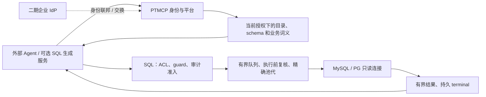

# PTMCP 开源项目核验与系统优化规划

研究开始：2026-10-29；交付：2026-10-30（Asia/Taipei）。状态：研究建议，尚未实施或替换既有 PRD/ADR。
工作记录：[DEV-20261029-mcp-landscape-research](../../tasks/work-items/DEV-20261029-mcp-landscape-research.md)。

## 1. 建议先做什么

保留 PTMCP 的 Java/JDBC、授权、SQL guard、审计与受控连接内核，吸收参考项目的局部机制。
优先完成现有 [G1～G7 网关收尾](../../tasks/work-items/DEV-20261028-gateway-completion.md)，
再用业务字典和评测证明问数质量的改善，最后决定是否引入专用 NL2SQL 服务。

具体顺序：

1. **完成身份与接入闭环**：固定 canonical MCP URI、预注册客户端、用户身份和撤销语义，取得真实客户端证据。
2. **补齐运行闭环**：密钥兼容与审计恢复、候选连接发布、版本化健康、明确取消和部署容量。
3. **改善模型拿到的上下文**：准确的三个工具说明、授权后的业务字典、口径和关系、紧凑的 schema。
4. **用同一题集选 NL2SQL 方案**：先测现有外部 Agent，再测字典、检索和示例的增益；有明确收益才增加生成服务。
5. **按真实需求扩展企业能力**：企业 IdP、Token Exchange、行列权限、新数据库沿二期契约推进。

以上与 [总体方案](../总体方案.md)、[PRD](../product/PRD.md) 保持一致：一期是权限管控型问数网关，
自然语言推理由外部 Agent 承担；支持经过验证的 MySQL/PG、库表权限和三个 MCP 工具。
企业 SSO、Token Exchange、行列权限不能因参考项目有同名功能就算一期已具备。

### 调研范围和证据边界

覆盖用户清单的 19 个条目：18 个有确切 URL 的仓库，以及未给出地址的 AgenticMCP。
外部证据以固定提交的源码、许可和官方协议为主；README 能力与作者测试数据单独标明。
不以星数、未归档、最近推送或测试文件存在推导生产成熟度。

本地开工基准为 `dev / 74e5515449c6449024a720aad38750abb8a24e13`；
整合时复核为 `fc6f27313f01ef482400e9f6f5d233d2f2361d31`，定稿时进一步核对到 `a3776d08b9950472282756768db5223efedd4a51`。
共享工作区的其他工作期间有提交，本报告不把历史缺口原样套到当前源码。
定稿时另有 OAuth、WAL/目录 owner 及前端变更继续进行；本报告不把这些未完成差异判为通过或仍未实现。
引用本地文件反映查阅时的工作树；历史测试只证明其记录的切片和环境。
本轮没有安装或执行参考仓代码，没有连接业务库、调用收费模型、运行 Maven/pnpm 或完成真实客户端联调。

## 2. 三类项目逐项核验

表中的“借鉴”是机制建议，不表示已经集成、完成安全审计或取得运行验收。

### 2.1 可控数据库连接

| 项目与固定版本 | 已核验能力和证据 | 许可 / 最近推送 UTC | PTMCP 适用判断 |
| --- | --- | --- | --- |
| [mcp-pg-db-reader](https://github.com/riefer02/mcp-pg-db-reader/tree/a6ac88761633ea3f7fd24be0a449d37a54366b06) | S：SQLAlchemy pool、sqlparse token 校验、每次事务只读、局部 statement/lock/idle timeout、max_rows+1 截断、进程内滑窗限流。[限流](https://github.com/riefer02/mcp-pg-db-reader/blob/a6ac88761633ea3f7fd24be0a449d37a54366b06/database_read.py#L71)、[执行](https://github.com/riefer02/mcp-pg-db-reader/blob/a6ac88761633ea3f7fd24be0a449d37a54366b06/database_read.py#L490) | 未识别；根目录未见 LICENSE；2026-10-08 | 可参考执行器资源约束；不是企业用户 ACL 或跨副本配额。许可待确认。 |
| [mcp-multi-db](https://github.com/mahAnuj/mcp-multi-db/tree/c8a0de62d7c936f03ff7746451d25c18e916b6ae) | R：PG/MySQL/SQLite、多连接 ID。S：PG BEGIN READ ONLY / MySQL START TRANSACTION READ ONLY，分别在同一借出连接执行。[README](https://github.com/mahAnuj/mcp-multi-db/blob/c8a0de62d7c936f03ff7746451d25c18e916b6ae/README.md#L1)、[PG](https://github.com/mahAnuj/mcp-multi-db/blob/c8a0de62d7c936f03ff7746451d25c18e916b6ae/src/adapters/postgres.ts#L89)、[MySQL](https://github.com/mahAnuj/mcp-multi-db/blob/c8a0de62d7c936f03ff7746451d25c18e916b6ae/src/adapters/mysql.ts#L79) | ISC；2026-08-30 | 可参考双方言 adapter；文本 guard 不能代替对象授权。 |
| [multi-database-mcp-server](https://github.com/HaticeGuzell/multi-database-mcp-server/tree/26caca9334748e5996cfc671dcca6902552b389c) | R：PG/MySQL、单实例单库、get_tables/query、100 行、Docker 示例只读用户。README 明确 NLP 在 AI application。[README](https://github.com/HaticeGuzell/multi-database-mcp-server/blob/26caca9334748e5996cfc671dcca6902552b389c/README.md#L1) | MIT；2026-10-07 | 未读关键执行源码，不能记为写保护动态验证通过。 |
| [mysql-readonly-mcp](https://github.com/beydemirfurkan/mysql-readonly-mcp/tree/697b67f5ed5e1907ff495a187d6820c8ef3868ba) | R：单 MySQL、schema/关系/预览/查询；README 的 MYSQL_USER 示例为 root，不能据此认定默认最小权限。[README](https://github.com/beydemirfurkan/mysql-readonly-mcp/blob/697b67f5ed5e1907ff495a187d6820c8ef3868ba/README.md#L1) | MIT；2026-06-04 | 仅候选；未核验 SQL 执行安全边界。 |
| [go-readonly-mcp-sql-db](https://github.com/shakram02/go-readonly-mcp-sql-db/tree/9a4c2c243cbf83b397675a9b9d4206e745ff5d65) | S：PG/MySQL/SQLite adapter，正则/前缀 guard、context 超时、结果截断；启动设置 session 只读，查询直接 sql.DB.QueryContext。[guard](https://github.com/shakram02/go-readonly-mcp-sql-db/blob/9a4c2c243cbf83b397675a9b9d4206e745ff5d65/validation.go#L35)、[初始化](https://github.com/shakram02/go-readonly-mcp-sql-db/blob/9a4c2c243cbf83b397675a9b9d4206e745ff5d65/server.go#L35)、[执行](https://github.com/shakram02/go-readonly-mcp-sql-db/blob/9a4c2c243cbf83b397675a9b9d4206e745ff5d65/handlers.go#L79) | 未识别；根目录未见 LICENSE；2026-03-07 | 原清单“只读事务”过强；见下方池连接疑点。许可待确认。 |
| [contextflo/postgres-mcp](https://github.com/contextflo/postgres-mcp/tree/f370d7d328bc1bb6d308563030c0aac2122e8a7e) | S：libpg-query 单语句/节点白名单，连接默认只读，每次 BEGIN READ ONLY＋SET LOCAL，cursor maxRows+1，finally ROLLBACK。[parser](https://github.com/contextflo/postgres-mcp/blob/f370d7d328bc1bb6d308563030c0aac2122e8a7e/src/safety/validate.ts#L42)、[executor](https://github.com/contextflo/postgres-mcp/blob/f370d7d328bc1bb6d308563030c0aac2122e8a7e/src/db/pool.ts#L124) | MIT；2026-09-28 | 值得参考 PG 执行链；角色检查仍是警告，非自动最小授权，更非平台/用户 ACL 交集。 |
| [db-mcp](https://github.com/neverinfamous/db-mcp/tree/bb0dd6f276d708ddc2fd7801ccddf3e557ea5f08) | R/S：标题是 SQLite MCP Server，WASM/better-sqlite3；实现 sqlite_write_query、write scope。S：OAuth 资源元数据、JWT issuer/audience 验证。[README](https://github.com/neverinfamous/db-mcp/blob/bb0dd6f276d708ddc2fd7801ccddf3e557ea5f08/README.md#L1)、[写工具](https://github.com/neverinfamous/db-mcp/blob/bb0dd6f276d708ddc2fd7801ccddf3e557ea5f08/src/adapters/sqlite/tools/core/queries.ts#L365)、[JWT](https://github.com/neverinfamous/db-mcp/blob/bb0dd6f276d708ddc2fd7801ccddf3e557ea5f08/src/auth/token-validator.ts#L103) | MIT；2026-09-29 | 是 SQLite 工具产品，不是 PG/MySQL 只读执行器。OAuth 端是受保护资源服务器；用户/机器主体取决于外部 AS，不应称自带用户 AS。 |
| AgenticMCP | 没有确切仓库 URL，身份不明，未核验。 | 未核验 | 不猜测实现或许可，暂不纳入可选型对象。 |

R 表示 README 声明，S 表示已读源码路径；本轮没有动态验证。S 仅覆盖引用路径，不扩大为全仓保证。
Go 项目在 sql.DB 上启动时设置 session 只读，不能证明池中后续每个连接皆只读；这是静态设计疑点，本轮未复现写入。

### 2.2 OAuth 与企业权限

| 项目与固定版本 | 已核验能力和证据 | 许可 / 最近推送 UTC | PTMCP 适用判断 |
| --- | --- | --- | --- |
| [mcp-zero-trust-proxy](https://github.com/AnobleSCM/mcp-zero-trust-proxy/tree/0ae5de888b549c92e845ea208dc2fcaa86534094) | S：IdP code+PKCE、userinfo 主体、email→role、方法/工具 RBAC、本地 per-client bucket；HTTP/SSE 删除用户 Authorization。[认证](https://github.com/AnobleSCM/mcp-zero-trust-proxy/blob/0ae5de888b549c92e845ea208dc2fcaa86534094/internal/auth/oauth.go#L168)、[限流](https://github.com/AnobleSCM/mcp-zero-trust-proxy/blob/0ae5de888b549c92e845ea208dc2fcaa86534094/internal/ratelimit/limiter.go#L20)、[token边界](https://github.com/AnobleSCM/mcp-zero-trust-proxy/blob/0ae5de888b549c92e845ea208dc2fcaa86534094/internal/proxy/handler.go#L79) | MIT；2026-04-25 | 可参考中间件与 token 清理；不能直接视为 PTMCP audience-bound 授权服务器。 |
| [AthenZ/mcp-oauth-proxy](https://github.com/AthenZ/mcp-oauth-proxy/tree/fa2033b175800a643aa8f4fc17616eb62718a50c) | S：S256、资源映射、授权码的客户端与回调校验、下游 token 交换。R：多 IdP、mTLS、DynamoDB/KMS 运维能力。[authorize](https://github.com/AthenZ/mcp-oauth-proxy/blob/fa2033b175800a643aa8f4fc17616eb62718a50c/src/main/java/io/athenz/mop/resource/AuthorizeResource.java#L115)、[交换](https://github.com/AthenZ/mcp-oauth-proxy/blob/fa2033b175800a643aa8f4fc17616eb62718a50c/src/main/java/io/athenz/mop/service/AuthorizerService.java#L380) | Apache-2.0；2026-09-02 | 二期 Java 联邦/资源交换参考；scope/ACL 需按本项目合同收紧。 |
| [mcp-zero](https://github.com/abwaters/mcp-zero/tree/47fdb3680b24aac6a022f1a9b93cf8ffb54896d6) | S：JWT 签名/issuer/audience 与 exp/iss/aud/sub；policy deny 优先、异常拒绝；OBO 按 server audience 交换。R：脱敏、审计、限流插件。[JWT](https://github.com/abwaters/mcp-zero/blob/47fdb3680b24aac6a022f1a9b93cf8ffb54896d6/src/mcp_zero/identity/jwt.py#L63)、[policy](https://github.com/abwaters/mcp-zero/blob/47fdb3680b24aac6a022f1a9b93cf8ffb54896d6/src/mcp_zero/governance/engine.py#L89)、[OBO](https://github.com/abwaters/mcp-zero/blob/47fdb3680b24aac6a022f1a9b93cf8ffb54896d6/src/mcp_zero/proxy/obo_auth.py#L37) | MIT；2026-10-22 | 值得参考认证/治理/转发分层；工具 ACL 不能代替 SQL 表列行 ACL。 |
| [Manoj-R-Kulkarni/mcp-oauth-proxy](https://github.com/Manoj-R-Kulkarni/mcp-oauth-proxy/tree/79dfe1ddc84a09081537b52f2054086a29b2fa6c) | S：client_credentials 获取应用 token，STDIO→HTTP 加 Bearer。[grant](https://github.com/Manoj-R-Kulkarni/mcp-oauth-proxy/blob/79dfe1ddc84a09081537b52f2054086a29b2fa6c/lib/proxy.js#L23)、[转发](https://github.com/Manoj-R-Kulkarni/mcp-oauth-proxy/blob/79dfe1ddc84a09081537b52f2054086a29b2fa6c/lib/proxy.js#L66) | MIT；2025-12-08 | 服务到服务客户端桥，不是企业用户登录/RBAC/AS。 |

**Anoble 的身份边界**：[回调](https://github.com/AnobleSCM/mcp-zero-trust-proxy/blob/0ae5de888b549c92e845ea208dc2fcaa86534094/internal/auth/oauth.go#L297)
返回上游 token；[Authenticate/userinfo](https://github.com/AnobleSCM/mcp-zero-trust-proxy/blob/0ae5de888b549c92e845ea208dc2fcaa86534094/internal/auth/oauth.go#L168)
路径缓存身份 5 分钟，不能据此证明满足 PTMCP 的资源绑定或撤销目标。
[反代](https://github.com/AnobleSCM/mcp-zero-trust-proxy/blob/0ae5de888b549c92e845ea208dc2fcaa86534094/internal/proxy/handler.go#L79)
删除 Authorization，不能将它描述为把员工 token 原样交给后端。
其 [readonly 角色](https://github.com/AnobleSCM/mcp-zero-trust-proxy/blob/0ae5de888b549c92e845ea208dc2fcaa86534094/internal/rbac/engine.go#L122)
拒绝 tools/call，并不表示允许执行 SELECT。以上只针对所读路径，不推断全仓不存在其他措施。

**AthenZ 的资源边界**：[authorize](https://github.com/AthenZ/mcp-oauth-proxy/blob/fa2033b175800a643aa8f4fc17616eb62718a50c/src/main/java/io/athenz/mop/resource/AuthorizeResource.java#L115)
要求已映射 resource；[token 入口](https://github.com/AthenZ/mcp-oauth-proxy/blob/fa2033b175800a643aa8f4fc17616eb62718a50c/src/main/java/io/athenz/mop/resource/TokenResource.java#L149)
通用检查允许缺失 resource。所读 [code 校验](https://github.com/AthenZ/mcp-oauth-proxy/blob/fa2033b175800a643aa8f4fc17616eb62718a50c/src/main/java/io/athenz/mop/service/AuthorizationCodeService.java#L199)
未比较 tokenRequestResource 与 code.resource，但实际交换使用
[authCode.getResource()](https://github.com/AthenZ/mcp-oauth-proxy/blob/fa2033b175800a643aa8f4fc17616eb62718a50c/src/main/java/io/athenz/mop/resource/TokenResource.java#L263)，
因此不能直接宣布已证实资源替换漏洞。
[AuthorizerService](https://github.com/AthenZ/mcp-oauth-proxy/blob/fa2033b175800a643aa8f4fc17616eb62718a50c/src/main/java/io/athenz/mop/service/AuthorizerService.java#L346)
按资源配置交换 token，scope/ACL 还需按本项目合同收紧。

### 2.3 NL2SQL / 问数

| 项目与固定源码 | 核验结果及清单纠偏 | 对 PTMCP 的取舍 |
| --- | --- | --- |
| [text2sql-mcp](https://github.com/cpenniman12/text2sql-mcp/blob/97142b44e95e09a11a02dad2492b8468958fca5c/README.md) | MIT；Python MCP 包装 text2sql-framework，探索、执行和修复由框架承担，多数据库依赖不同 extras。[入口](https://github.com/cpenniman12/text2sql-mcp/blob/97142b44e95e09a11a02dad2492b8468958fca5c/text2sql_mcp/server.py#L40-L86) 直接接收数据库 URL 并执行 `ask`。 | 借鉴探索/修复和调用次数统计。PoC 需将 schema 与执行接缝改为 PTMCP，不能给它另一套直连凭据。 |
| [NL2SQL](https://github.com/noah-collins1/NL2SQL/blob/e9d5fbf9509c3d7fb4dc155f5906768c6f392881/README.md) | TS + Python + Ollama/pgvector，主要面向 PG；检索、schema linker、join planner 和修复值得研究。README 也包含写入/管理及 checkpoint 能力。作者自报 500 题、2,377 表上的 92% SQL / 86.6% overall，非本轮复测或 PTMCP 准确率。README 写 ISC，但根目录未见 LICENSE，GitHub 未识别许可。 | 优先借鉴大 schema 召回与歧义题评测；复用源码前明确许可，保留双引擎和只读边界。 |
| [nlqueries](https://github.com/nlqueries/nlqueries/blob/e3e681a5753fa0b1e76ce39e73228008da585276/README.md) | 确有引擎、MCP、知识库和评测能力；[认证文档](https://github.com/nlqueries/nlqueries/blob/e3e681a5753fa0b1e76ce39e73228008da585276/docs/mcp-authentication.md) 有 OIDC、静态主体及 agent/action grants，并非只有共享全权 token。它的授权模型不能直接等同平台与用户的表 ACL 交集。 | 借鉴知识库、反馈、SQL 复用与授权测试设计；当前 BSL 1.1 有使用限制，部署引入需先核许可和执行边界。 |
| [nlp2sql](https://github.com/luiscarbonel1991/nlp2sql/blob/5790899d44dd4d0e4df0df951353ada34bc83090/README.md) | MIT；当前 README 重点是 DSL-first PG/Redshift 与显式业务语义。确有 [MCP 入口](https://github.com/luiscarbonel1991/nlp2sql/blob/5790899d44dd4d0e4df0df951353ada34bc83090/mcp_server/server.py#L185-L336)，`execute=false` 可只返回生成结果，但初始化仍传数据库 URL，并不是现成的无直连 PTMCP 适配器。“1000+表”不能作为本轮规模实测。 | 适合研究指标/维度/标准表/规则和生成、执行分离；作为可选生成 PoC 候选，先替换 schema 获取和执行口。 |
| [Text2Sql.Net](https://github.com/shuyu-labs/Text2Sql.Net/blob/6cf9d903c5c4bd14ee66a38447f1d0ed446ed1a2/README.md) | Apache-2.0；.NET/SemanticKernel、向量 schema、人工 QA 示例和多数据库。MCP 配置示例使用 `/mcp/sse`，不能据此声称已符合本项目锁定的 Streamable HTTP 接入。 | 借鉴经过审核的问答示例和检索；当前没有迁入另一套 .NET 执行服务的必要。 |
| [focus_mcp_sql](https://github.com/FocusSearch/focus_mcp_sql/blob/6a7f1ef61dedab9eb85741d30cbe3ccd6847b11d/README_CN.md) | Apache-2.0；中文关键词→SQL 两步流程；要求 Datafocus bearer。[客户端](https://github.com/FocusSearch/focus_mcp_sql/blob/6a7f1ef61dedab9eb85741d30cbe3ccd6847b11d/src/main/java/datafocus/ai/mcp/util/FocusGptClient.java#L16-L39) 直接调用 Datafocus 云接口，仓库并非完整本地推理引擎；JDK23+ 也不同于本项目 Java21。 | 借鉴生成 SQL 前确认指标、维度和过滤条件的交互。完全本地部署时不作为直接集成候选，本轮未调用其服务。 |
| [sql-cortex-mcp](https://github.com/loglux/sql-cortex-mcp/blob/e3e97fe548aaa5e985d2b94600699f1db8df4dd7/README.md) | 有多源、管理 UI 和只读策略，同时列出 `db.apply`、`db.migrate`、`db.migrate.plan_apply` 等写入/DDL 工具。README 有 MIT badge，但根目录未见许可证文件，GitHub 未识别许可。 | 借鉴多源状态和工具组织方式；不迁入写工具、会话选库状态或另一套安全执行链。 |

**nlqueries 许可补充**：[实际 LICENSE](https://github.com/nlqueries/nlqueries/blob/e3e681a5753fa0b1e76ce39e73228008da585276/LICENSE)
写明 BSL 1.1，额外授权限制向第三方提供托管/管理式服务，Change Date 为 2030-06-04、Change License 为 Apache-2.0。
应按计划的部署方式核实适用条款，不能把当前版本直接按 MIT/Apache 使用。

**维护状态补充**：上述七仓核验时均未归档；最后推送日期（UTC）依次为
2026-08-02、2026-04-16、2026-10-29、2026-10-22、2025-11-08、2025-04-14、2026-05-01。
日期来自各仓 GitHub 元数据，只表示仓库活动，不表示对应版本经过发布、安全或双引擎验证。

### 2.4 优先阅读和吸收的对象

- 连接执行：先看 contextflo/postgres-mcp 的 PG 执行链和 mcp-multi-db 的双方言事务结构；pg-db-reader 补充时间/输出预算设计，许可确认前只参考机制。
- 身份治理：先看 mcp-zero 的 JWT、Deny 和转发分层；AthenZ 留作二期资源映射/交换研究。现有 PTMCP 的安全裁决继续保留。
- 问数质量：先看 nlp2sql 的显式业务语义、NL2SQL 的大 schema 召回/歧义评测、nlqueries 的知识库与反馈。先在 PTMCP 字典和外部 Agent 上验证这些机制，再选生成服务。

这个顺序是适配本项目的阅读/借鉴优先级，不是开源项目成熟度排名。证据和约束见上表。

## 3. 清单里最容易混淆的能力

| 标签 | 选型时应追问的实际边界 | PTMCP 应保留的合同 |
| --- | --- | --- |
| 只读 | 是提示词、关键词校验、AST、只读事务还是数据库账号？是否仍暴露写入工具/危险函数？ | 已批准 SQL 计划、未知语法拒绝、库表授权、只读事务/账号和受控执行共同成立 |
| 限流 | 限工具调用、用户、服务账号还是进程？是否包括排队、并发和数据库连接？ | 分开控制调用速率、执行并发、队列、物理连接、时间和输出；明确每副本/全部署语义 |
| OAuth / RBAC | 认证的是员工还是代理服务？token 发给哪个 resource？工具权限能否限制表？ | 受信主体→本地用户/平台→当前 ACL 交集；代理身份不能替代终端用户 |
| 多数据库 | 只是驱动能连，还是已验证 TLS、SQL 方言、取消、清理、宽行和失败路径？ | 只宣传完成对应拒绝/故障矩阵的数据库组合 |
| 自修复 | 会否重放已发送、结果未知的 SQL？尝试是否有总预算？ | 已发送 SQL 不自动重放；新的候选 SQL 经新一轮 guard、授权和审计 |
| 准确率 | 数据集、口径、模型、拒答题、权限题、数据泄漏和修复次数是什么？ | 固定合成题集按结果与业务口径评估，不移植作者自报数字 |
| 缓存 | 缓存 SQL、schema 还是结果？缓存命中后是否重新核权？ | 结构/语义版本可复用；当前授权和执行准入每次重新成立 |

例如 nlqueries 文档明确其网络限流/并发计数在进程内，多副本会放大额度；
静态 token 的调用共享同一个主体。这些机制对小规模部署有用，但需要部署语义，
不能仅看到“限流”就得出跨副本隔离结论。
见其 [限额说明](https://github.com/nlqueries/nlqueries/blob/e3e681a5753fa0b1e76ce39e73228008da585276/docs/mcp-authentication.md#limits)。

## 4. 对照当前 PTMCP：保留已有成果，续接真实缺口

| 主题 | 查阅时已存在的事实 | 本次优化应承接什么 |
| --- | --- | --- |
| SQL 与授权准入 | [McpToolService](../../ptmcp-parent/ptmcp-gateway/src/main/java/local/ptmcp/gateway/mcp/McpToolService.java) 先 guard，排队后和 JDBC 前复核主体、权限与版本，并确认 START；已有 MySQL/PG 只读执行器 | 保持这条唯一执行链，补组合故障证据，不再另搭数据库 MCP 代替它 |
| TLS、代际与目标隔离 | [T15-c](../../tasks/work-items/T15-c.md) 记录 S1～S3 和 S4 目标隔离的实现及历史双引擎证据；统一 [PhysicalConnectionFactory](../../ptmcp-parent/ptmcp-datasource/src/main/java/local/ptmcp/datasource/connection/PhysicalConnectionFactory.java) 已存在 | 10/27 研究中的管理连接/TLS、旧池绑定、出队复核问题已有后续修复，不重复立项；S4 完整候选生命周期仍待完成 |
| OAuth | [TokenRequestPolicy](../../ptmcp-parent/ptmcp-authz/src/main/java/local/ptmcp/authz/oauth/TokenRequestPolicy.java) 已校验 resource；[授权服务](../../ptmcp-parent/ptmcp-authz/src/main/java/local/ptmcp/authz/oauth/PtmcpOAuth2AuthorizationService.java) 已出现 access JWT 撤族路径；现有工作项仍在收尾 | 以最新源码和实际回归重新判定完成度；不把旧核查的资源不一致/access revoke 缺口继续写成完全未实现 |
| HTTP 协议入口 | [Controller](../../ptmcp-parent/ptmcp-gateway/src/main/java/local/ptmcp/gateway/mcp/McpToolController.java) 处理认证后的 POST 和消息体上限；查阅主代码未找到 MCP Origin/协议版本校验及取消通知接线 | 按锁定协议补边界与 HTTP 反例，和真实客户端一起验；不把管理会话的 same-origin 检查当作 MCP 检查 |
| 审计恢复 | [配置](../../ptmcp-parent/ptmcp-gateway/src/main/java/local/ptmcp/gateway/mcp/McpGatewayConfiguration.java) 已装配 TerminalWal/KeyProvider；定稿时 [WalReplayer](../../ptmcp-parent/ptmcp-persistence/src/main/java/local/ptmcp/persistence/audit/wal/WalReplayer.java) 和 TerminalWal 已接入 [WalDirectoryOwner](../../ptmcp-parent/ptmcp-persistence/src/main/java/local/ptmcp/persistence/audit/wal/WalDirectoryOwner.java) 与 replayClosed；所查 gateway 配置未见运行时回放调度 | G2 复核新 owner/关闭段原语及故障证据，补生产调度、幂等和 UNKNOWN 收敛；不重复开发已新增原语，也不据其存在宣布组合通过 |
| 候选和健康 | [DatasourceAdminService](../../ptmcp-parent/ptmcp-admin/src/main/java/local/ptmcp/admin/datasource/DatasourceAdminService.java) 有 DraftTarget/草稿测试；update 仍走 active 更新路径，返回 health 为固定 UNKNOWN | G3 建 candidate→probe→CAS publish；健康记录绑定目标、配置/策略版本与时间 |
| 容量和取消 | [配置](../../ptmcp-parent/ptmcp-gateway/src/main/java/local/ptmcp/gateway/mcp/McpGatewayConfiguration.java) 装配 InMemoryQuotaLimiter；执行时新建 ReadOnlyCancellation，尚未见与请求 owner 的取消注册接线 | G4 补主体隔离、清理完成后归还额度、部署容量合同；底层有取消对象不等于客户端已可取消 |
| 凭据 | [连接侧 CredentialCipher](../../ptmcp-parent/ptmcp-datasource/src/main/java/local/ptmcp/datasource/connection/CredentialCipher.java) 使用单一 AES-GCM key，storedKeyId 只匹配当前钥，未见 AAD 对象绑定；管理侧另有一份实现 | G5 统一有版本的 envelope/keyring、对象绑定与兼容迁移，验证旧凭据和 WAL 仍可读 |
| 语义上下文 | [MetadataCatalogService](../../ptmcp-parent/ptmcp-admin/src/main/java/local/ptmcp/admin/metadata/MetadataCatalogService.java) 已有业务字典 CRUD；网关 schema 主要输出物理注释；工具 description 为空 | G6 将已维护字典接到授权后的上下文，补描述/预算；外键目标 READ 过滤和 foreignKeysRestricted 已有，不重复写为缺失 |

这份表是静态核查与已有工作项的对照，不是本轮运行时通过证明。
[T15-c](../../tasks/work-items/T15-c.md) 的历史 746 项通过、OAuth 资源切片的历史定向通过，
都不能覆盖新代码、真实客户端、多副本和本轮未运行的故障矩阵。

## 5. 推荐的系统形态

外部 Agent 只持 MCP 用户凭证，工具只引用已登记的数据源，不携带任意 DB URL、数据库密码或驱动属性。
若引入生成服务，它同样使用经过授权的上下文和 PTMCP 执行工具；身份与平台必须贯穿每次调用。
模型输出是待验证输入，业务字典/注释也是数据，不能变成越过 guard 的执行指令。

企业 IdP 负责证明身份；本地账号状态、平台 Scope、Deny 与有效 READ 继续由 PTMCP 裁决。
不接受客户端自报的用户名/组 Header 作为授权事实。代理若删除 Authorization，
需要明确的受信身份桥接合同，不能因此让所有员工合并为一个后端服务主体。

### 协议基线与企业授权

当前按 MCP **2025-06-18** 验证，不因为参考仓使用更晚 SDK 或协议 badge 就升级基线：

- [Authorization](https://modelcontextprotocol.io/specification/2025-06-18/basic/authorization)：受保护资源发现、canonical resource、token audience、PKCE、精确 redirect 与禁止 token passthrough。DCR 是 SHOULD，预注册是可采用路径，客户端能力仍需实测。
- [Transports](https://modelcontextprotocol.io/specification/2025-06-18/basic/transports)：校验 Origin；initialize 后按协商版本处理 MCP-Protocol-Version，不支持的版本返回 400，缺失版本按该版兼容规则处理。HTTP 断开不表示明确取消，应处理取消通知或服务端 deadline；无 GET SSE 支持时可返回 405。
- [Tools](https://modelcontextprotocol.io/specification/2025-06-18/server/tools)：工具应有准确描述；可给只读工具真实的 annotations，但 annotations 是提示，不能承担安全校验。
- [Enterprise-Managed Authorization](https://modelcontextprotocol.io/extensions/auth/enterprise-managed-authorization)：当前官方扩展通过企业身份与 ID-JAG/交换衔接 MCP AS，需要客户端、IdP、AS 协同支持。按二期能力独立评估，不默认任一 OAuth 代理都实现该扩展，也不直接改动当前协议基线。

## 6. 按现有工作项推进的优化切片

以单副本、一期双引擎和现有三个工具为默认推进范围。以下是建议完成门，未运行的验收保持待验证。
每片按既有开发流程实现、定向验证和评审，再推进下一片；本报告没有建立一套替代任务状态。

| 优先级 / 依赖 | 承接与主要范围 | 可审查交付与完成门 |
| --- | --- | --- |
| P0：身份与 HTTP 闭环 | G1 后续，T13/T14/T19；authz、gateway filter/controller、认证合同 | 先锁最新实现，补 resource/iss/aud、错误/重复 resource、PKCE/redirect、刷新重放、本人/他人撤销、停用/改密/角色变化、Origin/版本反例。锁定一个真实目标客户端完成发现→授权→调用→续期→撤销，再扩客户端矩阵。 |
| P0：密钥兼容与审计恢复 | G5 的读取兼容先明确，再接 G2；现有 CredentialCipher、TerminalWal、WalReplayer、装配和运维合同 | 新写使用当前 key，历史 key 受控只读；envelope 标记格式/对象用途，迁移可恢复。唯一目录 owner，仅回放已关闭段；主库 terminal 幂等，损坏段告警隔离；未知执行结局不能猜成成功，恢复只补审计、不重跑 SQL。 |
| P1：候选发布与健康 | G3 / T15-c S4；admin datasources、store/迁移、连接 profile、API、前端合同 | candidate 独立保存；探测绑定候选指纹/凭据与策略版本；成功后 CAS 发布，配置变化使旧探测失效；失败保留 active。换物理目标继续执行既有身份退役/撤权事务，同目标轮密不误继承为新目标。健康含 checkedAt/版本/脱敏原因和过期规则。 |
| P1：取消与容量；多副本前为 P0 | G4 / T15-c S5；gateway request owner、quota、datasource executor | 主体+平台+请求 ID 绑定取消；明确取消/deadline 触发驱动取消、回滚/清理，结束后才还额度，失败淘汰。先证明单副本上界；扩多副本前固定部署预算、租约失联语义和故障矩阵。 |
| P1：授权后的问数上下文 | G6 / T15-c S7；McpToolService、字典、工具 JSON/文档与缓存合同 | 三工具说明准确，字典/单位/口径和关系只在允许范围输出；先过滤再检索/裁剪，有来源和字节预算、撤权失效。恶意注释、超长字典、隐藏对象/关系、同名表必须有反例。 |
| 组合完成门 | G7 / T19-e/T20；现有后端/前端门禁与证据 | 双引擎真实连接/取消/宽行/TLS/故障、OAuth 客户端、恢复、权限时效、接口与前端真实状态组合验收。历史通过、自审、独立评审、人工接受和发布分别记。 |
| P2：可选生成增强 | 上述受控链与上下文稳定后，在独立合成 PoC 中比较 | baseline→字典→检索→审核示例→候选生成器逐步 A/B；达到第 7 节的准入条件再决定引入。不得把生成服务直连库作为捷径。 |
| P2：企业化与扩引擎 | 二期 PRD/ADR 切片 | IdP 主体映射/交换、组变更和撤销、行列规则、新引擎均各自锁契约、威胁边界与验收；不在本次研究中宣告支持。 |

### 容量要落实到物理数据库

[PRD](../product/PRD.md) 明确源并发 8、gateway 并发 16 等是每副本限制。
当前进程内计数不能据此宣称全部署用户/数据源限额；若要改为全部署语义，需同步合同与测试。

为每个物理 DB 建立连接预算：
**各副本、各源、各代际池的最大连接数之和 + 管理探测/同步保留量 ≤ DB 分配上限**。
排空中的旧池和候选探测仍计入；查询并发与池连接数分开计算。
先在单副本证明上界，再选静态分配或集中租约实现多副本，不为增加 Redis 组件而引入新依赖。
租约失联不能把未确认终止的 DB 任务当作已释放；容量不可确认时拒绝新准入。

代表性反例：取消与正常完成竞态只释放一次；他人取消不影响任务；
HTTP 断开与明确取消语义不同；清理失败/旧池排空仍占预算；
双副本同时排队、租约服务不可达、版本切换时均不超发或重放 SQL。

### 上下文先做小而准确

第一片复用已有业务字典，优先覆盖业务含义、单位、时间/状态口径与常用关系，不先扩一套语义平台。
目录保留 DISCOVER/HIDE 合同，列和关系按对应 READ 规则过滤；
既有外键过滤继续沿用，新增词义和搜索结果不能泄露被隐藏对象。

物理结构可按快照缓存，业务词义可按语义版本缓存，但返回前重新应用当前主体/平台权限。
缓存内容不得延长权威权限确认窗口；若缓存用户可见片段，key 和失效必须包含有效权限及相关版本。
模型仅收到预算内的候选表/列、必要关系和审核示例；原始样例数据、动态枚举另走正常授权/guard/审计路径。

工具描述应说明调用顺序、所需标识、方言、范围与行数上界、稳定错误和重试条件。
优先补齐目前空的 description；只读提示可以加，但不自动声称幂等。
禁止将字典或数据库注释提升为系统指令，恶意文本和截断策略纳入测试。

## 7. 怎样验证“问数更好”

先建立小而可复现的合成制造/ERP题集，再比较服务。建议首轮约 60 题，覆盖以下类别，
并保留训练示例、调参题和独立测试题的分离：

| 类别 | 代表性问题/陷阱 | 判断什么 |
| --- | --- | --- |
| 定位与关联 | 同名表、跨业务域、需要两三表 JOIN | 候选召回、必要关系、结果粒度 |
| 指标口径 | 含税/未税、件/箱、退货、状态、分母为零 | 指标定义、单位与过滤条件正确 |
| 时间 | 自然月/滚动月、时区、日期边界 | 边界数据的执行结果正确 |
| 歧义与不可回答 | “产量”有多个定义、库里没有对应指标 | 正确澄清或拒答，不编造口径 |
| 权限与恶意内容 | 可发现但不可读、撤权、隐藏关联表、注释注入 | 越权披露和执行为零；拒绝前无业务连接 |
| 故障与预算 | 超时、截断、语法错误、结果未知 | 失败解释正确、修复有界、不自动重放 |

比较五档：A 现有 Agent+三工具；B 准确描述+业务字典；C 授权后的 schema 检索；
D 审核过的 few-shot；E 专用生成器。固定模型/版本、提示、采样参数、数据快照、用户/平台、权限和调用预算，
同时记录冷/热缓存，不把换模型带来的变化归因于连接层。

核心指标是结果及业务口径正确率、可回答题首答成功率、歧义题澄清/拒答正确率、越权数、
修复次数、工具调用数、上下文字节/估算 token、端到端 P50/P95 和实际费用。
不以 SQL 字符串相同代替结果正确，不把失败后多次尝试只计作一次成功。
每个新 SQL 都独立授权、guard 和审计，用关联 ID 追踪一轮问数；只记录合成数据或受控脱敏证据。

**生成服务准入建议**：独立测试题上的结果/口径正确率有稳定收益；权限反例零绕过；
延迟、成本和运维负担可解释；所有执行仅经 PTMCP；修复有总次数/时间/费用预算；
可退回外部 Agent 路径且不影响权限与审计。
没有收益就保留较轻的方案。本轮尚未运行这组实验，不能给出准确率提升幅度。

网关本身仍按既有 PRD 验收：撤销对新查询最大 5 秒；
首次管理员在具备只读账号/网络的前提下 10 分钟完成配置；
2C4G、50 客户端、SQL≤4KiB、热权限缓存条件下非 DB 内部 P95<50ms，排队等待单列。
这些是目标，不是当前实测成绩；解析、授权与审计准入不能从开销中扣除。

## 8. 本轮交付、未验证项与后续入口

本轮交付为项目核验和优化规划，不改变业务源码、产品边界或既有架构决策。
详细命令结果与文档自审在 [研究工作项](../../tasks/work-items/DEV-20261029-mcp-landscape-research.md)；
研究自审不能代替后续安全变更的独立评审。

仍待实际取得的证据：参考仓运行行为与安全测试、目标客户端及版本兼容、
双引擎完整故障/取消/宽行矩阵、WAL 恢复和密钥轮换、跨副本预算、合成问数评测、
管理员流程计时和指定条件性能测试。许可有疑问的项目先澄清再复用代码。
AgenticMCP 未能唯一定位，保持未核验。

下一实施入口仍是 [网关收尾](../../tasks/work-items/DEV-20261028-gateway-completion.md) 和
[T15-c](../../tasks/work-items/T15-c.md)；本报告提供取舍和验收建议，不把它们的 pending 项改为完成。
