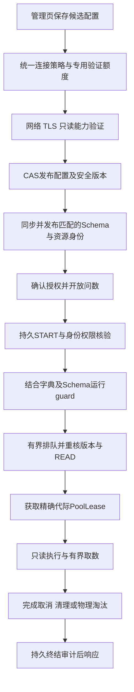

# PTMCP 数据库连接与问数接入完善方案

研究日期：2026-10-27（Asia/Taipei）。状态：源码研究与实施建议，**尚未实施或纳入替代架构基线**。
任务与验证：[DEV-20261027-datasource-connection-research](../../tasks/work-items/DEV-20261027-datasource-connection-research.md)。

## 1. 结论与实际版本

建议继续使用 PTMCP 自己的 Java/JDBC/Hikari、guard、授权与审计链，完善“数据源配置→验证→发布→执行→回收”的完整生命周期。
universal-db-mcp 最值得吸收的是元数据和问数上下文的产品思路；直接引入它作为执行代理，会形成另一套连接、凭据与权限模型。
眼下最优先的问题不是增加驱动数量，而是**同一连接策略能否贯穿管理与执行、旧授权是否始终绑定正确的物理目标、故障与轮换是否可控**。

| 基线 | 本次实际获取结果 | 处理方式 |
| --- | --- | --- |
| 本地 dev / Codeup dev | `8afb59c6e9c017af588f7f3b07f3b5cfad5492d7`，fetch 后左右差异 `0/0` | 保持当前分支和未提交修改 |
| Codeup xquan/feat-backend | `b64777c49c6748d1656691b19a2b9f9bd10d5e68`，提交时间 2026-10-27 20:34:50 +08:00，比 dev 新增 150 个提交 | 通过 git archive 导出至忽略目录 `.local/research/ptmcp-b64777c/`，对照最新实现，没有合并 |
| GitHub origin | 没有 dev 分支；main 为 `7315b2b53c92a4d5512fb8469ea8bd5ec6f76c48` | 不用不存在的 origin/dev 判断进度 |
| universal-db-mcp main | `dc338cd7740c277c04722743b97eb1681e409016`，提交时间 2026-03-17 16:34:55 +08:00，package 2.14.0，MIT | 实际浅克隆至 `.local/research/universal-db-mcp/`；SHA 与远端 HEAD 一致 |

本项目最新分支增加了界面、审计等变化；本报告涉及的管理连接工厂、数据源存储、池注册表与快照读取核心没有对应修复。
例如 `DatasourceConnectionFactory.java` 的当前文件与新分支 blob 均为 `b0cb0e6418345efb90564e4a5f23c3a4c05bab43`，
`PublishedSnapshotReader.java` 均为 `bb4918312109e91bd20e9c3194845e8f8ae0cee4`。
下文项目链接指向当前工作树，行号以说明中的对应版本为准；参考仓全部使用固定 SHA 链接。

本轮未安装参考仓依赖、未执行参考仓脚本或测试、未连接业务数据库，也未重跑项目数据库测试。
“源码存在”“历史切片报告通过”“本轮运行通过”分别表述；静态风险不能当作已经复现的攻击或事故。

## 2. PTMCP 已具备什么

当前项目不是只有数据库框架。已经存在以下实际实现，应在其上续做：

- 管理侧有数据源 CRUD、凭据只写不读、If-Match、幂等连接测试与同步 Job；见 [T15-b](../../tasks/work-items/T15-b.md)。
- 网关先持久 START，再调用 guard，取得执行额度后激活池并通过 approved-plan adapter 执行。
  最新 `McpToolService.java` 对应行 218、270、282、288～303；[当前源码](../../ptmcp-parent/ptmcp-gateway/src/main/java/local/ptmcp/gateway/mcp/McpToolService.java)。
- MySQL/PG 均有只读事务、超时、清理与淘汰路径；超时连接不复用的理由有实际切片证据，见 [T10-a](../../tasks/work-items/T10-a.md)、[T11-a](../../tasks/work-items/T11-a.md)。
- 网关生产装配已经使用 [PinnedTlsPoolFactory](../../ptmcp-parent/ptmcp-datasource/src/main/java/local/ptmcp/datasource/connection/PinnedTlsPoolFactory.java)，按引擎分派目标固定与完整 TLS 校验；不能因为旧 `HikariPoolFactory` 使用 REQUIRED，就误报网关生产入口仍只有 REQUIRED。
- 元数据已有批量采集、staging/发布、对象 generation、外键、注释与独立业务字典；[采集器](../../ptmcp-parent/ptmcp-datasource/src/main/java/local/ptmcp/datasource/metadata/MysqlMetadataCollector.java)、[字典服务](../../ptmcp-parent/ptmcp-admin/src/main/java/local/ptmcp/admin/metadata/MetadataCatalogService.java)。

这些实现还不等于整体生产验收。例如 [T19-b](../../tasks/work-items/T19-b.md) 明确：PG 问数链路使用测试专用非 TLS 工厂，PG 生产证书链/主机名校验与部分拒绝矩阵仍未验收。
较新的分支有真实栈验证记录，也不能把一个链路成功扩大成所有双引擎故障矩阵通过。

## 3. 参考项目：采纳机制与边界

| 主题 | 最新参考源码的实际行为 | PTMCP 的采用方式 |
| --- | --- | --- |
| 连接池与保活 | MySQL/PG 每 adapter 一个池，最大 3，配置 TCP keepalive，首次 SELECT 1；[MySQL](https://github.com/Anarkh-Lee/universal-db-mcp/blob/dc338cd7740c277c04722743b97eb1681e409016/src/adapters/mysql.ts#L67-L102)、[PG](https://github.com/Anarkh-Lee/universal-db-mcp/blob/dc338cd7740c277c04722743b97eb1681e409016/src/adapters/postgres.ts#L70-L102) | 保留现有按 dataSourceId/代际复用的 Hikari 池；按部署预算配置，不照抄 3 或保活时间 |
| 自动重试 | 连接类错误命中正则后重试一次，直接包住 SQL 执行；[MySQL](https://github.com/Anarkh-Lee/universal-db-mcp/blob/dc338cd7740c277c04722743b97eb1681e409016/src/adapters/mysql.ts#L45-L61)、[执行位置](https://github.com/Anarkh-Lee/universal-db-mcp/blob/dc338cd7740c277c04722743b97eb1681e409016/src/adapters/mysql.ts#L108-L143) | SQL 未发送前可有界恢复；已发送/结局未知的 SQL 不自动重放 |
| HTTP 连接 | 每次 connect 建立 adapter 和 service；session 存完整 config；[连接管理](https://github.com/Anarkh-Lee/universal-db-mcp/blob/dc338cd7740c277c04722743b97eb1681e409016/src/core/connection-manager.ts#L24-L74) | 不改为每用户会话建池；用户隔离由执行授权实现。100 会话×每池上限 3=理论 300 连接，仅是配置推导 |
| TLS 与执行合同 | 所审 MySQL/PG 连接构建没有 TLS/CA 参数；adapter 只有 connect/disconnect/query/schema 等方法，缺少取消与输出预算合同；[接口](https://github.com/Anarkh-Lee/universal-db-mcp/blob/dc338cd7740c277c04722743b97eb1681e409016/src/types/adapter.ts#L6-L38) | 不替代现有 pinned TLS、只读事务与有界输出实现；此结论不否认驱动可能有自身默认超时 |
| 安全与凭据 | SQL 安全主要识别首个写关键词，未知返回 null；SSE URL 可传 password；MCP 验证前打印 SQL 前 100 字符；[安全代码](https://github.com/Anarkh-Lee/universal-db-mcp/blob/dc338cd7740c277c04722743b97eb1681e409016/src/utils/safety.ts#L11-L120)、[SSE](https://github.com/Anarkh-Lee/universal-db-mcp/blob/dc338cd7740c277c04722743b97eb1681e409016/src/http/routes/mcp-sse.ts#L46-L62)、[SQL日志](https://github.com/Anarkh-Lee/universal-db-mcp/blob/dc338cd7740c277c04722743b97eb1681e409016/src/mcp/mcp-server.ts#L383-L388) | 不吸收写权限切换、URL 传密或原 SQL 日志；MCP 继续只引用已登记数据源 |
| 批量元数据 | MySQL/PG 批量抓列、索引、外键等；[MySQL](https://github.com/Anarkh-Lee/universal-db-mcp/blob/dc338cd7740c277c04722743b97eb1681e409016/src/adapters/mysql.ts#L171-L248)、[PG](https://github.com/Anarkh-Lee/universal-db-mcp/blob/dc338cd7740c277c04722743b97eb1681e409016/src/adapters/postgres.ts#L161-L291) | PTMCP 已有批量基础；增加规模证据、阶段统计与分页/内存上界，不重写一套采集器 |
| 关系与语义 | 区分显式 FK 与命名推断关系，记录 source/confidence；[增强器](https://github.com/Anarkh-Lee/universal-db-mcp/blob/dc338cd7740c277c04722743b97eb1681e409016/src/utils/schema-enhancer.ts#L24-L78) | 吸收关系提示；推断先进入管理员候选区，双方对象均授权后才可披露，不能自动建立授权 |
| 枚举与样例 | enum 默认 50/上限 100；sample 默认 3/上限 10，默认全部列，取回后按格式脱敏；直接调 adapter；[enum/sample](https://github.com/Anarkh-Lee/universal-db-mcp/blob/dc338cd7740c277c04722743b97eb1681e409016/src/core/database-service.ts#L326-L456) | 优先使用已维护的字典。动态枚举需经过正常 guard/READ/审计/预算；样例推迟，不能把格式脱敏当列权限 |
| 缓存 | 每 service 一个 schemaCache，TTL/命中统计可见，没有用户、ACL 和版本组合键；[缓存](https://github.com/Anarkh-Lee/universal-db-mcp/blob/dc338cd7740c277c04722743b97eb1681e409016/src/core/database-service.ts#L46-L142) | 借鉴诊断信息；结构缓存按快照版本，用户可见性每次重新约束 |

参考仓确有 17 种适配类型，但这不证明每种都满足 PTMCP 的安全语义。
其 [connection-stability 单测](https://github.com/Anarkh-Lee/universal-db-mcp/blob/dc338cd7740c277c04722743b97eb1681e409016/tests/unit/connection-stability.test.ts#L16-L87) 有复制正则/重试逻辑与配置对象自测的写法，本次没有运行，不能当作真实断链恢复证据。
采纳的是机制与需求，不复制这些验证方式，也不采用 README 的性能倍率承诺。

## 4. 按项目源码定位的改进清单

### 4.1 P0：统一管理测试、同步和业务执行的物理连接策略

**事实**：[管理连接工厂](../../ptmcp-parent/ptmcp-admin/src/main/java/local/ptmcp/admin/datasource/DatasourceConnectionFactory.java) 行 54～97 先校验 DNS/CIDR，再由 DriverManager 对 hostname 建连；没有复用网关的 socket 固定。
网关 [PinnedDriverDataSource](../../ptmcp-parent/ptmcp-datasource/src/main/java/local/ptmcp/datasource/connection/PinnedDriverDataSource.java) 行 40～47 则在实际建连线程重新解析、校验并绑定目标。
管理侧只收一个 truststorePath，在 MySQL 分支作为 Java truststore，在 PG 分支作为 PEM rootcert 使用；网关有分别配置。
两份 DestinationPolicy 主要校验 CIDR 与端口范围，未表达每源批准端口集合。

**影响推断**：可能出现“测试成功但执行失败”、证书格式/信任链不一致以及管理探测 DNS 校验与连接之间的时间差。
本轮未执行 DNS 重绑定实验，不声称已绕过目的地控制。

**具体变更**：在现有 datasource/connection 内新增受控 `ConnectionProfile` 与统一物理连接工厂；
管理 TEST/SYNC 和网关池都调用它。MySQL 与 PG 独立 trust policy，使用服务器配置的 policyId/version，不能由模型提交文件路径或任意属性。
目标约束为批准的 CIDR、端口、引擎和 hostname；固定 IP 时保留原 hostname 供 TLS 身份验证，不把 TLS 主机名改成 IP。
保留不同操作的超时与用途预算，避免统一工厂变成所有操作共用一个无限池。
移除每次请求修改全局 `DriverManager.setLoginTimeout` 的做法；关闭候选连接时只释放本次资产。

**验收**：管理测试/同步/网关各自覆盖受信证书成功、错 CA、过期证书、错 hostname、混合 A/AAAA 越界、DNS 切换、端口未批准；失败不降级、不返回驱动原文。
PG 的生产 TLS 夹具续接 T19-b，而不是重新宣称支持已完成。

### 4.2 P0：候选配置验证成功后发布，并绑定快照与物理身份

**事实**：[DatasourceAdminService](../../ptmcp-parent/ptmcp-admin/src/main/java/local/ptmcp/admin/datasource/DatasourceAdminService.java) 行 72～94 校验并直接保存；
[DatasourceStore.update](../../ptmcp-parent/ptmcp-admin/src/main/java/local/ptmcp/admin/datasource/DatasourceStore.java) 行 244～281 直接替换 host/database/credential、递增 configVersion，未清空 active_snapshot_id。
创建/修改允许提交 ACTIVE，没有把通过连接测试设为服务端发布前置。
测试草稿不会覆盖旧密文，这是已有正确行为；问题在实际保存与发布路径。

**另一处实际不一致**：[PublishedSnapshotReader](../../ptmcp-parent/ptmcp-persistence/src/main/java/local/ptmcp/persistence/schema/PublishedSnapshotReader.java) 行 258～299 读取当前 datasource 配置，再仅校验快照 PUBLISHED/expiry，未比较快照 config_version 与当前配置。
管理侧 [SchemaSnapshotStore.requireUsableActiveSnapshot](../../ptmcp-parent/ptmcp-persistence/src/main/java/local/ptmcp/persistence/schema/SchemaSnapshotStore.java) 行 583～595 已做此比较。
因此两个入口对“同一配置是否有可用快照”的判定不同。

**高优先反例**：源 A 已发布快照并授予 orders READ，随后把 host/database 改为结构同名的 B。
必须在借业务连接前拒绝 A 的旧快照/授权，不能拿旧对象身份去解释新目标。
目前源码缺少上述联合核验；这是需要补真实双库测试的安全风险，不是本轮已复现的泄露。

**最小修复切片**：两入口使用一致的快照合法性判定，校验 sourceId、配置版本、状态、expiry 和资源版本；读取要有一致性保证，避免多次独立读取混合旧新状态。
目标/数据库变化时同一安全事务内失效旧快照与执行准入，按现有 epoch/outbox 合同传播；新目标需重新同步与确认资源授权。

**后续发布模型**：旧 active 配置继续服务；编辑写 candidate；服务端对候选 profile 做网络、TLS、登录、只读会话/元数据能力验证；
成功并 CAS 校验预期版本后发布，新池就绪才切换。失败保留旧配置、旧密文和可解释的诊断结果。
候选验证使用专用受限连接，不接受用户测试 SQL，也不授予候选库的数据读取工具。

建议后续区分 connectionVersion、credentialGeneration、tlsPolicyVersion 与资源快照版本，避免修改显示名称就重建池/使快照失效。
第一片保持现有 configVersion 严格一致、允许保守拒绝；版本拆分另做 expand 迁移，不能为了少同步先放宽校验。
跨目标切换重新确认授权；仅凭据轮换在确认物理身份不变后，可保留对象身份。

### 4.3 P0：ApprovedQuery 必须绑定精确池代，出队后核验完整状态

**事实**：[ApprovedSqlPlan](../../ptmcp-parent/ptmcp-common/src/main/java/local/ptmcp/common/execution/ApprovedSqlPlan.java) 只有 datasourceId、SQL/hash、limit 与时间窗；
[ApprovedPlanVerifier](../../ptmcp-parent/ptmcp-datasource/src/main/java/local/ptmcp/datasource/ApprovedPlanVerifier.java) 只核验 hash/window。
最新网关出队后 callback 调用 authentication.revalidate 与 audit.confirmStart；
[PatJwtAuthentication.revalidate](../../ptmcp-parent/ptmcp-gateway/src/main/java/local/ptmcp/gateway/mcp/PatJwtAuthentication.java) 行 65 起读取新的身份安全状态，但不校验原计划绑定的资源版本，回调也没有消费它返回的新 identity。
MySQL [执行器](../../ptmcp-parent/ptmcp-datasource/src/main/java/local/ptmcp/datasource/MysqlReadOnlyExecutor.java) 行 57～66 再次按 id 取 registry.current；PG 则接收此前取得的 handle，两者绑定方式不同。

**具体变更**：在 common 的受信 approved-plan 接缝传递不可由请求绑定的 expected execution binding，包含 source/config/snapshot/resource/credential/TLS 版本与授权 epoch；
出队、借池前重新读取权威状态，比对权限有效期、相关对象 READ 与上述版本。
版本变化返回现有 RESOURCE_VERSION_CHANGED/SCHEMA_STALE 或契约规定错误，重新守门才能重试。
MySQL/PG 同样从 `acquire(expectedBinding)` 获取 `PoolLease`，执行到清理结束都持有这一个 handle，禁止仅凭 sourceId 再取当前池。

[池注册表](../../ptmcp-parent/ptmcp-datasource/src/main/java/local/ptmcp/datasource/DataSourcePoolRegistry.java) 行 29～58 只按 key 相等判断复用，换代后 beginDrain 并立即 close 旧 DataSource。
应增加每源单调版本约束、候选创建失败清理、活动 lease 计数与 drain deadline；旧请求不能把新代换回旧代。
普通轮换：旧代停新借用、等待在途结束，超出预算走取消/淘汰再销毁。
安全停用/撤销：按安全事件停止准入和取消策略，不为保活保留继续执行权限。
不要将调用 Hikari.close 自动当作已完成应用层优雅排空的证明。

**验收**：guard 后排队期间撤 READ/停用/同步/换密码/换目标；旧版本延迟激活；MySQL 获取 handle 之间并发轮换；
每个请求要么在唯一正确代执行，要么零业务连接拒绝；不允许串目标、旧代复活或迟到取消误杀。

### 4.4 P1：连接测试成为可诊断、有时效的 Job

**事实**：[DatasourceJobService](../../ptmcp-parent/ptmcp-admin/src/main/java/local/ptmcp/admin/datasource/DatasourceJobService.java) 行 76～87 在 HTTP 请求线程 inline 探测并立即记录终态，虽然返回 202；
失败只记录成功/失败，不能区分网络/TLS/登录。
[DatasourceAdminService.toRead](../../ptmcp-parent/ptmcp-admin/src/main/java/local/ptmcp/admin/datasource/DatasourceAdminService.java) 行 239 固定返回 UNKNOWN。
最新前端 `DatasourceDetailView.vue` 已有测试/同步动作与 Job 详情，应补服务端模型后在既有页面展示。

**具体 DTO 建议**：沿用 Job API 与 R/数字错误码合同，增加 purpose、profileVersion、stage、safeErrorCode、checkedAt、validUntil、durationMs 和阶段结果。
阶段可表示 POLICY/DNS/CONNECT/TLS_AUTH/SESSION/METADATA；驱动无法可靠区分 TLS 与 AUTH 时保留联合阶段或 UNKNOWN，不能伪造精确耗时。
`health` 来自最近同版本、未过期的结果；“TCP 可达”“查询就绪”“Schema 新鲜”分别显示，失效后回 UNKNOWN/STALE，不永久显示成功。

测试队列必须有界，按操作者和数据源限流，并保留幂等与 If-Match/CAS 语义。
持久化任务仅存候选密文的受控引用或配置版本，不能存明文草稿；纯临时草稿可由短寿命内存任务处理，进程重启标失败，不暗中回放。
继续只读内置探针，不能增加自定义 SQL 输入框。

### 4.5 P1：容量、保活、恢复按部署约束收敛

**事实**：网关装配 [McpGatewayConfiguration](../../ptmcp-parent/ptmcp-gateway/src/main/java/local/ptmcp/gateway/mcp/McpGatewayConfiguration.java) 的 QuotaLimiter 返回 InMemoryQuotaLimiter；
它不能证明多副本用户并发总数为 3。
管理同步器使用 `new LinkedBlockingQueue<>()`，单线程执行，但队列没有容量上限；TEST inline 也没有同一数据库连接总预算。
Pinned 池显式设 max/minIdle/checkout/validation，其他生命周期参数依赖实际 BOM 版本默认，不能描述成“没有任何保活”。

**具体变更与参数原则**：

| 项 | 建议 |
| --- | --- |
| 用户并发 | 续接 T12，单副本保留现约束；开放多副本前上共享原子租约、owner/执行 ID、续租失败拒绝与取消。TTL 到期不等于旧 DB 任务已结束 |
| 数据源/副本/队列 | 保留 8/16/32 与排队 3s 基线；管理测试/同步独立小队列和连接额度，但计入相同物理 DB 总预算 |
| 多池预算 | 按同一 DB 实例汇总，而非只按 datasourceId；峰值包含旧新代并存、同步、探测、驱动取消辅助连接及其他应用预留 |
| 示例 | 同一 DB 配给 3 个网关副本、每副本 poolMax=4，常态理论上限 12；若轮换时旧新满池并存则可能接近 24，再加管理等额度。这个算例不是当前实际负载 |
| 保活 | 依据实际 Hikari 版本、数据库 wait_timeout 和网络回收时间决定 keepaliveTime/maxLifetime/idleTimeout；keepaliveTime 小于 maxLifetime，活动查询不靠保活延长 |
| 恢复 | SQL 发出前在原预算内最多做受控重新借用，并重新核验版本/权限；SQL 发出或结局不确定后不自动重放。不加 autoReconnect 式业务重试 |
| 背压 | 连接失败/认证失败/证书失败分别计数；健康探测退避带抖动，错误配置不高频重连。局部熔断不能绕过审计或默认放行 |

[Hikari 官方说明](https://github.com/brettwooldridge/HikariCP#frequently-used) 指出 keepalive 针对空闲连接、maxLifetime 需结合外部连接时限。
具体数值须在项目 BOM 锁定版本上测试，不从当前网页默认值推导本构件行为。

### 4.6 P1：从执行器取消能力接到请求生命周期

**事实**：MySQL/PG 执行器已有 ReadOnlyCancellation，但最新 McpToolService 在执行点直接 new 句柄，没有登记到请求执行表；
无 JSON-RPC id 的通知直接返回 202；[McpToolController](../../ptmcp-parent/ptmcp-gateway/src/main/java/local/ptmcp/gateway/mcp/McpToolController.java) 同步执行完后才写响应。
所以不能仅凭执行器测试就宣称客户端取消/断开已经端到端接通。

**具体变更**：登记受信 executionId→owner/代际/取消句柄，在终结后删除；按锁定 MCP 版本处理取消通知，
将 transport deadline 与可检测的断开映射到唯一取消 owner。请求完成与迟到取消竞争用代际令牌隔离。
JSON-RPC requestId 可能由不同用户重复，不能全局只按这个 ID 寻址；按主体、平台和传输关联隔离，多副本需正确路由到执行 owner。
无法可靠识别断开时仍有服务端 deadline，不把代理超时当数据库已停止。

MCP 的取消通知与未知/已完成请求处理参见 [协议取消规范](https://modelcontextprotocol.io/specification/2025-06-18/basic/utilities/cancellation)。
保持 [ADR0008](../architecture/adr/0008-执行预算与安全取消.md) 的联合清理条件；未确认终止的连接淘汰，额度不能因 HTTP 提前结束就释放。

### 4.7 P1：凭据从单钥密文演进为可轮换的对象绑定信封

**事实**：admin 与 datasource 各有近乎相同的 CredentialCipher，均为单个部署密钥的 AES-GCM，storedKeyId 必须等于当前 keyId；未见 updateAAD，不能按对象/用途验证密文归属。
见 [admin cipher](../../ptmcp-parent/ptmcp-admin/src/main/java/local/ptmcp/admin/datasource/CredentialCipher.java) 行 30～84 与 [datasource cipher](../../ptmcp-parent/ptmcp-datasource/src/main/java/local/ptmcp/datasource/connection/CredentialCipher.java)。
现有方案不是明文落库，但与安全架构要求的 AAD、历史 keyId 读取与信封轮换仍有距离。
池内 JDBC Properties 仍持有密码字符串，清空入口 char[] 不等于全 JVM 已清除密码。

**具体变更**：收敛为共用 CredentialProvider 接缝；本地 provider 支持 key ring，生产可适配既有 KMS/Secret 服务。
新信封带 formatVersion/keyId/nonce/ciphertext/tag，AAD 绑定 sourceId、用途、credentialGeneration；
草稿用独立 candidateId/purpose，发布时按正式身份重新封装。记录 keyId 不记录密钥哈希或凭据指纹。
旧格式受控读取，新写只用新格式，后台可重加密；全部迁完并完成恢复测试后才移除旧钥。
不因重加密改变数据库逻辑凭据，不无故打断已确认的物理连接身份。

同时清理日志边界：最新分支 McpToolService 行 337～345 新增 `failure.getCause().toString()` 控制台探针。
这比 dev 多了一处潜在驱动诊断泄露面；替换为安全错误类/requestId/阶段与版本，不输出 cause 原文或连接 URL。

### 4.8 P1/P2：把已维护的业务字典交给模型，改进问数上下文

**事实**：管理端 MetadataCatalogService 已读写 business_dictionary；
MCP schema descriptor 目前输出采集的 `column.comment()`/`object.tableComment()`，未装配业务字典覆盖层。
最新 McpToolService 行 644、681、1229 分别为这些注释与空的工具 description。
[SchemaSnapshotStore](../../ptmcp-parent/ptmcp-persistence/src/main/java/local/ptmcp/persistence/schema/SchemaSnapshotStore.java) 行 90 还硬编码快照有效 1 DAY，而领域设计要求按源配置/验证最大年龄。

**第一片无需新增工具**：

1. `get_table_schema` 合并已发布结构和批准字典，返回业务名称、说明、单位/统计口径（仅已维护字段），标注 physicalComment 与 businessDescription 来源；空内容不编造。
2. 给现有三工具写清描述：先目录/结构再 SQL，必须指定 dataSourceId/database/schema，说明允许的方言子集、行数和拒绝码。不能把数据库注释作为工具指令。
3. 已有 FK 仅在两端对象均有 READ 时披露，沿用 foreignKeysRestricted；人工确认的逻辑关联再纳入展示。推断关系不能成为 ACL/guard 依据。
4. 按源配置快照最大年龄和受控刷新策略；缓存命中不延长 expiresAt。结构缓存绑定 sourceId/identityVersion/snapshot/resourceVersion，字典缓存绑定 objectId/generation/dictionaryVersion。
5. 最终可见上下文按当前平台与用户权限过滤；若缓存过滤后结果，key 必须含主体/平台/权限版本与到期边界。首选缓存不可变结构、请求时过滤，防止撤权后复用旧内容。

这片可以直接改善制造问数中“表列名缩写、字段口径不清、跨表关系靠猜”的问题，但实际提升需要合成题集衡量。
建议题集包含：同名对象、计量单位、状态码、缺 FK 的逻辑关联、未授权关联表和字典内提示注入；记录一次成功率、纠错次数、结构上下文体积，不能预先承诺提升倍率。

**后续可选**：先支持管理员维护的状态字典；若确需动态枚举，服务器构造受控只读计划，仍走 guard/READ/审计/输出预算。
DISTINCT/GROUP BY 即便 LIMIT 100 也可能全表扫描，需 DBA 资源预算。业务值不进入共享元数据缓存，不自动全库抽样。
样例、行列脱敏与新工具涉及现有一期边界，另做 PRD/API/安全合同切片后再启用。

### 4.9 P2：数据库扩展采用能力矩阵

当前 DatabaseEngine 只有 MYSQL/POSTGRESQL，这与一期约束一致。
未来实际有业务需求时，为每种候选数据库建立连接/TLS、catalog/schema、类型、只读事务、guard 方言、输出 profile、取消/清理与审计的能力矩阵。
能力状态分 DESCRIBE_ONLY、READONLY_VERIFIED、DISABLED；仅元数据可读不等于可执行查询。
对 MySQL/PG 兼容库也逐项验收，不能只增加 driver/type alias 就进入支持名单。
当前方案不要求引入 Node sidecar、跨库联邦、写 SQL、SSH 隧道服务或连接密码 MCP 工具。

## 5. 建议的端到端结构

这里的候选探针、元数据同步是管理内部固定命令通道，受专用权限与预算约束；用户 SQL 只通过 guard 后的执行通道。
配置发布不自动授予 READ；已有快照也不自动证明新目标可执行。
不增加独立连接微服务：先在现有 datasource 模块收敛工厂和租约接口，admin/gateway 继续保持原有部署边界。

## 6. 实施顺序、改动范围与可审查交付

下列是建议切片，尚未创建或启动实现工作项；时间为单人开发初步估算，包含定向集成测试，不包含等待 DBA、证书和生产评审。
现有任务的历史完成事实保留，后续以新子片续接，不把旧 done 改写成所有新验收已通过。

| 顺序 | 建议续接与改动位置 | 可验收产出 | 估算 |
| --- | --- | --- | --- |
| S1 | T15/T19：PublishedSnapshotReader、SchemaSnapshotStore、DatasourceStore、McpToolService | 配置/快照读取一致；切目标旧身份不能执行；出队版本/READ 变化零连接拒绝 | 2～3 人日 |
| S2 | T10/T11/T19：ApprovedSqlPlan 接缝、两 adapter、PoolKey/Registry/Handle | 精确代际租约、旧代不能复活、受控 drain；含并发轮换反例 | 2～3 人日 |
| S3 | T15/T19：connection 工厂、两 DestinationPolicy、两服务配置、TLS fixtures | TEST/SYNC/QUERY 共用物理策略；双引擎 TLS/DNS/端口允许与拒绝矩阵 | 2～3 人日 |
| S4 | T15：DatasourceAdminService/Store/JobService、expand migration；现有数据源与 Job 页面 | 候选验证后发布；换错密码保留旧服务；真实异步/有界测试与同版本健康状态 | 3～4 人日 |
| S5 | T12/T19/ADR0008：QuotaLimiter、请求取消登记、管理队列 | 多副本租约与物理DB总预算；取消到达实际owner，故障后不超卖、不重放SQL | 3～5 人日 |
| S6 | 安全架构/T15：两 cipher、共用 provider、迁移与日志 | 对象绑定信封、历史钥读取/重加密、移除 cause 原文输出与恢复证据 | 2～3 人日 |
| S7 | T15/T17/T19：字典 reader、MCP schema/描述、快照策略 | 已授权业务字典实际进入模型上下文；字段来源明确；过期/撤权立即收窄 | 2～3 人日 |

总计约 16～24 人日的工程量区间，不是交付承诺；安全独立评审、M0/M1 负载与网络实验另排。
生产阻断项优先：S1/S2/S3；S4 解决接入体验与可靠切换；多副本上线以 S5 为前置。
S6 的原文日志清理应作为前置小修复，完整密钥迁移可独立切片；S7 可以提前准备合成题集。

### 6.1 兼容与回退

- 复用现有 REST 路径、If-Match、Idempotency-Key、R 响应与数字错误码登记规则；新增 Job 字段先可选，前端兼容缺省。OAuth/MCP 不套 REST 外壳。
- 存储采用 expand：先加候选/验证/密钥格式字段与兼容 reader，再新写；旧格式密文可读，安全版本更新不因回滚变宽。禁止 destructive down migration。
- 已运行源逐源完成同版本验证与快照核对后进入新发布流程；缺证据的 profile 保持待验证/停新查询，不能伪造验证票据维持可用率。
- 失败回退到仍匹配的旧 active 配置；若是泄露、撤权、禁用或旧目标不再可信，则停用并取消，不能回退到已撤销凭据/授权。
- 新目标的授权迁移须管理员确认；跨数据库同名对象不能继承旧 grant。全部状态变更有操作者、版本和审计。

### 6.2 最低验证矩阵

| 用例 | 预期与现有追踪 |
| --- | --- |
| DNS/TLS/登录失败与错误证书 | 三入口策略一致、无降级、无凭据/URL/栈输出；TC-API-001、T19-b |
| 修改 host/database 且表同名 | 旧快照/对象身份不可执行，重新同步和确认授权后才开放；TC-API-002 |
| 排队期间撤权/停用/换版本 | 出队重新核验，静态/版本拒绝业务连接计数 0；TC-ACL 与 TC-AUD-001/007 |
| 新凭据验证失败 | 旧有效密文、旧配置与受信服务状态保留；候选失败可诊断 |
| 轮换时有慢查询和迟到请求 | 旧代不接新租约、不被重新激活，原请求只使用绑定代；TC-EXE-006/007/008 |
| 空闲连接被网络回收 | SQL 发送前受控恢复；已发送 SQL/UNKNOWN 不重放；TC-AUD-002 |
| 多副本与同一DB多数据源 | 用户总并发、队列、数据库总连接峰值受控，包含旧新代和管理/取消额度；TC-EXE-009、TC-PERF-002 |
| 客户端取消/断开/重复requestId | 只取消该 owner 的执行，直到清理/淘汰后才释放额度；TC-EXE-008/010 |
| 大库同步、慢元数据与进程重启 | 队列/采集内存有界、租约有效、无半快照发布；失败不刷新旧快照有效期；TC-API-002 |
| 新旧key、移换密文与恢复 | 新旧格式兼容；AAD错位拒绝；旧钥退役前历史资产可解；TC-OPS-003/005 |
| 字典、FK、缓存与撤权 | 未授权关系/列不披露，注释仅作数据；同版本缓存不会延长授权/快照寿命；TC-API-003、TC-UI-005 |
| 4KiB/1MiB与宽行 | 保留既有输出 profile；未证明类型零连接拒绝，不能为展示枚举/样例绕开；TC-EXE-003/004/005 |

实施时先在对应切片建立会暴露缺口的真实反例，再修改。仅检查代码中存在 TLS/timeout 字符串不算验收。
构建按 [开发环境](../ops/development-environment.md) 进入 Java21，再对改动模块执行 Maven verify；前端有改动才执行 pnpm check。
跨模块组合后运行 `python scripts/check.py --all`，并按风险取得独立安全评审；本轮只完成方案自审。

## 7. 来源、未验证项与决策边界

本项目合同：[数据源与执行器](../backend/datasource.md)、[权限](../backend/authorization.md)、[安全](../architecture/security.md)、
[ADR0008](../architecture/adr/0008-执行预算与安全取消.md)、[测试用例](../test/test-case.md)。
部分概览仍写“待实现”，本研究依据实际源码与具体工作项，不将过时概览用于否定已有实现，也不把源码存在当生产验收。

外部协议/驱动依据：[Hikari](https://github.com/brettwooldridge/HikariCP#frequently-used)、
[MySQL TLS属性](https://dev.mysql.com/doc/connector-j/en/connector-j-connp-props-security.html)、
[pgJDBC SSL](https://jdbc.postgresql.org/documentation/ssl/)、
[MCP取消](https://modelcontextprotocol.io/specification/2025-06-18/basic/utilities/cancellation)。
MySQL VERIFY_IDENTITY 与 PG verify-full 都需证书身份验证；本报告据此建议统一策略，没有在本轮验证实际证书握手。

研究没有访问真实业务 SQL/数据、没有生产负载数字、没有参考仓或本项目的本轮数据库运行结果。
DBA 连接限额、网络回收时间、生产 trust policy、数据源规模、DDL 维护窗和实际新增引擎需求仍需落地时配置/验证；
这些缺口不影响先完成 S1～S3 的实现设计与合成反例准备。
没有采纳外部 connect_database/write-mode 作为产品接口；若将来改变一期只读、三工具或行列权限边界，需明确产品决策并同步现有合同。
